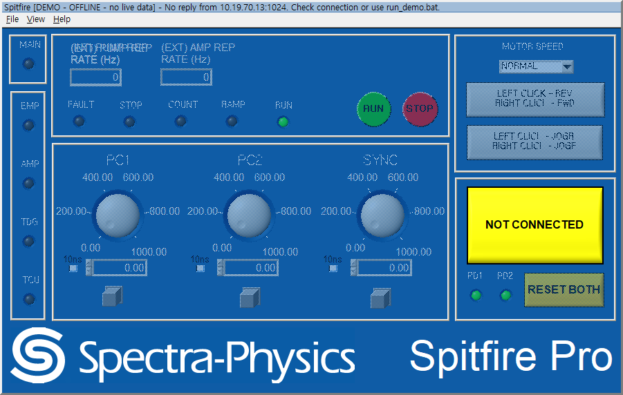
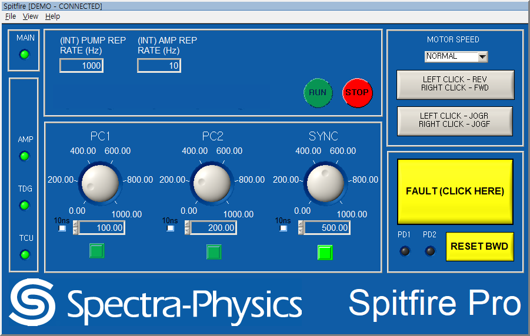

# 원본 재구현 1.6.0.post2

기준: `main`의 `78d3f447b1ca3dea35c5a737b75569a882bc0650` (`1.6.0.post1`).
별도 브랜치: `release/reconstruction-1.6.0-post2`.

## 변경

성공한 시작·재연결의 세 번의 identity 조회 뒤, 원본 초기 큐에서
`[1068]EMPOPTOUT?` 직전에 `[2036]EMPOPTOUT 1`을 한 번 추가합니다.
초기 요청은 43개에서 44개로 늘고, 나머지 원본 순서는 유지됩니다.

HV OFF 선행 조회, HV 상태 검사, 사용자 확인창은 없습니다. 원본 post1에도 이 검사 자체는
없었으며 External 2.0.0에서 추가한 정책을 가져오지 않았습니다.
쓰기 ACK만으로 설정을 켠 것으로 표시하지 않습니다. 원본 조회 응답이 상태와 화면을 갱신합니다.
보드가 0을 반환하면 0을 표시하며, 기존 재연결·응답 대기 동작을 사용합니다.
자동 Opt-out 쓰기의 ACK는 최대 1초만 기다리고 원래 `EMPOPTOUT?` 조회로 진행합니다.
쓰기에 응답하지 않는 경우에도 초기화를 계속할 수 있으며, 지연 ACK는 다음 조회를
완료한 것으로 취급하지 않습니다. 쓰기를 재전송하거나 조회값을 만들어내지는 않습니다.

원본 Empower 조회·초기 쓰기(`EMP:LBOBREAK 1`)·Reset·RUN/OFF·접근 단계·수동 Opt-out ON/OFF를
유지합니다. 수동 OFF 후에는 다음 연결에서 다시 ON을 요청합니다.
External 버전의 명령 필터·PC2→PC1 시퀀스·오류 비트 마스킹은 추가하지 않았습니다.
UIR·NI DLL·명령표·콜백은 post1 그대로입니다. 응답 디코더의 16진수 접두사 해석은
원본 C 런타임의 `%x`와 일치하도록 수정했습니다.

Windows `install.bat`의 기본값은 NI Native입니다. 32비트 Python을 찾고, 없으면 공식
서명이 유효한 CPython 3.13.9 32비트 설치 프로그램으로 `.python32`에 설치합니다.
앱은 `.venv-native`에 설치하며 기존 Qt `.venv`는 보존합니다. Qt 설치는 명시적으로 선택합니다.
`run_native.bat`도 환경을 확인해 필요하면 설치하고, 실패 시 오류와 로그를 보이며 창을 유지합니다.
설치는 앱을 실행하지 않습니다. PATH·파일 연결은 변경하지 않지만 Python 사용자 등록은 생성됩니다.
Windows 11에서는 임시 HKLM 뷰 안에서 Windows `mpr.dll`이 처음 로드되면 NI DLL보다 먼저
초기화에 실패했습니다(`WinError 1114`). 시스템 폴더의 `mpr.dll`을 원래 레지스트리 상태에서
선행 로드하도록 수정했습니다. NI DLL·Python 실행 파일·DEP 설정은 변경하지 않습니다.
출력 폴더의 post1 ZIP/wheel은 post2 배포물로 교체하고, 재생성 도구와 SHA256을 제공합니다.
wheel에도 NI 런타임의 중첩 `bin/`·`fonts/` 리소스를 포함하고 원본 바이트와 대조합니다.

## 이전 설치 등록·폴더 이동 복구

사용자 제공 Windows 10 빌드 19045 로그에서 Python 3.13.9 x86이 이전의 중첩 프로젝트
폴더에 설치된 것으로 등록돼 있었습니다. 새 폴더를 TargetDir로 지정해도 설치기는
`Modify`로 실행했고, core/exe가 `Present`, 실행 작업이 `None`인 채 성공 코드 0을 반환했습니다.
이전 post2는 새 위치의 `.python32/python.exe`만 확인해 설치 실패로 종료했습니다.

현재 설치기는 설치 후 요청 경로·Python 등록 경로·설치 로그의 실제 경로를 재탐색합니다.
등록된 Python 파일이 삭제된 경우 서명된 공식 설치기로 사용자 범위 Repair를 한 번 수행하고
복구한 경로를 다시 확인해 `.venv-native`를 만듭니다. 기존 Python을 제거하거나 임의로
옮기지 않습니다. 재부팅 필요 코드가 남으면 이를 안내하며 자동 재부팅하지 않습니다.

Python 검사는 `-I`로 격리하고 버전·비트수·실행 경로를 확인합니다. 설치 명령과 실행 배치도
상속된 PYTHONHOME/PYTHONPATH의 영향을 받지 않도록 했습니다. 실제 실행 실패의 종료 코드와
stderr는 `logs/python-probes.json`에 남기며, 실행이 멈춘 검사에는 제한 시간을 적용합니다.
캐시된 설치 파일도 Python Software Foundation 서명이 유효한 경우에만 실행합니다.

기존 프로젝트에 설치 파일만 덮어쓸 수 있는 `output/PY_SPF_1.6.0.post2_installer_fix.zip`을
추가했습니다. 새 폴더로 이동하거나 기존 가상환경을 삭제하지 않고 `install.bat`을 다시 실행합니다.
Windows에서 이전 등록 경로의 파일이 사라진 상태를 실제로 재현해, Modify 성공 후 자동 Repair,
기존 경로 복구, 새 가상환경 설치와 데모 실행을 확인했습니다.
PowerShell 설치 검증 11개가 통과했고, 실제 MSI 설치·복구와 환경변수 격리 상태의 재설치·실행도
확인했습니다. 설치 검증에서는 앱이나 장치 연결을 시작하지 않으며 데모 실행만 별도로 수행합니다.
결과는 `analysis/post2_installer_recovery_validation.json`에 기록합니다.

## 사용자 통신 로그 대조

자료: 지정된 `run-2010-10-9-20-46-32-11363` 폴더 안의 동명 하위 폴더.
이름의 2010년은 XP guest 시각이며 실제 수집 날짜로 해석하지 않습니다.
약 63.453초, 요청/응답 각각 1,073개, 쓰기 0개, 캡처 누락·잘린 프레임 0개입니다.

- 원본 프로세스 상태: `emp_optout=1`, 접근 단계 0.
- `TDG:HV:ON?` 응답은 37회 모두 1. 이미 Opt-out ON인 상태에서 HV ON 조회가 관측됩니다.
- Opt-out ON이어도 원본은 `EMP:STB?`, 전류·출력·LBO 온도 조회를 계속합니다.
  전류·출력·LBO 원문은 `-99`, EMP 상태는 `0.000000`입니다. 이 처리를 그대로 유지합니다.
- 초기화·Opt-out 쓰기/전환·Reset·RUN/STOP·HV 쓰기는 기록되지 않았습니다.
  `1068`, `2036`, `1089 COMSTATUS?`도 없습니다. 따라서 HV ON 중 Opt-out 쓰기의
  펌웨어 동작 또는 post2 실장비 운용을 이 로그로 검증했다고 해석하지 않습니다.

개인 경로·주소를 제외한 15종 요청/응답 UDP payload 표본, 첫 29개 조회 순서,
태그별 발생 횟수와 원본 JSONL/PCAP/EXE SHA256은
`analysis/optout_post2_capture.json`에 기록했습니다. 전체 원문이나 모든 변화 표본을 복제하지는 않았습니다.

오프라인 재생은 socket 생성을 금지하고 수행했습니다.
실제 컨트롤러의 15종 요청 payload 바이트 일치, 29개 폴링 순서의 순환 위치 일치,
37주기·1,073개 요청의 태그별 집계, 실제 응답 표본 15개의 파싱·디코딩을 확인했습니다.
또한 표본 15개 모두 원본 EXE x86 디코더의 결과와 일치했습니다.
결과: `analysis/optout_post2_replay_results.json`.

## 01번 PC에서 Native 화면 재검증

원본은 `STATUS?`(1085) 수신 전 DARKSCREEN 가림막으로 제어부를 가립니다.
이전 post2는 자동 Opt-out 쓰기(2036)의 ACK가 없으면 1068 조회로 넘어가지 못했고,
STATUS 조회도 보내지 못해 회색 화면에 남았습니다. 이전 커밋과 수정본에 같은 ACK 유실을
주입해 정지와 회복을 재현했습니다. [전후 비교](analysis/post2_optout_ack_regression.json).
첨부 화면만으로 실제 장비의 ACK 유실 여부를 확정한 것은 아닙니다.

2026-11-02에 RDC의 p01(Windows 10, Python 3.13.9 x86) 실제 설치 폴더에서 확인했습니다.
설치된 소스는 당시 최신 파일과 해시가 일치했고, Native 실행 로그에는 identity 조회 응답도
없었습니다. 같은 PC의 데모는 정상적으로 STATUS를 받고 전체 화면을 표시했습니다.
실제 장비 연결은 확인되지 않았으며 OS 네트워크 설정을 변경하지 않았습니다.

현재 Native는 연결 전에도 전체 원본 레이아웃을 표시하고 메뉴 탐색·Help·종료를 허용합니다.
기존 물리 가림막과 중앙 안내문 대신 제목의 `OFFLINE - no live data`와 상태 버튼의
`NOT CONNECTED`로 연결 상태를 알립니다. 장치 입력 및 수치·상태 표시는 비활성화하며,
CSV에 오프라인 값을 기록하지 않습니다. 연결 실패 후 일반 폴링으로 넘어가던 경로도 고쳐
identity 실패 시 재시도까지 초기화 큐를 보류합니다.

수동 장치 요청은 Native 준비 전까지 차단합니다. RUN 길게 누르기, STOP, HV·온도·모터·raw·Opt-out
콜백, Esc와 마우스 release의 별도 경로도 검사합니다. 자동 identity·초기화·Opt-out·Empower 조회는
기존 순서대로 진행합니다. 현재 연결이 실제로 요청한 STATUS 응답 이후에만 입력을 복원하며,
무조건 활성화하지 않고 마지막 Fault·접근 단계별 제한을 유지합니다. 재연결 때는 준비 상태와
이전 RUN 대기를 취소합니다. 30초 넘게 응답이 끊겨 재시도 경고를 띄우는 경로에서도
경고 전에 입력과 로거를 중지하며 이전 STATUS로 준비 상태가 복원되지 않도록 합니다.
연결 오류·마지막 TX/RX 태그는 Native 실행 로그에 남깁니다.

01번 PC에서 무응답 전체 화면·수동 요청 차단·Help 탐색, 정상 데모 연결과 실제 STOP 마우스 클릭,
캡처 응답 상태 표시, localhost만 대상으로 한 실제 배치 실행과 정상 종료를 확인했습니다.
검증은 시뮬레이터 또는 localhost만 사용했습니다.
[p01 실제 화면·조작 결과](analysis/post2_p01_gui_validation.json).
[30초 응답 중단·재시도 검증](analysis/post2_p01_timeout_validation.json).
이전 p04의 가림막 검증은 `analysis/post2_native_connection_validation.json`에 과거 기록으로 보존합니다.



## 16진수 상태 표시 수정

제공된 캡처의 1039 응답은 `0X00330409`였습니다. 이전 Python 정규식은 맨 앞의 0만 읽어
BWD와 PD1/PD2 표시를 잘못 갱신했습니다. 1039와 1066의 해석을 `%x`처럼 접두사·부호를
처리하도록 수정했습니다. 원본 기계어 대조 도구의 같은 정규식도 제거하고 독립적인 실제 C
`sscanf`를 사용합니다. 실제 NI 런타임도 이 문자열을 `0x330409`로 읽는 것을 확인했습니다.
`-99` 미지원 값은 원본처럼 유지하며 실제 NI 컨트롤에도 정상 입력됨을 확인했습니다.
[NI C 런타임 대조](analysis/post2_native_crt_validation.json).



## 검증

- post2 회귀시험: 93 passed, 7 subtests passed.
- 기본 Opt-out: HV OFF / ON / 미조회 상태에서도 초기 쓰기, 응답 기반 표시,
  보드가 설정을 거부하는 경우, 수동 OFF와 재연결 기본 ON을 시뮬레이터로 확인.
- 원본 x86 콜백 대조 395개, 디코더 338개, 추가 디코더 23개: 총 756개 통과.
- 원본 통신 캡처 표본의 x86 디코더 추가 대조: 15개 통과.
- Linux Qt offscreen 10개 패널 렌더와 headless 데모 연결·230개 컨트롤 갱신 통과.
- Windows 11 기본 Native 설치: 공식 서명을 확인한 Python 3.13.9 32비트 자동 설치,
  `.venv-native` 생성, 반복 설치, pip 검사, 기존 Qt `.venv` 보존과 Qt 재설치 통과.
  Native/기본 데모 실행 배치의 headless 실행과 실패 시 오류 표시·파일 저장도 확인했습니다.
  [현재 Native 설치 결과](analysis/post2_windows_native_install.json)에 기록했습니다.
- 실제 Windows NI 화면: 원본 UIR·런타임으로 패널 10개 로드, 시뮬레이터 연결,
  컨트롤 230개 갱신, Opt-out 쓰기 한 번과 조회 기반 ON 표시, 콜백 오류 없음,
  NI 리소스 정리와 종료 코드 0을 확인했습니다.
  [NI GUI 실행 결과](analysis/post2_windows_native_gui.json)에 기록합니다.
- 실제 `run_native.bat --demo --tcp-port 0`에서도 소유 프로세스가 확인된 `Spitfire` 창 표시와
  시스템 창 닫기 동작 후 배치 종료 코드 0을 확인했습니다.
  [실행 배치 GUI 검증](analysis/post2_native_launcher_gui.json)을 참고하세요.
- 초기 Qt 설치 검증은 [이전 설치 결과](analysis/post2_windows_install.json)에 보존했습니다.
  해당 기록은 Native 기본 설치 수정 이전의 배치 파일·동작에 대한 것입니다.
- 최종 Linux wheel을 새 가상환경에 설치해 headless 데모를 확인하고,
  포함된 리소스 526개를 소스와 바이트 단위로 대조했습니다.

현재 변경으로 실제 장비에 명령을 보내지 않았습니다. 과거 post1의 Wine/QEMU NI 화면 시험은
`ANALYSIS.ko.md`에 보존하며 이번 실제 Windows NI 화면 시험과 구분합니다.

재현:

```sh
python -m pip install ".[qt,test,analysis]"
python -m pytest -q
python analysis/verify_optout_capture.py --native-oracle
python analysis/native_oracle.py --extended
python analysis/native_decoder_oracle.py
python analysis/native_decoder_oracle.py --extra
python tools/build_release.py
```

Windows Native GUI 대조는 설치 후 `.venv-native\Scripts\python.exe tools\verify_native_demo.py`로
재현합니다. 이 도구는 시뮬레이터만 사용하고 TCP 상태 서버도 열지 않습니다.
`--drop-optout-ack --snapshot ready.bmp`로 ACK 유실 경로와 실제 준비 화면을 확인할 수 있습니다.
`--offline --snapshot offline.bmp`로 identity 무응답 상태의 전체 화면·입력 차단을 확인합니다.
