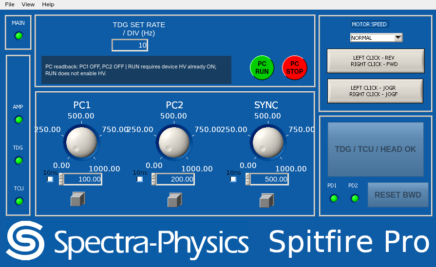

# PY_SPF — Empower 독립형 External Pump 버전

`feature/empower-independent` 브랜치는 기존 Spitfire GUI 재구현을 바탕으로,
**Empower 장치의 응답 없이 TDG·PC 채널·온도 제어·모터를 운용하는 버전**입니다.
앱의 기본 동작이 External이며 Empower 모드 선택은 없습니다.
배포 패키지는 **`spitfire-external-control` 2.0.0**입니다.

- [설치·실행 안내](README.ko.md)
- [Empower 제외 범위, PC RUN/STOP 및 TCP 호환성](EXTERNAL_PUMP.ko.md)
- [현재 검증 결과: 141개 시험 통과](VALIDATION_EXTERNAL.ko.md)
- [원본 복구의 과거 분석 근거](ANALYSIS.ko.md)
- [공급된 NI 런타임·리소스 출처](THIRD_PARTY_NOTICES.md)
- [External 2.0.0 설치용 wheel](output/external/spitfire_external_control-2.0.0-py3-none-any.whl)
- [External 2.0.0 소스 ZIP](output/external/PY_SPF_external_2.0.0.zip)

## 장치 없는 Qt 데모

Python 3.10 이상에서 이 브랜치의 소스를 설치합니다.

```sh
python -m pip install ".[qt]"
python -m spitfire --backend qt --demo --tcp-port 0
```

시뮬레이터는 Empower 장치가 없는 상태로 시작하며 HV와 PC 채널은 OFF입니다.
PC RUN은 현재 readback 조건을 확인한 뒤 PC2 ON → PC1 ON으로 진행합니다.
PC STOP과 Esc는 두 PC 채널 OFF를 요청합니다. 외부 펌프·seed·HV ON은 별도로 운용합니다.



## 검증

```sh
python -m pip install ".[qt,test]"
python -m pytest -q
```

Empower 없는 초기화·폴링, 금지 명령 차단, PC 출력 시퀀스, 응답 유실·불일치,
GUI 및 TCP 상태 조회를 오프라인으로 검증합니다. 실장비와 Windows NI 화면 엔진의
이번 변경에 대한 검증은 수행하지 않았습니다.

`analysis/`와 External 캡처를 제외한 기존 `previews/`는 원본 재구현 당시의 근거 자료입니다.
`output/Spitfire_Python_1_6_0.zip`과 `output/spitfire_gui_reconstruction-1.6.0.post1-py3-none-any.whl`도
기존 재구현 배포물이며 External 버전 설치용이 아닙니다. 현재 버전은 이 브랜치의 소스 또는 위 External 2.0.0 wheel을 설치합니다.
