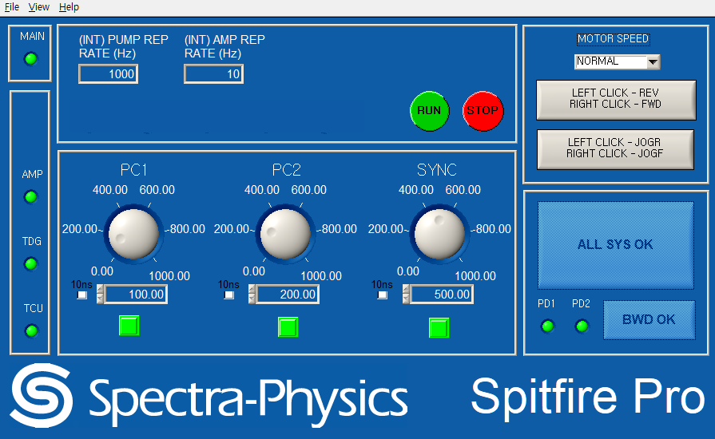
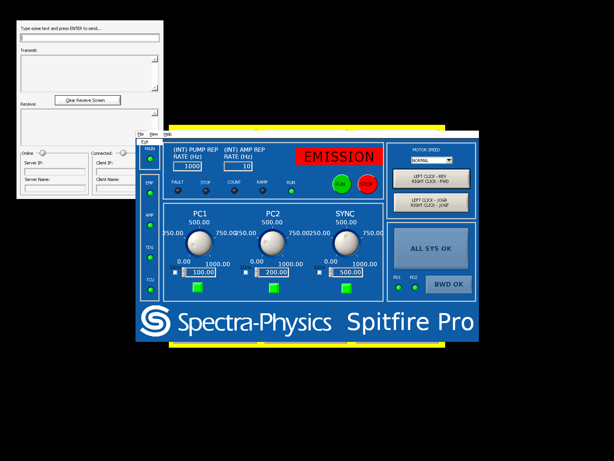

# Spitfire GUI 1.6.0.post2 Python 재구현

업로드된 Spectra-Physics Spitfire GUI 1.6.0 Windows 설치본에서 복구한 Python 제어 코드, GUI, 분석 근거와 검증 자료입니다.

`post2`는 원본 재구현 `1.6.0.post1`에 **시작·재연결 시 Empower Opt-out 기본 ON**과
Windows 가상환경 설치를 추가한 버전입니다. 초기 통신 성공 후 `[2036]EMPOPTOUT 1`을 보내고
원본 `[1068]EMPOPTOUT?` 응답으로 설정·화면을 갱신합니다. **HV OFF 조회·확인 조건은 없습니다.**
원본 Empower 조회, RUN/STOP, Reset, 상태 해석과 수동 Opt-out ON/OFF는 유지합니다.
External 2.0.0의 명령 차단·PC 시퀀스·오류 마스킹은 사용하지 않습니다.

**실장비 검증은 수행하지 않았으며, 원본과 모든 동작·화면이 완전히 동일하다고 인증한 결과는 아닙니다.** Windows용 화면은 원본 NI 런타임과 UIR 리소스를 사용합니다. Qt 모드는 별도의 Python GUI이며 동적 렌더링에 차이가 있습니다.

- [실행 방법과 파일 구성](README.ko.md)
- [원본 분석·동일성 검증 범위](ANALYSIS.ko.md)
- [로깅 기능·저장 파일 확인 결과](analysis/logging.ko.md)
- [post2 변경·통신 로그 검증](POST2.ko.md)
- [전체 소스·분석 패키지 ZIP](output/PY_SPF_1.6.0.post2.zip)
- [설치용 Python wheel](output/spitfire_gui_reconstruction-1.6.0.post2-py3-none-any.whl)
- [post2 검증 결과 요약](analysis/post2_validation_summary.json)
- [공급된 NI 런타임·리소스 출처](THIRD_PARTY_NOTICES.md)

## Windows 설치

ZIP을 풀고 `install.bat`을 실행하면 **원본 NI Native용 32비트 환경**을 설치합니다.
32비트 Python이 없으면 공식 서명을 확인한 Python 설치 파일을 다운로드해 프로젝트의
`.python32`에 설치하고, `.venv-native`에 앱을 설치합니다. 별도 Python 설치 명령은 필요 없습니다.
이전 폴더의 Python 설치 등록이 남아 있는 경우 자동으로 복구하고 실제 설치 경로를 찾아 사용합니다.

```bat
install.bat
run_native.bat
```

이미 받은 버전의 설치가 실패했다면 [설치 수정 ZIP](output/PY_SPF_1.6.0.post2_installer_fix.zip)을
**기존 프로젝트 폴더에 덮어쓰고** `install.bat`을 다시 실행하세요. 기존 폴더와 가상환경을
삭제하거나 옮길 필요는 없습니다.

설치는 장치에 접속하지 않습니다. `run_native.bat`은 실제 장치 연결,
`run_demo.bat`은 시뮬레이터로 원본 화면을 실행합니다. 실패 시 창에 오류를 표시하고
`logs/native-launch.log`에 보관합니다. Qt는 원할 때만 `install.bat qt`로 별도 설치합니다.

전체 화면은 장치의 `STATUS?` 응답 후 열립니다. 장치가 응답하지 않으면 연결 주소와
`No reply` 안내가 표시됩니다. 장치 없이 화면을 확인하려면 `run_demo.bat`을 실행하세요.
Opt-out 쓰기 ACK가 누락되어도 1초 후 실제 설정 조회를 이어가며, 지연 ACK는 해당 조회를
완료한 것으로 취급하지 않습니다. [화면·응답 유실 검증](POST2.ko.md)을 참고하세요.



## Qt 데모 실행

Python 3.10 이상에서:

```sh
python -m pip install ".[qt]"
python -m spitfire --backend qt --demo --tcp-port 0
```

`--demo`는 실장비에 연결하지 않는 개발용 시뮬레이터입니다.

## 원본 NI 화면 실행

위 Native 설치 후 장치 없는 원본 화면 데모:

```bat
run_native.bat --demo --tcp-port 0
```

실장비 연결 설정과 원본 포트는 [실행 안내](README.ko.md)에 있습니다. NI 모드는 독립 응용 프로세스로 실행합니다.

## 검증

원본 x86 코드와 Python을 대조한 756개 사례가 post2에서도 통과했습니다.
사용자 제공 원본 통신 로그의 Opt-out ON 상태 폴링·응답을 오프라인 대조했습니다.
로그에는 Opt-out 설정 전환이 없어, HV ON 중 설정 쓰기의 펌웨어 동작까지 검증한 것은 아닙니다.
현재 시험 결과와 과거 Windows NI 검증의 구분은 [post2 보고서](POST2.ko.md)에 기록합니다.

```sh
python -m pip install ".[qt,test]"
python -m pytest -q
```

원본 기계어 대조 스크립트는 `analysis/`에 있습니다. `analysis/reference/SPITFIRE.EXE`는 검증용 사본이며 Python 응용 실행 경로에서는 사용하지 않습니다.


