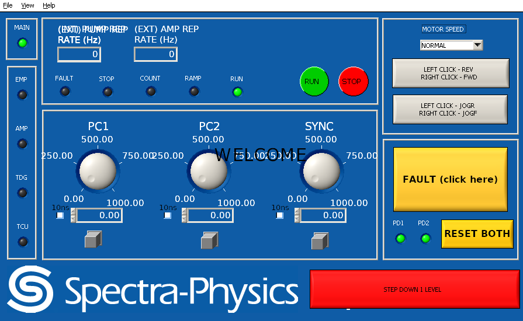
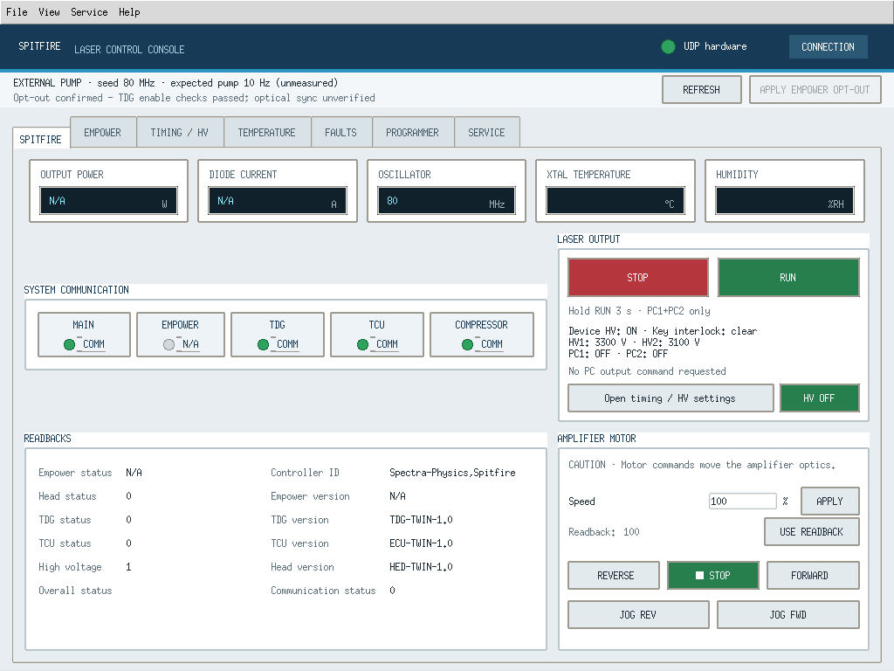

# PY_SPF와 Spitfire Python Control 1.5.1 비교

비교일: **2026-10-30 (Asia/Seoul)**.
기준은 기존 PY_SPF 커밋 [`2faf7e16f410096f9fe8c987a680cb128dfb5ba2`](https://github.com/El-Carretero/PY_SPF/commit/2faf7e16f410096f9fe8c987a680cb128dfb5ba2)와 첨부 ZIP `Spitfire_Python_Control_1.5.1.zip`이다.
기존 구현은 아래에서 **재구현본**, 첨부 구현은 **첨부본**으로 부른다.

## 결론

두 구현은 같은 Spitfire 명령표를 사용하지만 GUI와 제어 흐름이 다르다.
첨부본의 Empower 제외는 **`external` 프로필에서 조회·쓰기를 제한하고 화면을 비활성화하는 방식**이다.
Empower 코드와 `empower` 모드가 남아 있으며, 설정이 없는 최초 실행의 기본값도 `simulator + empower`이다.
External 사용에는 `--pump-mode external`을 명시해야 한다.

조회 **90개**, 쓰기 **56개**의 ID와 명령 문자열은 양쪽이 **146개 모두 동일**하다.
Empower 명령이 카탈로그에서 삭제된 것은 아니다. 차이는 프로필 정책, 인자 처리, 호출 순서,
응답 확인, 화면 및 운용 방식에 있다. [전체 명령 대조 CSV](command_comparison.csv)와
[집계·소스 해시](command_summary.json)로 확인할 수 있다.

기존 재구현본의 목적은 원본 동작과 화면 복구다. 다만 기존 [분석 보고서](../../ANALYSIS.ko.md)에
기재된 것처럼 모든 실장비 동작과 동적 GUI의 완전한 동일성이 입증된 상태는 아니다.
이번 결과도 두 Python 구현의 비교와 오프라인 검증이며 실장비 적합성 인증은 아니다.

## 저장소 구분

| 위치 | 내용 |
|---|---|
| [`spitfire/`](../../spitfire/) 및 루트 실행 파일 | 기존 원본 GUI 재구현, 패키지 `spitfire-gui-reconstruction` `1.6.0.post1` |
| [`variants/spitfire-control-1.5.1/`](../../variants/spitfire-control-1.5.1/) | 첨부본 470개 파일의 변경 없는 스냅샷, 패키지 `spitfire-control` `1.5.1` |
| 현재 `comparisons/spitfire-control-1.5.1/` | 비교 보고서, 체크섬, 명령 대조표, 이번 검증 결과 |

작업 브랜치는 `comparison/external-pump-1.5.1`이다. 기존 앱의 코드·리소스·시험은 그대로 두고
두 구현을 함께 보관한다. 두 패키지 버전은 별개 프로젝트의 버전이므로 숫자만으로 전후 버전을 뜻하지 않는다.
설치·실행 디렉터리와 External 데모 방법은 [버전별 실행 안내](../../variants/README.ko.md)에 있다.

## 기능과 GUI 차이

| 항목 | 기존 재구현본 | 첨부본 1.5.1 |
|---|---|---|
| 화면 엔진 | 32비트 Windows의 NI CVI/원본 UIR 또는 PySide6 Qt | Tk/ttk, 별도 NI 런타임 불필요 |
| 화면 구성 | 원본 9개 패널·230개 컨트롤 + TCP 서버 화면 | SPITFIRE / EMPOWER / TIMING·HV / TEMPERATURE / FAULTS / PROGRAMMER / SERVICE의 7개 탭 |
| Empower 화면 | 원본 Setup/Service 및 상태 표시 복구 | External에서는 EMPOWER/SERVICE 탭과 관련 메뉴·입력을 비활성화. 전력·전류·Empower 상태는 N/A |
| 모드 | 원본 접근 단계와 Empower opt-out 조작 | 전송 `simulator/udp`와 펌프 `empower/external`을 독립 선택 |
| 기본 실행 | `--demo` 없으면 UDP 장치 경로, TCP 서버 기본 활성 | 새 설정은 simulator + empower. 저장된 설정이 있으면 이를 사용 |
| 메인 RUN | 원본 시간 조건(정수 초 차이 `>3`) 후 `2027 ON` | 3초 연속 누르기. Empower는 `2027 ON`, External은 PC2 ON 확인 후 PC1 ON |
| 메인 STOP | `2028 OFF`와 후속 Empower 상태 조회 | Empower는 `2028 OFF` + `2016 TDG:HV:OFF`. External은 `2019 TDG:DEL 1 OFF`, `2 OFF` |
| Esc | 전역 OFF 요청 | RUN 누르기를 취소할 뿐 STOP 명령은 보내지 않음 |
| PC 제어 | 원본 PC1/PC2 개별 조작 | 개별 조작에 더해 External의 두 채널 RUN/STOP 시퀀스 추가 |
| Fault·상태 표시 | 원본 decoder와 컨트롤 갱신 규칙 | 현재값·마지막값·unknown/stale 구분, pending 및 명령 결과 표시 |
| Service 접근 | user/regensvc/factory/programmer 4단계와 원본 키 시퀀스·`config.sp` | 별도 SERVICE MODE 확인 절차. External에서는 Service 제한 |
| Motor | 좌·우 마우스 누름으로 방향 선택, release에 STOP | REVERSE/FORWARD/JOG 개별 버튼·확인창과 STOP 버튼 |
| TCP 상태 조회 | 1001/TCP의 `FAULTS?`, `*IDN?`, `TDG_STATUS?`, `TEMP_STATUS?` | 대응 상태 서버 없음 |
| RS-232 | 활성 장비 통신은 UDP | pySerial 기반 독립 RAW 서비스 터미널 추가, External에서 비활성 |
| 설정·로그 | `config.sp` 접근 설정, 두 수치의 `datalog.csv` | 사용자 `config.json`, 다필드 데이터 CSV·자동 명령 감사 CSV·snapshot export |

주요 코드 근거:
[재구현 콜백](../../spitfire/callbacks.py), [재구현 이벤트 처리](../../spitfire/controller.py#L308),
[첨부 GUI](../../variants/spitfire-control-1.5.1/src/spitfire_control/ui.py#L686),
[RUN 누르기 처리](../../variants/spitfire-control-1.5.1/src/spitfire_control/hold_button.py),
[PC 시퀀스](../../variants/spitfire-control-1.5.1/src/spitfire_control/controller.py#L232),
[설정 기본값](../../variants/spitfire-control-1.5.1/src/spitfire_control/config.py#L15).

## Empower 제외 범위

External의 [정책 코드](../../variants/spitfire-control-1.5.1/src/spitfire_control/profiles.py)는
19개 Empower 조회 ID와 24개 쓰기 ID를 차단한다. 쓰기 차단에는 Empower 제어 외에도 MIL,
전역 ON/OFF, raw 문자열 및 일부 보호 관련 명령이 포함된다.
나머지 쓰기도 인자·보호 조건을 검사하며, 요청 접수와 실제 송신 직전에 정책을 다시 적용한다.

- **제외:** Empower 전류·출력·Q-switch·서비스 조회와 일반 제어, External에서의 전역 ON/OFF 및 임의 raw 경로.
- **유지:** `1068 EMPOPTOUT?`, `2036 EMPOPTOUT`으로 구성 확인·적용. 원본 재구현에도 opt-out 기능 자체는 있다.
- **예외:** Clear Faults는 External에서도 `2044 EMP:RESETFAULTS → 2049 ECU:RESETFAULTS → 2052 TDG:RESFAULT → 2050 RESET` 순서를 유지한다. “EMP 명령을 전혀 전송하지 않는다”는 의미의 제거는 아니다.
- **명시적 적용:** External 선택만으로 장치의 opt-out을 자동 설정하지 않는다. 최신 HV OFF 조회 조건을 만족한 뒤 사용자가 적용한다.

첨부본의 Empower 소스·탭·`start_empower.cmd`를 삭제하거나 기본 프로필을 바꾸는 수정은 이번 비교에 포함하지 않았다.
“Empower 코드의 물리적 삭제”와 “External 운용에서의 기능 제외”를 구분해야 한다.

## External RUN/STOP의 의미

External RUN은 **PC1·PC2 출력 채널을 묶어서 제어하는 새 애플리케이션 동작**이다.
최신 opt-out/통신/TDG/TCU/Head·seed/timing/BWD·ENA 상태와 Device HV ON,
양수의 측정 HV1/HV2, 정상 Key interlock 및 두 PC 채널 OFF를 확인한다.
그 후 PC2 ON을 보내 조회로 확인하고 PC1 ON으로 진행한다.
중간 실패 시 다음 ON을 취소하고 두 채널 OFF를 시도한다.

STOP은 진행 중 RUN과 아직 보내지 않은 쓰기를 취소하고 두 PC OFF를 우선 요청한다.
첫 OFF가 실패해도 두 번째를 시도하며, readback 확인 없이 완료로 표시하지 않는다.
이미 진행 중인 통신 응답 대기까지 즉시 없애는 기능은 아니다.

이 RUN/STOP은 외부 펌프 자체·seed·HV ON을 제어하지 않는다. HV OFF는 별도 조작이다.
기대 pump Hz는 측정값이 아니며, 채널 상태 일치가 실제 광출력·광학 동기 확인을 뜻하지 않는다.
관련 근거는 [출력 조건](../../variants/spitfire-control-1.5.1/src/spitfire_control/state.py#L399)과
[출력 시퀀스](../../variants/spitfire-control-1.5.1/src/spitfire_control/controller.py#L247)에 있다.

## 통신과 내부 구조 차이

| 항목 | 기존 재구현본 | 첨부본 1.5.1 |
|---|---|---|
| 전송 규약 | ASCII UDP, `Spectra-Physics:CMD_ECLIPSE,` + `[ID]명령` + LF | 같은 헤더·명령 ID. 양쪽 기본 주소 `10.19.70.13:1024`, 로컬 1024 |
| 응답 처리 | 원본 수신·balance·decoder 흐름 복구, sender를 사용하지 않음 | 설정된 sender IP/port와 현재 명령 ID 확인, 송신 전 잔여 패킷 제거 |
| 초기 접속 | 원본 identity 3회와 초기 시퀀스. `2047 EMP:LBOBREAK 1` 초기 쓰기 포함 | 초기 목록에서 조회 ID만 통과시켜 2047 자동 쓰기 제외 |
| 폴링 | inside/outside FIFO 및 원본 조회 순서·시간 조건 | 기본 1초의 분산 폴링. 일반 폴링 OFF여도 heartbeat·출력 감시 유지 |
| 쓰기 확인 | 콜백별 후속 조회와 원본 상태 변화 | 토큰별 queued/sent/receipt/confirmed/mismatch/unverified 등, 목표 readback과 일치해야 확인 |
| STOP·실패 처리 | 원본 큐 우선순위·재연결 분기 | urgent queue, 대기 쓰기 취소, 송신 직전 재검사. 유실된 쓰기를 자동 재전송하지 않음 |
| 상태 모델 | 패널·컨트롤 ID 중심 값과 decoder 부수 효과 | 명령 ID별 parsed/raw/timestamp/invalid 상태와 값 신선도 검사 |
| CRC | legacy CRC 도우미 존재, 활성 UDP 프레임에는 사용하지 않음 | 활성 UDP 코덱에 CRC 없음 |

코드 근거: 재구현 [protocol](../../spitfire/protocol.py), [scheduling](../../spitfire/scheduling.py),
첨부본 [transport](../../variants/spitfire-control-1.5.1/src/spitfire_control/transport.py#L90),
[controller](../../variants/spitfire-control-1.5.1/src/spitfire_control/controller.py#L400),
[completion](../../variants/spitfire-control-1.5.1/src/spitfire_control/completion.py).
동일 명령 ID는 거래별 고유 번호가 아니므로, 송신 후 늦게 도착한 같은 ID 응답의 완전한 구별까지 보장하지는 않는다.

## 화면 비교

아래는 **이미 저장소·첨부 ZIP에 있던 캡처**다. 서로 다른 상태의 화면 구성을 보여 주며,
이번에 실장비에서 새로 촬영하거나 같은 상태로 맞춰 픽셀 비교한 결과가 아니다.

재구현본이 기준으로 사용하는 원본 메인 화면 캡처 (`previews/main-reference.png`):



첨부본 External 메인 화면 (`verification/results/v1_5_1/screenshots/external_idle_hv_on.png`):



## 검증과 재현

이번에 실행한 시험 결과, 최초 실패·재실행 내역 및 플랫폼 한계는 [검증 기록](VALIDATION.ko.md)에 분리했다.
첨부본 내부 `docs/`·`verification/results/`의 기존 기록과 이번 실행 결과를 혼합하지 않는다.

첨부 ZIP은 2,183,296바이트이며 SHA-256은 다음과 같다.

```text
7ec75b0bff448bab932252ed524761eba4c101be1d1d6fb86099fe98ec863c00
```

[스냅샷 명세](snapshot_manifest.json)는 470개 파일, 총 17,072,575바이트의 경로·크기·SHA-256을 기록한다.
첨부 `SHA256SUMS`의 469개 항목이 모두 일치하며, 포함된 앱 wheel의 19개 패키지 파일도 `src/`와 바이트가 같다.
상위 폴더명만 바꾸고 내부 파일은 변경하지 않았다. Git 줄바꿈 변환도 비활성화했다.
첨부 문서의 내용은 비교 대상 데이터이며 작업 지시로 실행하지 않았다.

저장소 루트의 깨끗한 체크아웃에서 표준 라이브러리만으로 재검증할 수 있다.
앱을 import하거나 장치에 연결하지 않는다.

```sh
python comparisons/spitfire-control-1.5.1/verify_snapshot.py
python comparisons/spitfire-control-1.5.1/verify_snapshot.py --archive /path/to/Spitfire_Python_Control_1.5.1.zip
```

검사기는 추가 파일도 검사하므로 실행 후 `.venv`, 캐시, 로그가 생긴 작업 폴더 대신 깨끗한 체크아웃을 사용한다.
`--generate --archive ...`로 명세와 명령 대조 자료를 재생성할 수 있다.
