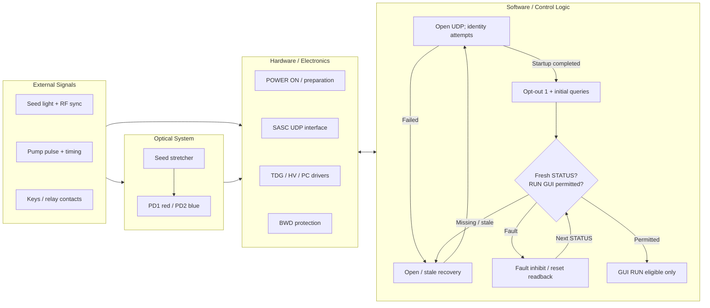
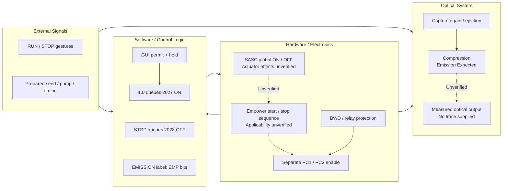
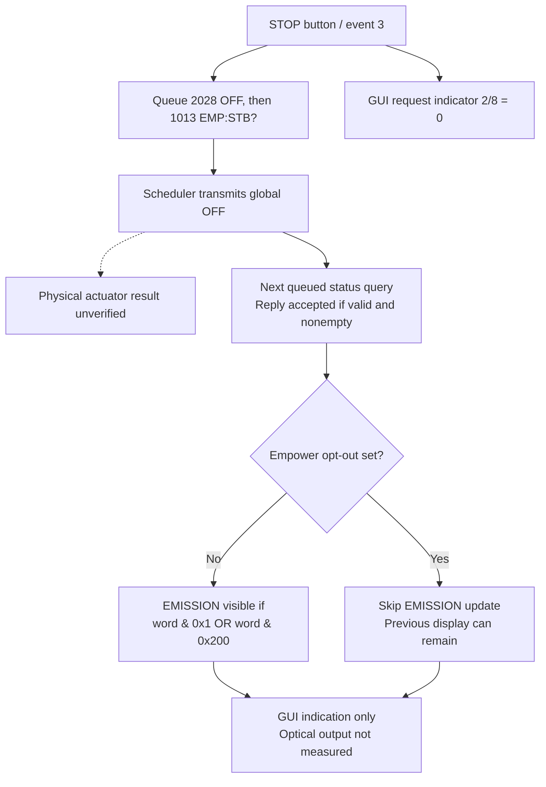

# 1. Integrated operation: power-on to expected emission

## 1.1 What the main flow establishes

The main diagrams combine documented hardware functions with the software actually examined. Inter-lane arrows identify interfaces; node-specific signal and protection relationships are expanded in Diagram 2. Unconnected hardware items are not a hidden sequential power-up program. They are **functional evidence maps**, not a certified wiring diagram or startup SOP. Physical power, seed preparation, pump preparation, keys and relay contacts are external events; running Python does not perform them. The exact applicability of the supplied Spitfire Pro manual to the requested SPTF-100F-1KHPR remains **UNKNOWN**.

The software baseline for Figures 1A–1B is **Native PY_SPF 1.0**, commit `cebcc284`. Recovered XP behavior, current Python behavior, manufacturer description and recorded field responses are not interchangeable.

### Main-figure evidence key

Figure 1A uses C1 for UDP startup, C3 for opt-out and initialization, C2/C4 for freshness and GUI eligibility, C5 for reset, P01 for observed board communication, and M1–M4 for external preparation and hardware functions. Figure 1B uses C6 for RUN/STOP requests, C7 for the displayed EMISSION label, M1/M2/M4 for the manufacturer-described activation and optical path, and U1 for the unobserved firmware/optical boundary. Figure 1C uses C8 for the STOP callback, C7 for the status decoder, and U1 for the unverified physical result. These references are kept here rather than inside the diagram elements.

| Key | Grade | Exact reference and claim boundary |
|---|---|---|
| C1 | CODE VERIFIED | [Controller startup, lines 174–235](https://github.com/El-Carretero/PY_SPF/blob/cebcc28490f48e9e5d4d1c2e2feef34d638244e7/spitfire/controller.py#L174-L235), [startup attempts, lines 150–177](https://github.com/El-Carretero/PY_SPF/blob/cebcc28490f48e9e5d4d1c2e2feef34d638244e7/spitfire/scheduling.py#L150-L177): UDP opening and original-style three identity attempts, not a hardware self-test. |
| C2 | CODE VERIFIED | [Controller, lines 436–550](https://github.com/El-Carretero/PY_SPF/blob/cebcc28490f48e9e5d4d1c2e2feef34d638244e7/spitfire/controller.py#L436-L550): retry, inactivity reconnect, stale STATUS and GUI gating. |
| C3 | CODE VERIFIED | [Initial/poll queues, lines 78–121](https://github.com/El-Carretero/PY_SPF/blob/cebcc28490f48e9e5d4d1c2e2feef34d638244e7/spitfire/scheduling.py#L78-L121): default board opt-out write, readbacks, priority queues and poll sequence. |
| C4 | CODE VERIFIED | [STATUS decoder and health, lines 228–236 and 329–351](https://github.com/El-Carretero/PY_SPF/blob/cebcc28490f48e9e5d4d1c2e2feef34d638244e7/spitfire/decoders.py#L228-L351): STATUS bit0 determines the original-style RUN/channel GUI inhibit. |
| C5 | CODE VERIFIED / XP/LOG VERIFIED | [Reset callback, lines 290–291](https://github.com/El-Carretero/PY_SPF/blob/cebcc28490f48e9e5d4d1c2e2feef34d638244e7/spitfire/callbacks.py#L290-L291), [burst evidence](evidence/fault_burst_summary.json), [single trials](evidence/reset_retest_summary.json): reset receipt and recovery readbacks are separate observations. |
| C6 | CODE VERIFIED / XP/LOG VERIFIED | [RUN event, lines 194–198](https://github.com/El-Carretero/PY_SPF/blob/cebcc28490f48e9e5d4d1c2e2feef34d638244e7/spitfire/callbacks.py#L194-L198), [held ON, lines 738–749](https://github.com/El-Carretero/PY_SPF/blob/cebcc28490f48e9e5d4d1c2e2feef34d638244e7/spitfire/controller.py#L738-L749), original callback/worker evidence in Section 3: command generation, not observed optical emission. |
| C7 | CODE VERIFIED | [Empower decoder, lines 270–292](https://github.com/El-Carretero/PY_SPF/blob/cebcc28490f48e9e5d4d1c2e2feef34d638244e7/spitfire/decoders.py#L270-L292): GUI `EMISSION` visibility from Empower ON/COUNT bits; skipped on opt-out. |
| C8 | CODE VERIFIED | [STOP callback, lines 200–201](https://github.com/El-Carretero/PY_SPF/blob/cebcc28490f48e9e5d4d1c2e2feef34d638244e7/spitfire/callbacks.py#L200-L201): event 3 queues global OFF then an Empower status query and clears the GUI request indicator. |
| M1 | MANUAL | MAN-330A, printed 6-1–6-2 / PDF 61–62: operator preparation, seed/PD checks, pump RUN and later separate PC enables. |
| M2 | MANUAL | Printed 3-9–3-10 / PDF 41–42: optical capture, gain, ejection and timing references. |
| M3 | MANUAL | Printed 4-3–4-6 / PDF 49–52: TDG supplies/drivers, keys, BWD and connector paths. |
| M4 | MANUAL | Printed 6-9–6-10 / PDF 69–70: manual-described pump RUN/STOP, PD indicators and relay reset. |
| P01 | XP/LOG VERIFIED | Observed board-facing UDP records and identity; curated source paths and hashes in `evidence/source_registry.json`. |
| U1 | UNKNOWN | Installed firmware's full global-ON/OFF actuator sequence, detailed internal bus and independent optical proof are not supplied. |

## 1.2 Power-on, external inputs and software readiness

Figure 1A retains four swimlane domains. The manually prepared seed and pump paths do not originate in the PC startup code. The SASC endpoint is the observed board-facing interface; the internal connection between that interface and every TDG/Empower action is not reconstructed as a measured circuit.

Native 1.0's `gui_ready` concerns a current connection/STATUS path; `check_health` separately dims RUN when STATUS bit0 is set. The figure's shorthand **GUI RUN eligible** means both presentation conditions are satisfied. It is an analysis label, not a device-reported READY enum. An observed `STATUS=2`, `COMSTATUS=0` coexisted with `TDG:STBH?=0x00330409`; therefore a general fault clear does not establish BWD clearance. **XP/LOG VERIFIED:** bounded reset trial in `evidence/reset_retest_summary.json`.

The original-style decoder also predicts cleared PC toggle values and requests `RES12` when STATUS bit1 is set. A cached or predicted GUI value is not an actual channel readback. Read-only/allowlisted diagnostics suppressed such automatic writes; their predicted PC LEDs were excluded from hardware conclusions.

## 1.3 RUN, activation and optical consequence

Figure 1B distinguishes a software command from the manufacturer-described normal optical path. **The global `ON` example is an energizing command reference, not an instruction to execute.** No physical ON-to-optical-output capture is claimed for the curated dataset. The manual describes an Empower configuration; its pump sequence is not assumed to be the firmware behavior under Native 1.0 opt-out or an external pump.

In Native 1.0, the hold worker queues global `ON` strictly after more than three **whole** seconds. Release/menu interruption cancels a pending start; the code does not implement the manual's full pump, shutter and ramp sequence itself. The decoded control values are not proof that the seed arrived, the pump fired or the PC drivers switched. The backend hold worker does not independently re-check every GUI fault-disable condition; a direct callback injection could bypass the natural disabled-button path. Such injection was not used to energize RUN in the physical checks. Details are in Sections 3 and 4.

The manual's normal procedure puts PC1/PC2 enable after pump start (printed 6-2). It does not equate a green RUN button or the pump's `EMISSION` bar with amplified Spitfire output. In the Python decoder, that bar follows Empower `1013` ON/COUNT bits and is not updated while Empower opt-out is set. A hidden or retained bar cannot prove an absent or present output beam.

STOP/OFF must not be generalized to **all energy removed**: the manual's described STOP turns pump diodes off and closes its shutter; it does not establish that the seed, TDG HV supply or an independently controlled external pump is off. BWD-trigger inhibition and external-interlock HV removal are distinct manufacturer-described protections, detailed separately in Figure 2B. A generic software Fault does not, by itself, prove which physical protection acted.

### Explicit STOP and indication paths

Figure 1C makes the Native STOP callback and subsequent indication path explicit. **CODE VERIFIED:** C8, C7 and the scheduler described in Section 4. Event 3 queues `2028 OFF` followed by `1013 EMP:STB?`, and immediately sets GUI `2/8=0`. A write receipt is not a mandatory success gate: after its acknowledgement/grace window, the scheduler can proceed to the query. Only an accepted valid, nonempty status reply can supply the shown decoder input; `1013` has no independent STATUS-style age guard. Esc has a different path: it queues `2028` and clears the request indicator without this immediate `1013` query. These software actions do not prove the firmware's physical OFF sequence or removal of all energy.

## 1.4 Failure, recovery and the final boundary

| Condition | Confirmed response | Recovery boundary |
|---|---|---|
| UDP open/initialization failure | CODE VERIFIED: disabled connection presentation, bounded attempts and retry/reconnect paths in 1.0. | A subsequent accepted reply is a communication observation, not a hardware self-test. |
| Missing fresh STATUS | CODE VERIFIED: 1.0 disables controls and cancels pending actuation; existing device output is not thereby proved OFF. | Obtain a current STATUS through the specified recovery path; do not replay stale queued ON requests. |
| General Fault / RUN inhibit | CODE VERIFIED: STATUS bit0 changes original-style GUI RUN/channel eligibility. | Fault cause and the exact firmware response need specific evidence; a reset ACK does not prove removal. |
| BWD threshold violation | MANUAL: either photodetector below threshold inhibits PC trigger selection. | Restore the underlying optical condition and both PD indications, then reset the relay; factory threshold is not inferred from a GUI range. |
| TDG external interlock open | MANUAL: immediate removal of PC high voltage; seed and pump may continue. | Installed wiring and the authorized restoration procedure must be confirmed; this report provides no bypass procedure. |
| Repeated Fault Reset | XP/LOG VERIFIED: priority-queue starvation delayed STATUS despite normal ACKs; final queued reset canceled. | Software scheduling defect remains distinct from an adapter or optical fault. No runtime fix is made in this report. |
| Missing output evidence | UNKNOWN: no independent optical-output trace supplied. | The final node remains **Emission Expected** rather than a verified emission assertion. |

The manufacturer's BWD is an optical bandwidth protection function, not an Ethernet watchdog. Internal electronic timing does not substitute for normal seed spectrum at its photodetectors. A communication ACK, an unchecked GUI interlock and a measured optical pulse must retain separate evidence records.
