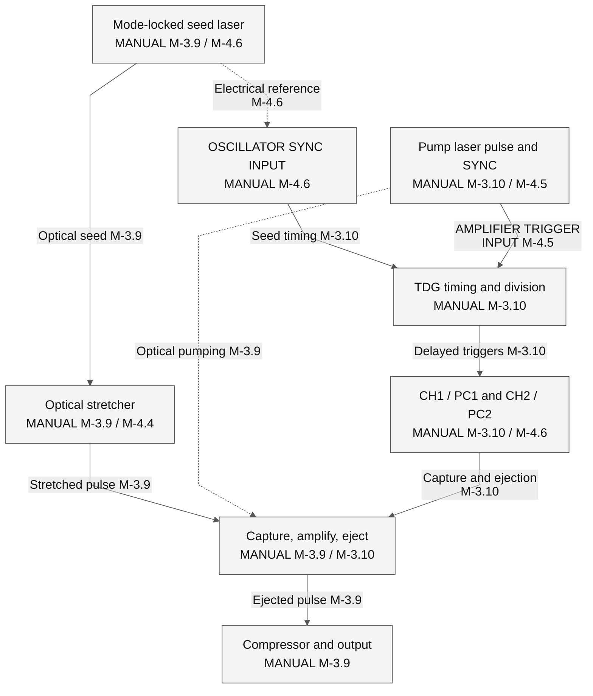
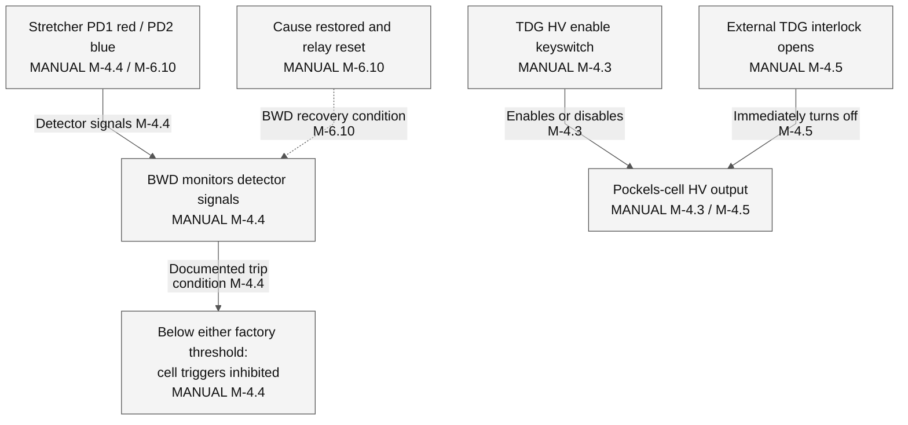

# 2. Optical timing and interlock boundaries

The documented amplifier needs both an optical seed and correctly timed electrical signals. A healthy Ethernet link, a readable TDG register, or an enabled GUI control does not demonstrate that a stretched pulse was captured, amplified, ejected, and recompressed. This section separates those observations from the protection functions described by the manufacturer.

## 2.1 Applicability and evidence

The supplied manufacturer's manual is **MAN-330A**, *Spitfire Pro Ti:Sapphire Regenerative Amplifier Systems*, part 0000-330A, Rev. A, January 2005. Its cover and preface name **Spitfire Pro F, Pro 40F, and Pro PM**. The user's equipment is identified as **2005 SPTF-100F-1KHPR**. A nameplate-to-manual model cross-reference, the original ship report, and the installed TDG/pump wiring record have not been supplied. Applicability of every Pro-specific connector, threshold, sequence, and specification to that exact system is therefore **UNKNOWN**. Similar manufacture dates and shared GUI terminology do not establish equivalence. The manual's specifications also defer to the purchase order (printed 3-11; PDF 43).

Evidence grades used here are **MANUAL** for a manufacturer's statement, **CODE VERIFIED** for behavior visible in the frozen Python source, **XP/LOG VERIFIED** for a captured observation identified elsewhere in this report, **INFERRED** for an explicitly reasoned connection, and **UNKNOWN** where the sources do not establish the claim. **CODE VERIFIED** does not identify uninspected controller firmware or prove an electrical response. No **XP/LOG VERIFIED** optical-output measurement is introduced in this section.

| Evidence ID | Grade | Source and scope |
|---|---|---|
| M-3.9 | MANUAL | MAN-330A, printed 3-9; PDF 41: regenerative capture, repeated amplification, and ejection. |
| M-3.10 | MANUAL | Printed 3-10; PDF 42: seed RF reference, pump positive-edge TTL trigger, PC1/PC2 delays, and laboratory SYNC. |
| M-4.1 | MANUAL | Printed 4-1; PDF 47: head umbilical and separate amplifier-cavity photodiode connector. |
| M-4.3 | MANUAL | Printed 4-3; PDF 49: TDG HV supplies, head-mounted drivers, HV keyswitch and indicator. |
| M-4.4 | MANUAL | Printed 4-4; PDF 50: BWD detector function, model-specific factory thresholds, and Figure 4-5. |
| M-4.5 | MANUAL | Printed 4-5; PDF 51: pump trigger input and separate external TDG interlock. |
| M-4.6 | MANUAL | Printed 4-6; PDF 52: seed synchronization connection, CH1/CH2 outputs, and communication connectors. |
| M-6.2 | MANUAL | Printed 6-2; PDF 62: pump start and subsequent PC1/PC2 enable are separate steps. |
| M-6.8 | MANUAL | Printed 6-8; PDF 68: GUI does not operate the seed laser; communication-indicator meanings. |
| M-6.9 | MANUAL | Printed 6-9; PDF 69: RUN/STOP, EMISSION, COUNT, RAMPING, and channel controls. |
| M-6.10 | MANUAL | Printed 6-10; PDF 70: PD1/PD2 meaning and BWD relay reset. |
| M-6.11 | MANUAL | Printed 6-11; PDF 71: Empower Q-switch source modes and external-trigger underfrequency. |
| M-6.13–15 | MANUAL | Printed 6-13–6-15; PDF 73–75: manufacturer fault categories and reset descriptions. |
| M-8.1/3 | MANUAL | Printed 8-1 and 8-3; PDF 87 and 89: causes of no amplified output despite partial system operation. |
| C-SIG-1 | CODE VERIFIED | [Protocol catalog, lines 15–16](https://github.com/El-Carretero/PY_SPF/blob/cebcc28490f48e9e5d4d1c2e2feef34d638244e7/spitfire/protocol.py#L15-L16): distinct EMP and TDG command namespaces. |
| C-SIG-2 | CODE VERIFIED | [Decoder, lines 131–165](https://github.com/El-Carretero/PY_SPF/blob/cebcc28490f48e9e5d4d1c2e2feef34d638244e7/spitfire/decoders.py#L131-L165): channel flags, oscillator/trigger modes, and opt-out readbacks. |
| C-SIG-3 | CODE VERIFIED | [Decoder, lines 270–304](https://github.com/El-Carretero/PY_SPF/blob/cebcc28490f48e9e5d4d1c2e2feef34d638244e7/spitfire/decoders.py#L270-L304): communication, pump status, and fault display updates. |
| C-SIG-4 | CODE VERIFIED | [Decoder, lines 319–344](https://github.com/El-Carretero/PY_SPF/blob/cebcc28490f48e9e5d4d1c2e2feef34d638244e7/spitfire/decoders.py#L319-L344): TDG bit-to-indicator mapping and software health display. |
| C-SIG-5 | CODE VERIFIED | [Callbacks, lines 194–203](https://github.com/El-Carretero/PY_SPF/blob/cebcc28490f48e9e5d4d1c2e2feef34d638244e7/spitfire/callbacks.py#L194-L203) and [held RUN, lines 738–749](https://github.com/El-Carretero/PY_SPF/blob/cebcc28490f48e9e5d4d1c2e2feef34d638244e7/spitfire/controller.py#L738-L749): software request generation. |

PDF pages are one-based physical pages, including the cover and front matter. Manual-file SHA-256: `d9bb260827f78a2ed67477043cb3036a26b771aaf19a0c3ec9aa6649449d5e29`. The full copyrighted manual is not reproduced in this repository.

## 2.2 Optical path and two independent timing references

Figure 2A shows functional paths described by the manual, rather than a connector pinout or circuit schematic. Node and edge evidence IDs refer to the table above. A line indicates a documented signal or optical relationship; it does not assert an unmeasured voltage level, propagation delay, or hidden firmware gate.

**Figure 2A.** The seed-reference cable and pump-trigger cable serve different functions. The manual describes the TDG as first triggered by a **positive-edge TTL pulse from the pump** and synchronized to the seed modelocker reference for selecting a seed pulse [M-3.10]. The absolute delay calibration, phase window, pulse shape, and exact installed electrical interfaces are **UNKNOWN** for the user's system.

For a **Mai Tai**, MAN-330A specifies the **40 MHz output, not its 80 MHz output**, for the TDG OSCILLATOR SYNC INPUT. For a **Tsunami**, it specifies the controller's **MONITOR output, not SYNC** [M-4.6]. These are manufacturer connection requirements for the manual's configurations; the 40 MHz instruction is not evidence that the seed optical pulse train itself must have a 40 MHz repetition rate. The installed seed model, selected output, and TDG calibration must be established separately. The same page specifies a 50 Ω, internally switchable input impedance and jitter below 250 ps for the described input; it does not establish the complete acceptable voltage/pulse-width range for the target installation.

The manual associates PC1/CH1 with capture and PC2/CH2 with ejection. Its 0–1000 ns setting range is a control range, not a measured timing tolerance. The DIVISOR reduces the amplifier repetition rate relative to the pump synchronization rate. Neither a reported divisor nor an enabled channel proves the optical pulse timing [M-3.10; M-4.6; M-8.1/3].

## 2.3 Protection paths without an invented master gate

**Figure 2B.** Separate documented protection functions. The drawing deliberately supplies no common AND/OR circuit, priority ordering, relay-coil polarity, or shared pump/seed interlock wiring. Those details are **UNKNOWN**. A dashed recovery arrow identifies a reset condition, not a proven circuit path.

The BWD samples parts of the seed spectrum in the stretcher. PD1 corresponds to its red end and PD2 to its blue end. If either detector signal falls below its factory-set threshold, the manual says that the Pockels-cell triggers are disabled and no pulses are selected for amplification [M-4.4; M-6.10]. This is a detector-based protective inhibit with a described relay/reset state. It does not measure output pulse duration directly. Both PD indicators being on is not independent proof of full spectral quality, correct compressor position, or safe peak intensity. Factory threshold values, analog transfer functions, debounce time, latch implementation, and target-hardware calibration are **UNKNOWN**.

The TDG front-panel key separately enables/disables Pockels-cell HV. The external two-pin TDG interlock is described as a normally closed switch circuit: opening it immediately turns off Pockels-cell HV and disables amplified output. **It does not turn off the seed or pump laser.** The manual explicitly treats their interlocks as separate circuits [M-4.3; M-4.5]. The physical routing and state of those circuits on the user's equipment, including any replacement external pump, are **UNKNOWN**; see the installed-pump wiring unknown in Section 6.

Empower keyswitch, cover/user interlock, cooling, temperature, Q-switch RF/underfrequency, diode/driver electrical faults, and communications have their own manual descriptions [M-6.13–15]. These must not be flattened into a single unspecified Boolean gate. Some conditions are associated with explicit pump fault indications and manual reset requirements; others inhibit amplified output without establishing that all radiation sources have stopped. The per-signal distinctions are in [Section 5](05_signal_reference.md).

## 2.4 Pump state, GUI state, and optical emission

MAN-330A describes RUN as a held pump-start request lasting about five seconds. Its subsequent sequence includes diode-array activation, a red EMISSION bar, a COUNT/beep delay, pump-head shutter opening, and power ramping. STOP turns off the pump diodes and closes the pump's internal shutter [M-6.9]. The startup description lists enabling the two Pockels-cell channels after pump startup [M-6.2]. Pump lasing, enabled PC channels, and amplified output therefore identify different states in the manual.

The frozen Python implementation arms a held request on the native RUN press. Its hold calculation is `int(now) - int(started) > 3`; it then queues tag 2027, `ON`. STOP queues tag 2028, `OFF`, and a pump-status readback [C-SIG-1; C-SIG-5]. This is **CODE VERIFIED** request behavior. It does not reproduce or time-measure the manufacturer's entire roughly-five-second pump/shutter sequence, and it is not evidence that the requested actuation occurred. These requests were not exercised to establish the physical claims in this section.

The GUI's EMISSION, READY/STOP, COUNT, RAMPING, fault, and PD displays are derived from returned status fields and decoder rules [C-SIG-3; C-SIG-4]. In particular, a code label such as `ALL SYS OK` denotes a software interpretation of a status bit; it is not an independent optical measurement. The manual itself lists BWD, seed/pump function, timing, interlock, driver, and alignment problems as possible reasons for absent or degraded amplified output [M-8.1/3].

## 2.5 Software selection is not physical bypass evidence

`EMP:QSW:SOURCE` configures the pump's Q-switch source. Its **INTERNAL** setting refers to an Empower power-supply clock [M-6.11]. `TDG:OSC:MODE` and `TDG:TRIG:MODE` are distinct TDG command families [C-SIG-1; C-SIG-2]. The shared word **INT** does not make these settings equivalent. The evidence does not establish that TDG INT modes synthesize a valid optical seed, satisfy BWD, or substitute for the required installed synchronization signal.

Similarly, `EMPOPTOUT`, `HEDOPTOUT`, and `ECUOPTOUT` are software settings whose readbacks affect GUI subsystem status and presentation [C-SIG-2; C-SIG-3]. The current startup policy sets Empower opt-out in writable operation, as detailed in the software-flow section. An external-pump installation can make that policy relevant, but **opt-out is not evidence of a physical interlock bypass, a valid external pump trigger, or suppression of hazards in a separately powered pump**. The replacement pump, its shutter, trigger cable, interlock circuits, electrical levels, and fault propagation remain **UNKNOWN** until model-matched wiring documentation and measurements establish them.
