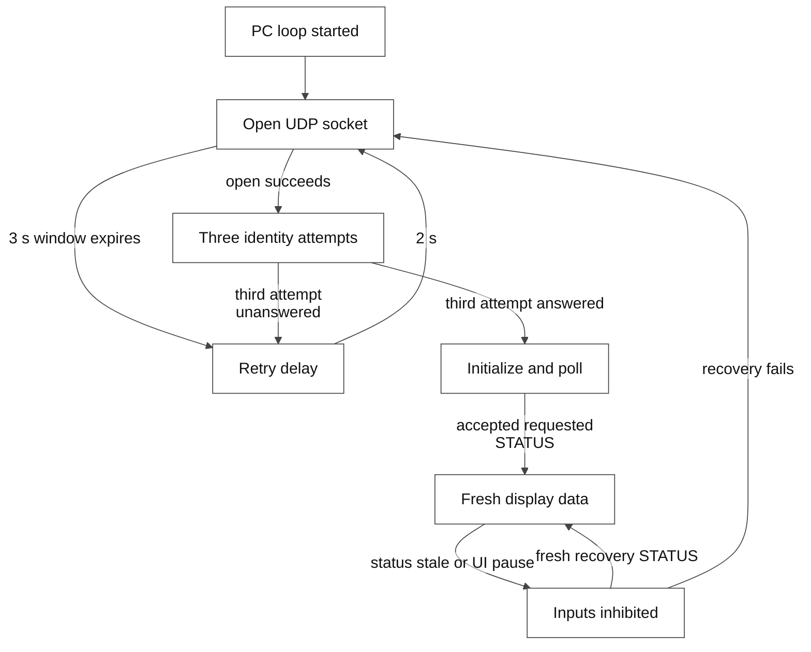
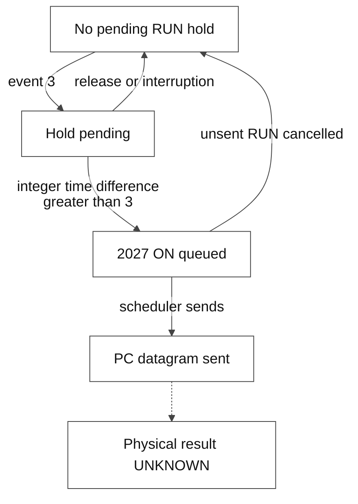

# 3. PC control states and hardware observations

**Status: REVIEW — human approval pending.** This chapter describes PY_SPF 1.0 at immutable commit `cebcc28490f48e9e5d4d1c2e2feef34d638244e7`. The package version is `1.0.0`; the reconstructed NI GUI is version `1.6.0`. These are not the SASC firmware version. This work changes documentation only and performs no equipment actions.

## Evidence boundary

| Grade | Meaning in this chapter |
|---|---|
| **CODE VERIFIED** | A condition or action present in the cited Python source; the release or branch is identified. |
| **XP/LOG VERIFIED** | Original x86 disassembly/isolated oracle, or a recorded physical-device observation. The provenance is stated each time. An oracle is not a Windows XP hardware run. |
| **MANUAL** | Manufacturer-described operation in manual 330A, Rev. A. Printed and PDF page numbers are both given. |
| **INFERRED** | A conceptual explanation combining identified evidence; not an implemented firmware state. |
| **UNKNOWN** | Not established by the available code, manual or observations. |

The original executable is identified by SHA256 `8a87bcad1709f93358cba5f5588647999524ba8b481c2f38cc6cc82a96623e9b`. Its code and the isolated original-x86 oracles support the legacy PC behavior. They do not reveal the firmware implementation or measure optical output. [XP-CALLBACK: original worker][X-RUN]; [XP-DECODER: oracle method][X-ORACLE].

## Separate state dimensions

There is no verified, single hardware state machine named `OFF → READY → RUNNING` in this repository. The following dimensions can coexist and must be read separately.

| Dimension | Code or observation | What it establishes | What it does not establish |
|---|---|---|---|
| PC application lifecycle | `controller.running` | Whether the application's loop should continue. | Whether a laser, shutter or HV supply is on. |
| UDP session | `transport`, startup attempts, `scheduler.hold`, pending request | Whether a local socket exists and the PC can schedule requests. | Readiness of every subsystem. |
| Accepted communication | `state['connected']`, last matched reply | The decoder has accepted a nonempty response in this session. | Global hardware RUN or optical emission. |
| Display data readiness | `gui_ready`, requested/current `1085`, status age | Whether the native view may restore its saved input policy. | Manufacturer operating prerequisites being satisfied. |
| GUI health policy | `STATUS?` bit 0 → `delay_monitor_status` | Whether the GUI health routine dims RUN and PC1/PC2 controls. | An independent firmware inhibit or direct optical measurement. |
| RUN intention | `evnt_cmt`, `_button_started`, queued `2027` | A pending hold gesture or a PC request. | An acknowledged or completed physical start. |
| TDG/BWD observation | `1039`, PD bits and BWD latch mask | The reported TDG word and its decoded indicators. | That both Pockels cells are firing, or that output power was measured. |
| Empower observation | `1013`, opt-out and Emission visibility | Pump status bits which the GUI displays when not opted out. | Complete Spitfire output state. |

**CODE VERIFIED:** initialization and state storage are in [PY-CONTROLLER: `controller.py` L23–82][C-STATE]. Communication is refreshed by decoder effects, not by the RUN button: [PY-DECODER: `decoders.py` L110–126][D-CONNECTED], [PY-CONTROLLER: L657–689][C-EFFECTS].

For example, a valid `STATUS=3` can make `gui_ready=True` while its bit 0 causes the GUI health routine to dim RUN. `HV=1`, `COMSTATUS=1`, a BWD latch, and a hidden Emission label do not collapse into one reliable "running" value. `COMSTATUS` has its own bit-to-fault-panel mapping. [PY-DECODER: L225–236][D-STATUS], [PY-DECODER: L338–344][D-HEALTH].

## PC session and display readiness

Figure 3A is an **INFERRED** projection of the PC variables, not a firmware state chart. "Fresh display" means software data readiness only.

**CODE VERIFIED — transition details:**

| Trigger | PC action and limit | Evidence |
|---|---|---|
| Start/connect | Clear queues and pending hold, mark data unready, then open the UDP transport. Native layout and navigation remain visible; the legacy gray curtain is suppressed. | [PY-CONTROLLER: L174–209][C-OPEN], [PY-CONTROLLER: L113–136][C-PRESENT] |
| Socket open fails | Attempt no more often than every 0.25 s within a 3 s opening window; after failure, schedule another connection attempt after 2 s. | [PY-CONTROLLER: L211–227][C-ATTEMPT], [L447–461][C-OPEN-RETRY] |
| Identity phase | Send tag `1000` three times, even if an earlier attempt answered. Each attempt has a 3 s deadline. The third attempt's nonempty response determines startup success. | [PY-SCHEDULER: L149–177][S-IDN], [PY-CONTROLLER: L468–486][C-IDN] |
| Identity succeeds | Release the scheduler hold and queue initialization; this does not itself set `gui_ready`. | [PY-CONTROLLER: L474–477][C-IDN] |
| Data becomes ready | Reject unsolicited/pre-initialization STATUS; only a matching, requested, valid, nonempty STATUS can be decoded and open the display. | [PY-CONTROLLER: L554–619][C-RX], [PY-DECODER: L228–236][D-STATUS] |
| No matched replies | Scheduler inactivity over 10 s requests reopening; over 30 s selects the reconnect branch. The normal path reaches the earlier threshold first. These are communication thresholds, not laser shutdown confirmations. | [PY-SCHEDULER: L135–146][S-INACTIVE], [PY-CONTROLLER: L501–518][C-STALE] |
| Other replies continue but STATUS is absent | After more than 30 s without fresh STATUS, inhibit device inputs and cancel pending actuation; communication may still be marked connected. | [PY-CONTROLLER: L519–525][C-STALE] |

In normal mode initialization includes `2036 EMPOPTOUT 1` before the `1068` readback. In read-only mode that write and other automatic writes are skipped. This is a Python release policy; it must not be attributed to the unmodified XP executable. [PY-SCHEDULER: L78–97][S-INITIAL].

## UI pause, recovery and cancellation

**CODE VERIFIED:** Native 1.0 uses a guarded 25 ms Win32 timer on the creating UI thread plus an outer-loop fallback. It does not run CVI calls from a background polling thread. The timer object remains alive through GUI teardown because queued timer callbacks can survive `KillTimer`. [PY-TICKER: L14–46][T-LIFE], [L72–125][T-TICK], [PY-NATIVE: L479–507][N-LOOP].

A native tick gap over 2 s invokes UI-pause recovery. Before the first STATUS it cancels a pending RUN and preserves initialization. In an established session it cancels unsent actuation, drains buffered responses, and requests a new STATUS on the existing socket. Buffered pre-probe replies cannot establish freshness. At most 64 datagrams are processed per tick; reaching that limit is not proof that the old receive queue is empty. [PY-CONTROLLER: L276–292][C-DRAIN], [L344–438][C-PAUSE], [L562–568][C-RX].

The cancellation rule preserves only exact, parameter-empty shutdown requests `2006`, `2013`, `2016`, `2023`, `2028`; these may be sent once while receive quarantine continues. This is preservation of a deliberate pending request, not an automatically generated hardware OFF. A successful fresh probe resumes polling without replaying startup writes; exhausted probe recovery reconnects. [PY-CONTROLLER: L312–438][C-PAUSE].

**XP/LOG VERIFIED — original x86, not a physical XP test:** the original schedules three CVI thread-pool workers before `RunUserInterface`. Python's UI-thread timer and quarantine are implementation changes. The original communication error branch also contains modal waiting; the release uses nonmodal recovery. [XP-CALLBACK: disassembly L9685–9706][X-THREADS], [L9408–9487][X-RECOVERY]. **XP/LOG VERIFIED — physical log:** the saved release validation describes the bounded native menu/soak checks, with their exact tested source scope. [LOG-SOAK][LOG-SOAK].

## RUN: gesture, inhibit, request and physical result

These PC-only intention states must not be called hardware OFF/ON states.

Figure 3B separates software RUN intent from physical state.

**CODE VERIFIED:** main panel `6`, control `10`, callback `cllbck` uses event `3` to arm the hold; event `1` clears the arm flag. The worker checks `int(now) - int(start) > 3`, queues `[2027]ON`, writes the TCU GUI toggle `2/8=1`, and clears the pending hold. This is a whole-second comparison, not an exact fixed four-second physical start time. Queueing and actual wire transmission can occur at different times. [PY-CALLBACKS: L194–203][CB-RUN], [PY-CONTROLLER: L738–749][C-HELD].

**XP/LOG VERIFIED — original x86 and isolated oracle:** event `3` arms and event `1` clears; worker address `0x406953` queues `2027` after the same integer condition. The callback alone does not transmit ON. The GUI toggle update is not a separate `ECU:TECON` command. [XP-CALLBACK: L14210–14240][X-RUN-CB], [L9136–9182][X-RUN].

The current timer cancels held or unsent `2027` on a released mouse, Alt/F10, standard menu/move flags, or another owned foreground panel. It does not cancel the separate `2005 EMP:ON` through this held-RUN rule. CVI custom menus do not always set Win32 menu flags; a zero `menu_ticks` count is not proof that no menu was open. [PY-TICKER: L88–102][T-TICK].

**Important implementation boundary — CODE VERIFIED:** the health routine dims RUN when `delay_monitor_status != 0`. `_held_turn_on` itself checks read-only/unready conditions but does not recheck the fault word or the RUN control's DIM state. An injected Native adapter/Controller event is therefore not equivalent to a permitted natural GUI click. This chapter documents the boundary; it does not authorize bypassing it. [PY-DECODER: L329–344][D-HEALTH], [PY-NATIVE: L360–372][N-EVENT], [PY-CONTROLLER: L738–749][C-HELD].

**MANUAL:** printed 6-9 / PDF page 69 describes RUN as starting the Empower pump diodes, followed by a countdown, shutter opening and ramp-up. Printed 6-1 / PDF page 61 requires both BWD indicators green before the later startup steps; printed 6-2 / PDF page 62 lists RUN and Pockels-cell enabling as distinct steps. **UNKNOWN:** the exact SASC firmware action and internal order for `[2027]ON`, especially with Empower opted out, are not established by PC code or the isolated oracle. Neither sending ON nor receiving its receipt proves measured optical emission. [MAN-330A].

## STOP and HV remain separate

| Operation | Verified PC request | Boundary |
|---|---|---|
| STOP, main `6/11`, event `3` | `2028 OFF`, then query `1013`; GUI `2/8=0`. | No explicit `2016 TDG:HV:OFF` in this callback. |
| Escape | `2028 OFF` and GUI `2/8=0`; blocked read-only. | Not the PC application exit command. |
| HV switch, timing panel `5/34`, event `1` | `2017 TDG:HV:ON` or `2016 TDG:HV:OFF`, then query `1061`. | Independent callback from RUN/STOP. |
| Quit/close | Stop the application loop/transport. | Does not synthesize a hardware OFF command. |

**CODE VERIFIED:** [PY-CALLBACKS: L200–203][CB-RUN], [L254–257][CB-HV], [L305–306][CB-STOP], [L148–152][CB-QUIT]. **XP/LOG VERIFIED — original x86/isolated callback oracle:** [XP-CALLBACK: STOP L14177–14207][X-STOP], [HV L18795–18850][X-HV]. **MANUAL:** printed 6-9 / PDF page 69 describes STOP as pump diodes off and the pump cavity shutter closed. **UNKNOWN:** that is not evidence that `2028` disables every HV supply, the seed laser, or all optical paths in the observed opt-out configuration. [MAN-330A].

## BWD, Emission and status are observations, not one machine state

**CODE VERIFIED:** `1039 TDG:STBH?` is hexadecimal. `word & 0x300000 == 0` produces `BWD OK`, gray and dimmed; any set bit in that mask produces `RESET BWD`, yellow and enabled. PD1 and PD2 are separately decoded from inverted bits `0x10000` and `0x20000`. The available source does not establish a PC1/PC2 name for BWD bits 20 and 21. `1066 TDG:STBHFLT?` drives a separate fault decoder. [PY-DECODER: L218–227][D-TDG], [L319–327][D-BWD].

**XP/LOG VERIFIED — physical log:** the sanitized BWD history reports observed words and missing-observation limits. A reset receipt, a clear COMSTATUS bit, and an observed BWD mask clear are different events. [LOG-BWD][LOG-BWD]. **MANUAL:** printed 4-4 / PDF page 50 and 6-10 / PDF page 70 describe two optical detector thresholds and reset after the underlying condition is resolved. **INFERRED from the optical/electrical distinction:** an electronic Internal clock does not supply the optical seed spectrum those detectors receive. The manual's QSW SOURCE INTERNAL description is for the Empower clock, not proof of the service-level oscillator/trigger command implementation. [MAN-330A].

**CODE VERIFIED:** main `6/32`, `MSG_EMISSION`, starts hidden with fixed text and color. When `emp_optout == 0`, accepted `1013 EMP:STB?` makes it visible if bit `0x1` or `0x200` is set. `emp_optout == 1` skips that update; it does not actively clear a previously visible label. `STATUS`, HV readback and a queued RUN do not directly set this visibility. [PY-DECODER: L269–292][D-EMP]. **XP/LOG VERIFIED — original decoder/emulation:** the same opt-out early return and visibility condition appear in the original and oracle. [XP-DECODER: L11965–11983][X-EMP-OPT], [L12179–12200][X-EMISSION]. **UNKNOWN:** the label is not an independently verified optical power measurement; hidden does not establish absence of light.

## External Control 2.0.0 has different PC states

**CODE VERIFIED — EXT-2 only:** External Control `2.0.0` at `4c319aa7ed3a6068c86622b759535dc693c4c056` is a dedicated Empower-independent implementation. Its PC state boundaries must not be substituted for the reconstructed 1.0 RUN callback above.

| External2 boundary | Implemented PC condition/action | Evidence |
|---|---|---|
| Ordinary initialization/polling | Query-only queues; no automatic Opt-out write, EMP startup sequence or legacy `2054 RES12` side effect. A reconnect with unresolved prior PC operation may reissue owed PC OFF cleanup. | [EXT-2: scheduling L117–133][E-INIT], [external decoder L263–289][E-DECODER], [controller L116–155][E-RECONNECT] |
| Explicit Opt-out apply | Only `2036=1` is permitted. Fresh HV OFF is checked when accepting the request and again before transmission. Querying `1068` does not apply the setting. | [EXT-2: controller L405–410][E-OPT], [L462–475][E-VALIDATE], [readback L177–180][E-HVOFF] |
| RUN eligibility | Fresh independent communications/fault/timing facts, Opt-out `1`, TCU/Head Opt-out and overrides `0`, both timing sources EXT, positive measured seed frequency, BWD/ENA gating, existing HV ON with positive measured HV1/HV2, and both PCs initially OFF. | [EXT-2: external state L201–239][E-GATES] |
| RUN request/confirmation | A continuous 3 s hold requests PC2 ON; a new valid ON readback permits PC1 ON; its new valid readback marks PC RUN confirmed. A receipt alone does not confirm either channel. | [EXT-2: controller L449–455][E-HOLD], [L509–568][E-RUN] |
| STOP/failed RUN | Cancel unsent enables, prioritize independent PC1/PC2 OFF requests and require new OFF readbacks. Unverified cleanup survives reconnect and blocks the next RUN; no automatic RUN resume. | [EXT-2: controller L116–155][E-RECONNECT], [L527–583][E-STOP] |
| Forbidden legacy requests | Original global `2027 ON`/`2028 OFF`, EMP/MIL and raw operations, BWD/ENA disabling and protection-override enabling are rejected by policy. | [EXT-2: external policy L47–114][E-POLICY] |

The RUN prerequisite of existing HV ON and the Opt-out-apply prerequisite of fresh HV OFF apply to **different actions**. They do not authorize changing HV as a side effect of RUN. External2's STOP requests turn off the PC channels; they do not request external pump or HV OFF. Physical output remains **UNKNOWN** from those channel confirmations alone. The detailed sequence is in [04, section D](04_communication_sequence.md#d--external-control-200-is-a-separate-flow).

**CODE VERIFIED — version boundary:** External2 retains an older Native outer event loop and a conditional modal-warning reconnect path. It does not contain the 1.0 UI-thread ticker and pause-recovery behavior described earlier. **UNKNOWN:** actual External2 Windows-NI/XP equipment execution and physical actuation are not established by the 1.0 read-only soak or inherited original-x86 oracles. [EXT-2: native L397–405][E-NATIVE], [controller L243–255][E-MODAL], [branch evidence analysis](evidence/external_control_2_analysis.md).

## Version and review limits

Except for the explicitly labelled External2 section, this chapter's Python claims are limited to `cebcc28`. `origin/main` at `78d3f447b1ca3dea35c5a737b75569a882bc0650` is package `1.6.0.post1` and does not contain all current transport/read-only/timer protections. [Older main version][OLD-MAIN]. Original XP worker scheduling, current Python scheduling, External2 policy, manufacturer operating instructions and physical observations remain separate evidence layers.

## Source references

The links below are immutable code references. `MAN-330A` means *Spitfire Pro User's Manual*, 330A, Rev. A, with page pairs stated above. Local log evidence is sanitized and is not an operating instruction.

[C-STATE]: https://github.com/El-Carretero/PY_SPF/blob/cebcc28490f48e9e5d4d1c2e2feef34d638244e7/spitfire/controller.py#L23-L82
[C-PRESENT]: https://github.com/El-Carretero/PY_SPF/blob/cebcc28490f48e9e5d4d1c2e2feef34d638244e7/spitfire/controller.py#L113-L136
[C-OPEN]: https://github.com/El-Carretero/PY_SPF/blob/cebcc28490f48e9e5d4d1c2e2feef34d638244e7/spitfire/controller.py#L174-L209
[C-ATTEMPT]: https://github.com/El-Carretero/PY_SPF/blob/cebcc28490f48e9e5d4d1c2e2feef34d638244e7/spitfire/controller.py#L211-L227
[C-OPEN-RETRY]: https://github.com/El-Carretero/PY_SPF/blob/cebcc28490f48e9e5d4d1c2e2feef34d638244e7/spitfire/controller.py#L447-L461
[C-IDN]: https://github.com/El-Carretero/PY_SPF/blob/cebcc28490f48e9e5d4d1c2e2feef34d638244e7/spitfire/controller.py#L468-L486
[C-RX]: https://github.com/El-Carretero/PY_SPF/blob/cebcc28490f48e9e5d4d1c2e2feef34d638244e7/spitfire/controller.py#L554-L619
[C-DRAIN]: https://github.com/El-Carretero/PY_SPF/blob/cebcc28490f48e9e5d4d1c2e2feef34d638244e7/spitfire/controller.py#L276-L292
[C-PAUSE]: https://github.com/El-Carretero/PY_SPF/blob/cebcc28490f48e9e5d4d1c2e2feef34d638244e7/spitfire/controller.py#L312-L438
[C-STALE]: https://github.com/El-Carretero/PY_SPF/blob/cebcc28490f48e9e5d4d1c2e2feef34d638244e7/spitfire/controller.py#L501-L525
[C-EFFECTS]: https://github.com/El-Carretero/PY_SPF/blob/cebcc28490f48e9e5d4d1c2e2feef34d638244e7/spitfire/controller.py#L657-L689
[C-HELD]: https://github.com/El-Carretero/PY_SPF/blob/cebcc28490f48e9e5d4d1c2e2feef34d638244e7/spitfire/controller.py#L738-L749
[S-IDN]: https://github.com/El-Carretero/PY_SPF/blob/cebcc28490f48e9e5d4d1c2e2feef34d638244e7/spitfire/scheduling.py#L149-L177
[S-INITIAL]: https://github.com/El-Carretero/PY_SPF/blob/cebcc28490f48e9e5d4d1c2e2feef34d638244e7/spitfire/scheduling.py#L78-L97
[S-INACTIVE]: https://github.com/El-Carretero/PY_SPF/blob/cebcc28490f48e9e5d4d1c2e2feef34d638244e7/spitfire/scheduling.py#L135-L146
[D-CONNECTED]: https://github.com/El-Carretero/PY_SPF/blob/cebcc28490f48e9e5d4d1c2e2feef34d638244e7/spitfire/decoders.py#L110-L126
[D-STATUS]: https://github.com/El-Carretero/PY_SPF/blob/cebcc28490f48e9e5d4d1c2e2feef34d638244e7/spitfire/decoders.py#L225-L236
[D-HEALTH]: https://github.com/El-Carretero/PY_SPF/blob/cebcc28490f48e9e5d4d1c2e2feef34d638244e7/spitfire/decoders.py#L329-L344
[D-TDG]: https://github.com/El-Carretero/PY_SPF/blob/cebcc28490f48e9e5d4d1c2e2feef34d638244e7/spitfire/decoders.py#L218-L227
[D-BWD]: https://github.com/El-Carretero/PY_SPF/blob/cebcc28490f48e9e5d4d1c2e2feef34d638244e7/spitfire/decoders.py#L319-L327
[D-EMP]: https://github.com/El-Carretero/PY_SPF/blob/cebcc28490f48e9e5d4d1c2e2feef34d638244e7/spitfire/decoders.py#L269-L292
[CB-RUN]: https://github.com/El-Carretero/PY_SPF/blob/cebcc28490f48e9e5d4d1c2e2feef34d638244e7/spitfire/callbacks.py#L194-L203
[CB-HV]: https://github.com/El-Carretero/PY_SPF/blob/cebcc28490f48e9e5d4d1c2e2feef34d638244e7/spitfire/callbacks.py#L254-L257
[CB-STOP]: https://github.com/El-Carretero/PY_SPF/blob/cebcc28490f48e9e5d4d1c2e2feef34d638244e7/spitfire/callbacks.py#L305-L306
[CB-QUIT]: https://github.com/El-Carretero/PY_SPF/blob/cebcc28490f48e9e5d4d1c2e2feef34d638244e7/spitfire/callbacks.py#L148-L152
[N-EVENT]: https://github.com/El-Carretero/PY_SPF/blob/cebcc28490f48e9e5d4d1c2e2feef34d638244e7/spitfire/native.py#L360-L372
[N-LOOP]: https://github.com/El-Carretero/PY_SPF/blob/cebcc28490f48e9e5d4d1c2e2feef34d638244e7/spitfire/native.py#L479-L507
[T-LIFE]: https://github.com/El-Carretero/PY_SPF/blob/cebcc28490f48e9e5d4d1c2e2feef34d638244e7/spitfire/native_ticker.py#L14-L46
[T-TICK]: https://github.com/El-Carretero/PY_SPF/blob/cebcc28490f48e9e5d4d1c2e2feef34d638244e7/spitfire/native_ticker.py#L72-L125
[X-RUN-CB]: https://github.com/El-Carretero/PY_SPF/blob/cebcc28490f48e9e5d4d1c2e2feef34d638244e7/analysis/annotated_disasm.txt#L14210-L14240
[X-RUN]: https://github.com/El-Carretero/PY_SPF/blob/cebcc28490f48e9e5d4d1c2e2feef34d638244e7/analysis/annotated_disasm.txt#L9136-L9182
[X-THREADS]: https://github.com/El-Carretero/PY_SPF/blob/cebcc28490f48e9e5d4d1c2e2feef34d638244e7/analysis/annotated_disasm.txt#L9685-L9706
[X-RECOVERY]: https://github.com/El-Carretero/PY_SPF/blob/cebcc28490f48e9e5d4d1c2e2feef34d638244e7/analysis/annotated_disasm.txt#L9408-L9487
[X-STOP]: https://github.com/El-Carretero/PY_SPF/blob/cebcc28490f48e9e5d4d1c2e2feef34d638244e7/analysis/annotated_disasm.txt#L14177-L14207
[X-HV]: https://github.com/El-Carretero/PY_SPF/blob/cebcc28490f48e9e5d4d1c2e2feef34d638244e7/analysis/annotated_disasm.txt#L18795-L18850
[X-EMP-OPT]: https://github.com/El-Carretero/PY_SPF/blob/cebcc28490f48e9e5d4d1c2e2feef34d638244e7/analysis/annotated_disasm.txt#L11965-L11983
[X-EMISSION]: https://github.com/El-Carretero/PY_SPF/blob/cebcc28490f48e9e5d4d1c2e2feef34d638244e7/analysis/annotated_disasm.txt#L12179-L12200
[X-ORACLE]: https://github.com/El-Carretero/PY_SPF/blob/cebcc28490f48e9e5d4d1c2e2feef34d638244e7/analysis/native_decoder_oracle.py#L1-L5
[LOG-BWD]: evidence/bwd_history_summary.json
[LOG-SOAK]: evidence/release_validation.json
[OLD-MAIN]: https://github.com/El-Carretero/PY_SPF/blob/78d3f447b1ca3dea35c5a737b75569a882bc0650/spitfire/__init__.py#L1-L2
[E-INIT]: https://github.com/El-Carretero/PY_SPF/blob/4c319aa7ed3a6068c86622b759535dc693c4c056/spitfire/scheduling.py#L117-L133
[E-DECODER]: https://github.com/El-Carretero/PY_SPF/blob/4c319aa7ed3a6068c86622b759535dc693c4c056/spitfire/external_state.py#L263-L289
[E-OPT]: https://github.com/El-Carretero/PY_SPF/blob/4c319aa7ed3a6068c86622b759535dc693c4c056/spitfire/controller.py#L405-L410
[E-VALIDATE]: https://github.com/El-Carretero/PY_SPF/blob/4c319aa7ed3a6068c86622b759535dc693c4c056/spitfire/controller.py#L462-L475
[E-HVOFF]: https://github.com/El-Carretero/PY_SPF/blob/4c319aa7ed3a6068c86622b759535dc693c4c056/spitfire/external_state.py#L177-L180
[E-GATES]: https://github.com/El-Carretero/PY_SPF/blob/4c319aa7ed3a6068c86622b759535dc693c4c056/spitfire/external_state.py#L201-L239
[E-HOLD]: https://github.com/El-Carretero/PY_SPF/blob/4c319aa7ed3a6068c86622b759535dc693c4c056/spitfire/controller.py#L449-L455
[E-RUN]: https://github.com/El-Carretero/PY_SPF/blob/4c319aa7ed3a6068c86622b759535dc693c4c056/spitfire/controller.py#L509-L568
[E-RECONNECT]: https://github.com/El-Carretero/PY_SPF/blob/4c319aa7ed3a6068c86622b759535dc693c4c056/spitfire/controller.py#L116-L155
[E-STOP]: https://github.com/El-Carretero/PY_SPF/blob/4c319aa7ed3a6068c86622b759535dc693c4c056/spitfire/controller.py#L527-L583
[E-POLICY]: https://github.com/El-Carretero/PY_SPF/blob/4c319aa7ed3a6068c86622b759535dc693c4c056/spitfire/external_policy.py#L47-L114
[E-NATIVE]: https://github.com/El-Carretero/PY_SPF/blob/4c319aa7ed3a6068c86622b759535dc693c4c056/spitfire/native.py#L397-L405
[E-MODAL]: https://github.com/El-Carretero/PY_SPF/blob/4c319aa7ed3a6068c86622b759535dc693c4c056/spitfire/controller.py#L243-L255
