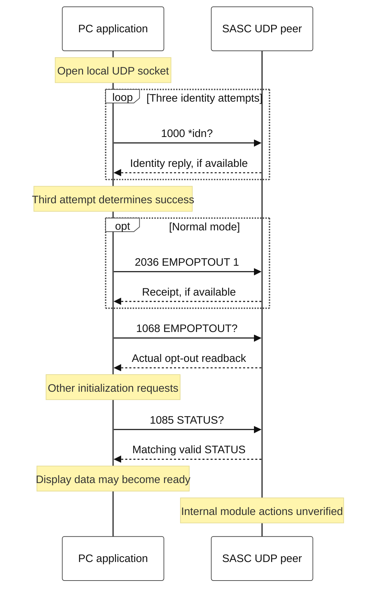
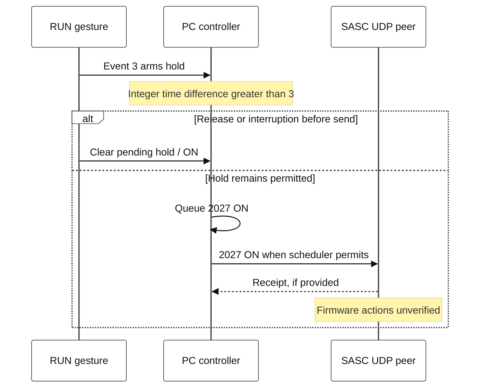
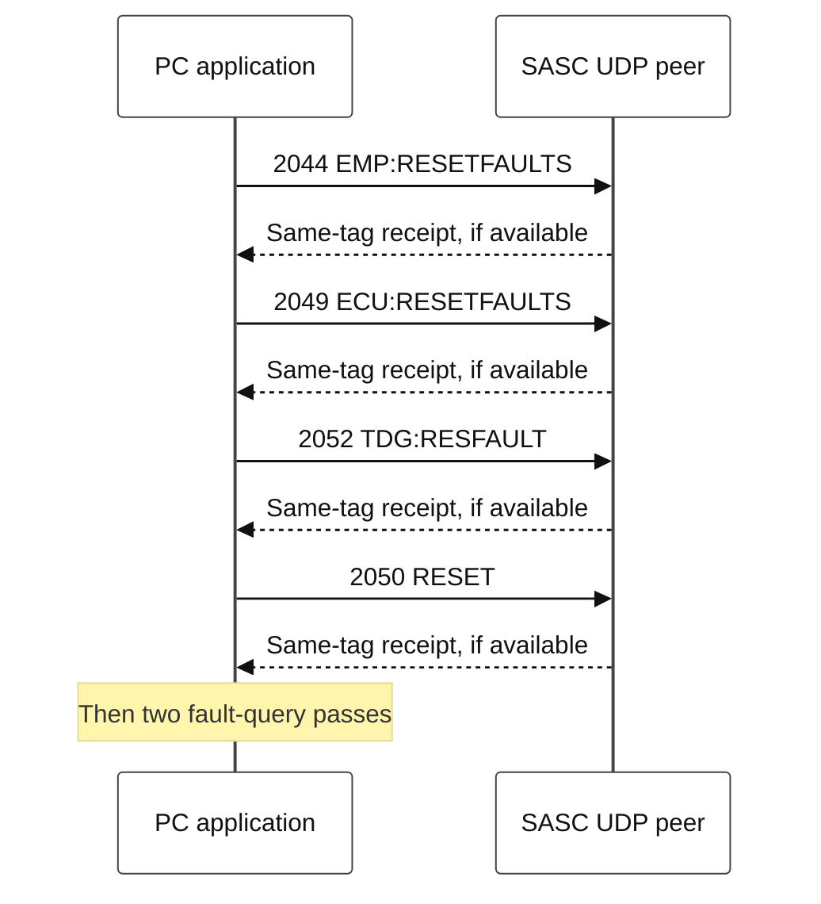

# 4. Communication sequences and confirmation limits

**Status: REVIEW — human approval pending.** This chapter describes PY_SPF 1.0 at commit `cebcc28490f48e9e5d4d1c2e2feef34d638244e7`. No commands were executed to write this document.

## Boundary and notation

**CODE VERIFIED:** the current PC transport sends ASCII UDP requests to its configured peer. Defaults are destination `10.19.70.13:1024` and local bind `0.0.0.0:1024`; the local adapter determines the source address. Windows uses an exclusive bind. Incoming datagrams from another source address or port are rejected. [PY-PROTOCOL: `protocol.py` L147–198][P-UDP].

**XP/LOG VERIFIED — physical p01 logs:** the observed peer identifies itself as `Spectra Physics,SASC,1.5.0`. The following UDP arrows end at that observed peer. A manufacturer diagram may label the Ethernet assembly TDG, but the PC capture does not expose internal SASC-to-TDG/Empower/ECU transactions. Their messages, order and firmware state transitions remain **UNKNOWN**. [LOG-RESET][LOG-RESET], [LOG-SOAK][LOG-SOAK].

| PC framing | Example and interpretation |
|---|---|
| Request prefix | `Spectra-Physics:CMD_ECLIPSE,` |
| One request line | `[1068]EMPOPTOUT?` followed by LF |
| Response framing | `Spectra-Physics:REPLY_ECLIPSE:<1068>1` |
| Tag | Query/command type identifier; not a unique transaction number. |
| Parsed decoration | `(packet,line)` is added locally for analysis, not a firmware transaction token. |

**CODE VERIFIED:** [PY-PROTOCOL: L13–26][P-FORMAT], [L29–87][P-PARSE]. The current `Controller._send` creates and flushes a packet for the selected request. A callback which queues several requests does not thereby transmit them as one atomic UDP batch. One outstanding request normally holds the scheduler balance until matching response or timeout. [PY-CONTROLLER: L237–274][C-SEND], [PY-SCHEDULER: L110–133][S-QUEUE].

The grades used below are **CODE VERIFIED**, **XP/LOG VERIFIED**, **MANUAL**, **INFERRED** and **UNKNOWN**. Every original-x86 oracle/disassembly claim is labelled as such; it is not a physical Windows XP or laser test.

## A — Open, initialize, request status

Figure 4A shows the PC-to-peer boundary only. Startup success is communication initialization, not verified hardware readiness.

**CODE VERIFIED — detail and limits:**

- `1000` is attempted three times; receipt advances an attempt early, otherwise its deadline is 3 s. A failed third attempt schedules another connection attempt after 2 s. [PY-SCHEDULER: L149–177][S-IDN], [PY-CONTROLLER: L447–486][C-STARTUP].
- Normal initialization inserts `2036 EMPOPTOUT 1` immediately before its `1068` readback. Missing write receipt has a 1 s grace, after which the readback proceeds; the display is not fabricated from the write intention. Read-only initialization skips that write and `2047 EMP:LBOBREAK 1`. [PY-SCHEDULER: L78–97][S-INIT], [PY-CONTROLLER: L491–500][C-OPT-ACK].
- Initialization is more than this shortened diagram. The exact sequence is the concatenation of the prefix, ECU, MIL, TDG and EMP lists, then `1062`; commands are inserted/skipped as stated above. A response to `1067 TDG:OSC:MODE?` lacking `INT` requests `2030 INT` then `2030 EXT` in the legacy decoder. `STATUS` bit 1 requests the channel reset path. These automatic writes are suppressed read-only. [PY-SCHEDULER: L15–23, L78–108][S-INIT], [PY-DECODER: L143–152][D-OSC], [L228–236][D-STATUS], [PY-CONTROLLER: L657–669][C-EFFECTS].
- Read-only is a final send policy, not merely a disabled button: only exact, parameter-empty catalog questions ending `?` are allowed. Legacy partial query `1026 TDG:DEL` is excluded. [PY-CONTROLLER: L237–250][C-SEND]. A separate literal-query utility without the Controller does not execute decoder-generated writes.

### Polling and request completion

The inside queue has priority over the outside poll queue. A normal poll starts with `1039`, then interleaves `1039` after each of the fourteen ordinary poll values. Service access adds four measurement queries. At the default 0.25 s send interval, the 29-request normal cycle consumes a nominal minimum of 7.25 s **from its first send to the next cycle's first send**, before loss, priority work or other delays. The first-to-last interval within that cycle has only 28 gaps. This is not a guaranteed STATUS refresh period. [PY-SCHEDULER: L15–24, L99–121][S-QUEUE], [PY-CONTROLLER: L24–44][C-CONFIG].

| Event | Current PC behavior | Confirmation boundary |
|---|---|---|
| Matching query reply | Release the pending tag; decode a nonempty value. | A tag match cannot distinguish a delayed reply to a repeated same-tag query. |
| Matching empty reply | Release the request and record unavailable/empty; do not reuse another tag's previous payload. | Empty is not a numeric zero or a measured state. |
| Wrong/unexpected tag | Log/ignore; do not release the next request. | An extra datagram is not progress for another transaction. |
| Query deadline | At 0.7 s, retry a safe catalog question up to twice: three attempts in total. | A retry is allowed for a question, not for an actuator command. |
| Write receipt absent | After 1 s, skip and record `write_ack_timeouts`; do not replay the write. | An uncertain send or missing receipt is not a reason to issue an actuator again. |
| Socket send fails | Record the error with a bounded next deadline. | Successful `sendto` only establishes local submission, not actuation. |

**CODE VERIFIED:** [PY-CONTROLLER: L237–310][C-SEND], [L554–619][C-RX]; [PY-SCHEDULER: L123–133][S-QUEUE]. A received reset receipt can be empty. The decoder does not turn every receipt into a positive physical completion verdict.

**XP/LOG VERIFIED — original x86:** the original decrements message balance for non-`1000` parsed responses without the current outstanding-tag match and clamps it at zero. Its receive scheduling and wall-clock recovery differ from this release. Current duplicate draining, source filtering, bounded query retries, pacing and UI-pause quarantine must not be described as proven original XP behavior. [XP-CALLBACK/XP-DECODER: disassembly L15443–15454][X-BALANCE], [L10999–11010][X-RECEIVE], [L9408–9487][X-RECOVERY].

For current UI-pause recovery, the PC first discards locally buffered responses, then sends a new `1085` on the same socket. A fresh accepted reply resumes without startup replay; failure reconnects. The wire still lacks unique transaction IDs, so network-delayed same-tag responses remain a protocol limitation. See [03 — PC control states](03_state_machine.md). [PY-CONTROLLER: L344–438][C-PAUSE].

## B — RUN request versus manufacturer start sequence

**CODE VERIFIED:** the natural GUI path, an injected adapter event, the queued request and the datagram are separate steps. Health may dim RUN before any input is delivered; `_held_turn_on` does not independently recheck the DIM/fault state if that UI boundary is bypassed. Read-only and unready guards remain separate. [PY-DECODER: L338–344][D-HEALTH], [PY-NATIVE: L360–372][N-EVENT], [PY-CONTROLLER: L738–749][C-HELD].

Figure 4B shows the Native 1.0 request sequence, rather than measured optical emission.

The worker also sets GUI `2/8=1`; it does not issue a separate `2022 ECU:TECON` or `2017 TDG:HV:ON` from this RUN branch. This absence of an explicit HV command does not prove the firmware cannot change HV internally. [PY-CONTROLLER: L738–749][C-HELD]. **XP/LOG VERIFIED — original disassembly/emulation:** the legacy event/worker distinction and `2027` are corroborated by worker `0x406953` and callback `0x40aba7`; no physical ON test is implied. [XP-CALLBACK: L9136–9182][X-RUN], [L14210–14240][X-RUN-CB].

### Manufacturer-described order — a different evidence layer

**MANUAL:** 330A Rev. A, printed 6-9 / PDF page 69 describes a standard Empower-equipped system as: RUN hold → Empower pump diodes on and red Emission bar → COUNT/delay/beep → pump shutter opens → reduced-power lasing and controlled ramp-up. STOP is described as pump diodes off and pump cavity shutter closed. This is a manufacturer operating description, not a decoded trace of SASC internal messages.

The manual separately places stable seed/both BWD indicators green before HV keyswitch and later RUN; it then lists enabling PC1/PC2 after RUN. Printed 6-1 / PDF page 61 and 6-2 / PDF page 62. It also states that the GUI does not operate the Mai Tai/Tsunami seed laser, printed 6-8 / PDF page 68. An actual optical-output conclusion requires the appropriate physical evidence; software `running`, an ON receipt, HV readback, or the Emission label alone does not supply it. [MAN-330A].

**UNKNOWN:** the complete physical behavior of global `ON`/`OFF` with this SASC firmware and Empower opt-out configuration; the internal serial/relay order; implicit HV behavior; and actual amplified optical emission during a software-only test.

## C — Reset, STOP and HV sequences

### C1. Fault reset

Fault panel `3/53`, `cllbckcmd_reset`, event `1` queues this exact write order. The four target writes are not interchangeable with BWD reset.

Figure 4C shows the Fault Reset message sequence.

Each pass is **five separate requests**, in order: `1089 COMSTATUS?`, `1088 ECU:STBH?`, `1014 EMP:FAULT?`, `1066 TDG:STBHFLT?`, `1057 ECU:STBH?`. The duplicate pass is deliberate original behavior, not proof that a button callback ran twice. **CODE VERIFIED:** [PY-CALLBACKS: L290–291, L319–321][CB-RESET]. **XP/LOG VERIFIED — original x86/emulated callback:** the exact four writes and repeated query sequence match the original. [XP-CALLBACK: L2897–2938][X-FAULT-ORACLE].

**XP/LOG VERIFIED — physical retest:** the sanitized reset evidence separates each transmitted write and receipt, post-reset state samples, and the scope of the Native-adapter invocation. That test is not a physical mouse-event validation. An empty receipt means a reply was received; it does not demonstrate that every underlying fault cleared. `2050 RESET` must not be silently renamed "clear one indicator" or assumed to be a power-cycle. [LOG-RESET][LOG-RESET].

### C2. BWD reset, STOP and separate HV switch

| UI action | Ordered PC requests | Interpretation limit |
|---|---|---|
| BWD main `6/5`, event `3` | `2018 TDG:RESBWD`; `1066 TDG:STBHFLT?` | The main button's live BWD state is decoded from separate query `1039`. |
| STOP main `6/11`, event `3` | `2028 OFF`; `1013 EMP:STB?`; GUI `2/8=0` | No explicit `2016` is appended by this callback. |
| HV switch `5/34`, event `1` | `2017 TDG:HV:ON` or `2016 TDG:HV:OFF`; `1061 TDG:HV:ON?` | A separate callback and readback from global ON/OFF. |

**CODE VERIFIED:** [PY-CALLBACKS: L200–203][CB-STOP-BWD], [L254–257][CB-HV]. **XP/LOG VERIFIED — isolated original-x86 oracle:** BWD reset has the same two requests; STOP and HV have separate branches. [XP-CALLBACK: L9–24][X-BWD-ORACLE], [disassembly L14177–14207][X-STOP], [L18795–18850][X-HV].

For BWD, four claims remain distinct: `2018` was submitted; a matching receipt arrived; `1039` later reported one/both latch bits clear; and optical prerequisites/output were physically established. The log evidence reports these separately. **MANUAL:** printed 6-10 / PDF page 70 says reset operates the relay and amplification resumes after the underlying problem is resolved and both PD indicators are green. **UNKNOWN:** an ACK alone does not establish either condition. [LOG-BWD][LOG-BWD], [MAN-330A].

## D — Local TCP status reader

The reconstructed local TCP status service is another boundary again. It serves `FAULTS?`, `*IDN?`, `TDG_STATUS?`, and `TEMP_STATUS?` from cached GUI/controller values. It does not forward arbitrary commands to the laser. A TCP `TDG_STATUS?` result can include a GUI DIM-derived flag; it is not an independent hardware sensor. [PY-CONTROLLER: L160–166][C-TCP], [PY-PROTOCOL: `tcp.py` L94–120][TCP-READ].

## Source references

`MAN-330A` is the supplied *Spitfire Pro User's Manual*, 330A, Rev. A. Printed/PDF page pairs are stated at the relevant claims. Current-source links use `cebcc28`.

[P-UDP]: https://github.com/El-Carretero/PY_SPF/blob/cebcc28490f48e9e5d4d1c2e2feef34d638244e7/spitfire/protocol.py#L147-L198
[P-FORMAT]: https://github.com/El-Carretero/PY_SPF/blob/cebcc28490f48e9e5d4d1c2e2feef34d638244e7/spitfire/protocol.py#L13-L26
[P-PARSE]: https://github.com/El-Carretero/PY_SPF/blob/cebcc28490f48e9e5d4d1c2e2feef34d638244e7/spitfire/protocol.py#L29-L87
[C-CONFIG]: https://github.com/El-Carretero/PY_SPF/blob/cebcc28490f48e9e5d4d1c2e2feef34d638244e7/spitfire/controller.py#L24-L44
[C-SEND]: https://github.com/El-Carretero/PY_SPF/blob/cebcc28490f48e9e5d4d1c2e2feef34d638244e7/spitfire/controller.py#L237-L310
[C-STARTUP]: https://github.com/El-Carretero/PY_SPF/blob/cebcc28490f48e9e5d4d1c2e2feef34d638244e7/spitfire/controller.py#L447-L486
[C-OPT-ACK]: https://github.com/El-Carretero/PY_SPF/blob/cebcc28490f48e9e5d4d1c2e2feef34d638244e7/spitfire/controller.py#L491-L500
[C-RX]: https://github.com/El-Carretero/PY_SPF/blob/cebcc28490f48e9e5d4d1c2e2feef34d638244e7/spitfire/controller.py#L554-L619
[C-PAUSE]: https://github.com/El-Carretero/PY_SPF/blob/cebcc28490f48e9e5d4d1c2e2feef34d638244e7/spitfire/controller.py#L344-L438
[C-EFFECTS]: https://github.com/El-Carretero/PY_SPF/blob/cebcc28490f48e9e5d4d1c2e2feef34d638244e7/spitfire/controller.py#L657-L669
[C-HELD]: https://github.com/El-Carretero/PY_SPF/blob/cebcc28490f48e9e5d4d1c2e2feef34d638244e7/spitfire/controller.py#L738-L749
[C-TCP]: https://github.com/El-Carretero/PY_SPF/blob/cebcc28490f48e9e5d4d1c2e2feef34d638244e7/spitfire/controller.py#L160-L166
[S-INIT]: https://github.com/El-Carretero/PY_SPF/blob/cebcc28490f48e9e5d4d1c2e2feef34d638244e7/spitfire/scheduling.py#L15-L108
[S-IDN]: https://github.com/El-Carretero/PY_SPF/blob/cebcc28490f48e9e5d4d1c2e2feef34d638244e7/spitfire/scheduling.py#L149-L177
[S-QUEUE]: https://github.com/El-Carretero/PY_SPF/blob/cebcc28490f48e9e5d4d1c2e2feef34d638244e7/spitfire/scheduling.py#L15-L133
[D-OSC]: https://github.com/El-Carretero/PY_SPF/blob/cebcc28490f48e9e5d4d1c2e2feef34d638244e7/spitfire/decoders.py#L143-L152
[D-STATUS]: https://github.com/El-Carretero/PY_SPF/blob/cebcc28490f48e9e5d4d1c2e2feef34d638244e7/spitfire/decoders.py#L228-L236
[D-HEALTH]: https://github.com/El-Carretero/PY_SPF/blob/cebcc28490f48e9e5d4d1c2e2feef34d638244e7/spitfire/decoders.py#L338-L344
[CB-RESET]: https://github.com/El-Carretero/PY_SPF/blob/cebcc28490f48e9e5d4d1c2e2feef34d638244e7/spitfire/callbacks.py#L290-L321
[CB-STOP-BWD]: https://github.com/El-Carretero/PY_SPF/blob/cebcc28490f48e9e5d4d1c2e2feef34d638244e7/spitfire/callbacks.py#L200-L203
[CB-HV]: https://github.com/El-Carretero/PY_SPF/blob/cebcc28490f48e9e5d4d1c2e2feef34d638244e7/spitfire/callbacks.py#L254-L257
[N-EVENT]: https://github.com/El-Carretero/PY_SPF/blob/cebcc28490f48e9e5d4d1c2e2feef34d638244e7/spitfire/native.py#L360-L372
[TCP-READ]: https://github.com/El-Carretero/PY_SPF/blob/cebcc28490f48e9e5d4d1c2e2feef34d638244e7/spitfire/tcp.py#L94-L120
[X-BALANCE]: https://github.com/El-Carretero/PY_SPF/blob/cebcc28490f48e9e5d4d1c2e2feef34d638244e7/analysis/annotated_disasm.txt#L15443-L15454
[X-RECEIVE]: https://github.com/El-Carretero/PY_SPF/blob/cebcc28490f48e9e5d4d1c2e2feef34d638244e7/analysis/annotated_disasm.txt#L10999-L11010
[X-RECOVERY]: https://github.com/El-Carretero/PY_SPF/blob/cebcc28490f48e9e5d4d1c2e2feef34d638244e7/analysis/annotated_disasm.txt#L9408-L9487
[X-RUN]: https://github.com/El-Carretero/PY_SPF/blob/cebcc28490f48e9e5d4d1c2e2feef34d638244e7/analysis/annotated_disasm.txt#L9136-L9182
[X-RUN-CB]: https://github.com/El-Carretero/PY_SPF/blob/cebcc28490f48e9e5d4d1c2e2feef34d638244e7/analysis/annotated_disasm.txt#L14210-L14240
[X-FAULT-ORACLE]: https://github.com/El-Carretero/PY_SPF/blob/cebcc28490f48e9e5d4d1c2e2feef34d638244e7/analysis/native_callback_extended_results.json#L2897-L2938
[X-BWD-ORACLE]: https://github.com/El-Carretero/PY_SPF/blob/cebcc28490f48e9e5d4d1c2e2feef34d638244e7/analysis/native_callback_extended_results.json#L9-L24
[X-STOP]: https://github.com/El-Carretero/PY_SPF/blob/cebcc28490f48e9e5d4d1c2e2feef34d638244e7/analysis/annotated_disasm.txt#L14177-L14207
[X-HV]: https://github.com/El-Carretero/PY_SPF/blob/cebcc28490f48e9e5d4d1c2e2feef34d638244e7/analysis/annotated_disasm.txt#L18795-L18850
[LOG-BWD]: evidence/bwd_history_summary.json
[LOG-RESET]: evidence/reset_retest_summary.json
[LOG-SOAK]: evidence/release_validation.json
