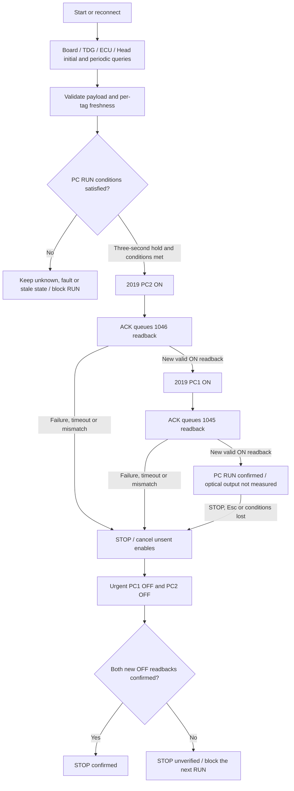

# External Control 2.0.0: branch behavior and evidence boundaries

The analyzed object is the existing local remote reference `origin/feature/empower-independent` at **`4c319aa7ed3a6068c86622b759535dc693c4c056`**. The feature was introduced by **`89de13d0fcb9cefdfc8d4908a628e89e391169ca`**, based on reconstruction commit `2faf7e16f410096f9fe8c987a680cb128dfb5ba2`. The three later commits change CI, dependencies, tests and documents; no `spitfire/` runtime file differs between the introduction and analyzed tip. This is an immutable-object review, not a fresh query of the current remote branch.

No equipment calls, remote operations, test execution, branch switching or runtime edits were performed for this analysis. Current user prohibitions on HV ON and RUN were preserved. The control paths below describe source code and are not an instruction to operate equipment.

## EXT2-BRANCH: evidence labels

- **CODE VERIFIED**: immutable implementation, test or repository-document contents inspected. A documented execution claim is not automatically execution-verified.
- **XP/LOG VERIFIED**: distinguish `ORIGINAL_PE_EMULATION` (original 32-bit PE static analysis, disassembly or Unicorn comparison) from `SAVED_LOG` (saved log contents). Neither means the software ran on an actual XP system. External2 XP equipment operation remains **UNKNOWN**.
- **MANUAL**: manufacturer or supplied equipment-manual evidence only. This analysis introduces no such manual evidence; repository CI reports do not receive this grade.
- **INFERRED**: a conclusion derived from evidence with separately stated scopes.
- **UNKNOWN**: matching execution, environment or physical behavior was not established.

## Keep External2 separate from PY_SPF_1.0

| Area | External Control 2.0.0 | Immutable evidence |
|---|---|---|
| Product | `spitfire-external-control` 2.0.0, dedicated Empower-independent application | [pyproject:5–9](https://github.com/El-Carretero/PY_SPF/blob/4c319aa7ed3a6068c86622b759535dc693c4c056/pyproject.toml#L5-L9) |
| Ordinary initialization and polling | Query-only queues; no automatic `2036` write, EMP startup traffic or original `2054 RES12` side effect. Reconnection with unresolved prior PC operation can reissue owed PC OFF cleanup | [scheduling:117–133](https://github.com/El-Carretero/PY_SPF/blob/4c319aa7ed3a6068c86622b759535dc693c4c056/spitfire/scheduling.py#L117-L133), [external_state:263–289](https://github.com/El-Carretero/PY_SPF/blob/4c319aa7ed3a6068c86622b759535dc693c4c056/spitfire/external_state.py#L263-L289), [controller:147–155](https://github.com/El-Carretero/PY_SPF/blob/4c319aa7ed3a6068c86622b759535dc693c4c056/spitfire/controller.py#L147-L155) |
| Opt-out | Retains `1068` readback. An explicit action permits `2036=1` only, with **fresh HV OFF** checked at acceptance and final dispatch | [controller:405–410](https://github.com/El-Carretero/PY_SPF/blob/4c319aa7ed3a6068c86622b759535dc693c4c056/spitfire/controller.py#L405-L410), [controller:462–475](https://github.com/El-Carretero/PY_SPF/blob/4c319aa7ed3a6068c86622b759535dc693c4c056/spitfire/controller.py#L462-L475) |
| RUN/STOP | Blocks original global `2027 ON` / `2028 OFF`; uses PC channel sequencing | [external_policy:47–114](https://github.com/El-Carretero/PY_SPF/blob/4c319aa7ed3a6068c86622b759535dc693c4c056/spitfire/external_policy.py#L47-L114), [controller:548–568](https://github.com/El-Carretero/PY_SPF/blob/4c319aa7ed3a6068c86622b759535dc693c4c056/spitfire/controller.py#L548-L568) |
| Fault Reset | `2049 ECU → 2052 TDG → 2050 board reset`; excludes `2044 EMP` reset, inserts independent readbacks | [external_policy:16–20](https://github.com/El-Carretero/PY_SPF/blob/4c319aa7ed3a6068c86622b759535dc693c4c056/spitfire/external_policy.py#L16-L20), [controller:585–599](https://github.com/El-Carretero/PY_SPF/blob/4c319aa7ed3a6068c86622b759535dc693c4c056/spitfire/controller.py#L585-L599) |

Do not apply the reconstruction/post2/1.0 default-on Opt-out behavior without an HV OFF prerequisite to External2. Likewise, do not transfer the 1.0 physical soak to this branch: that report identifies exact 1.0 source hashes, `production native read_only` and zero physical writes. The evidence does not validate External2 actuator operations. **INFERRED**: [1.0 report:93–111](https://github.com/El-Carretero/PY_SPF/blob/cebcc28490f48e9e5d4d1c2e2feef34d638244e7/analysis/release_1_0_validation.json#L93-L111), [1.0 coverage limits:146–161](https://github.com/El-Carretero/PY_SPF/blob/cebcc28490f48e9e5d4d1c2e2feef34d638244e7/analysis/release_1_0_validation.json#L146-L161).

External2 also retains the older Native outer loop `ProcessSystemEvents→controller.tick`, receives only during startup or an inflight request, and retains a conditional modal-warning reconnect path. The 1.0 Native event-pump/pause recovery changes are therefore not automatically present here. This is **CODE VERIFIED**, not an External2 field reproduction: [native:397–405](https://github.com/El-Carretero/PY_SPF/blob/4c319aa7ed3a6068c86622b759535dc693c4c056/spitfire/native.py#L397-L405), [receive:210–219](https://github.com/El-Carretero/PY_SPF/blob/4c319aa7ed3a6068c86622b759535dc693c4c056/spitfire/controller.py#L210-L219), [reconnect:243–255](https://github.com/El-Carretero/PY_SPF/blob/4c319aa7ed3a6068c86622b759535dc693c4c056/spitfire/controller.py#L243-L255).

## Control flow: CODE VERIFIED

Ordinary initialization queues queries only. This is not a promise of zero writes during unresolved-operation recovery: reconnect can resume owed PC OFF cleanup (controller 147–155). Policy rejects EMP/MIL requests, global ON/OFF, raw or separator injection, NBWD/NENA and enabling protection overrides. Requests are validated at acceptance, dequeue and final send. [policy:47–114](https://github.com/El-Carretero/PY_SPF/blob/4c319aa7ed3a6068c86622b759535dc693c4c056/spitfire/external_policy.py#L47-L114), [dequeue:135–147](https://github.com/El-Carretero/PY_SPF/blob/4c319aa7ed3a6068c86622b759535dc693c4c056/spitfire/scheduling.py#L135-L147), [final send:169–179](https://github.com/El-Carretero/PY_SPF/blob/4c319aa7ed3a6068c86622b759535dc693c4c056/spitfire/controller.py#L169-L179).

RUN requires Opt-out `1`; TCU/Head Opt-out `0`; overrides `0`; valid and fresh independent communications, fault and timing readbacks; EXT sources; positive measured seed frequency; BWD and ENA gating; Device HV already ON; positive measured HV1/HV2; and both PCs initially OFF. Freshness is `max(5s, request_timeout×3)`, therefore **6s** with the default 2 s timeout. An ACK alone does not update readback facts or confirm output. [timeout/freshness:31–35](https://github.com/El-Carretero/PY_SPF/blob/4c319aa7ed3a6068c86622b759535dc693c4c056/spitfire/controller.py#L31-L35), [eligibility:201–239](https://github.com/El-Carretero/PY_SPF/blob/4c319aa7ed3a6068c86622b759535dc693c4c056/spitfire/external_state.py#L201-L239), [sequence/readback:548–568](https://github.com/El-Carretero/PY_SPF/blob/4c319aa7ed3a6068c86622b759535dc693c4c056/spitfire/controller.py#L548-L568).

STOP does not turn off the external pump or HV supply. It prioritizes both PC OFF requests, retains the second OFF after failure of the first, and carries unverified cleanup across reconnects. Already transmitted requests cannot be retroactively canceled. [reconnection cleanup:116–155](https://github.com/El-Carretero/PY_SPF/blob/4c319aa7ed3a6068c86622b759535dc693c4c056/spitfire/controller.py#L116-L155), [STOP/readback:527–583](https://github.com/El-Carretero/PY_SPF/blob/4c319aa7ed3a6068c86622b759535dc693c4c056/spitfire/controller.py#L527-L583), [urgent queue:73–115](https://github.com/El-Carretero/PY_SPF/blob/4c319aa7ed3a6068c86622b759535dc693c4c056/spitfire/scheduling.py#L73-L115).

Reset is rejected during an active PC operation and never starts RUN automatically. BWD Reset uses the separate original callback: `2018 TDG:RESBWD → 1066`. Existence of that code path does not establish a successful physical BWD latch clearance. [Reset acceptance:415–422](https://github.com/El-Carretero/PY_SPF/blob/4c319aa7ed3a6068c86622b759535dc693c4c056/spitfire/controller.py#L415-L422), [BWD callback:202–203](https://github.com/El-Carretero/PY_SPF/blob/4c319aa7ed3a6068c86622b759535dc693c4c056/spitfire/callbacks.py#L202-L203).

## UI, communications and logging: CODE VERIFIED

Empower Setup/Service panels 8/9 and dependent controls remain constrained after later access-level changes. The External decoder removes legacy automatic writes. Unknown or active independent subsystem faults are not replaced with healthy values. [UI constraints:8–60](https://github.com/El-Carretero/PY_SPF/blob/4c319aa7ed3a6068c86622b759535dc693c4c056/spitfire/external_ui.py#L8-L60), [decoder/health:263–316](https://github.com/El-Carretero/PY_SPF/blob/4c319aa7ed3a6068c86622b759535dc693c4c056/spitfire/external_state.py#L263-L316).

TCP is a status interface, loopback by default. `TEMP_STATUS?` returns `nan, nan, nan, nan, -1`; `ECU_STATUS?` uses a validated fresh snapshot. Legacy `TDG_STATUS?` fields are last GUI values and are not sufficient evidence to permit PC output. This bridge does not forward device commands. [TCP boundary tests:14–63](https://github.com/El-Carretero/PY_SPF/blob/4c319aa7ed3a6068c86622b759535dc693c4c056/tests/test_external_tcp.py#L14-L63), [contract and limits:48–77](https://github.com/El-Carretero/PY_SPF/blob/4c319aa7ed3a6068c86622b759535dc693c4c056/EXTERNAL_PUMP.ko.md#L48-L77).

Responses must match the configured peer and current tag; pending datagrams are drained before the next send. IDs identify command types, not unique transactions: an older same-ID reply arriving **after** a new send remains ambiguous. Readback confirmation is not optical output or synchronization measurement. [UDP:155–203](https://github.com/El-Carretero/PY_SPF/blob/4c319aa7ed3a6068c86622b759535dc693c4c056/spitfire/protocol.py#L155-L203), [response handling:279–307](https://github.com/El-Carretero/PY_SPF/blob/4c319aa7ed3a6068c86622b759535dc693c4c056/spitfire/controller.py#L279-L307), [scope:92–100](https://github.com/El-Carretero/PY_SPF/blob/4c319aa7ed3a6068c86622b759535dc693c4c056/EXTERNAL_PUMP.ko.md#L92-L100).

Logging uses fresh independent snapshots in `external_datalog.csv`, replacing Empower-current/LBO-temperature semantics. Parser/UI unit conventions do not establish sensor calibration or firmware-specific bare-value units; those remain **UNKNOWN**. [logging:613–642](https://github.com/El-Carretero/PY_SPF/blob/4c319aa7ed3a6068c86622b759535dc693c4c056/spitfire/controller.py#L613-L642), [numeric/unit rules:144–150](https://github.com/El-Carretero/PY_SPF/blob/4c319aa7ed3a6068c86622b759535dc693c4c056/spitfire/external_state.py#L144-L150).

## Recorded results versus configured validation

| Primary label and facet | Inspected evidence | Scope |
|---|---|---|
| **XP/LOG VERIFIED** · `ORIGINAL_PE_EMULATION` | [original callback 395 cases](https://github.com/El-Carretero/PY_SPF/blob/4c319aa7ed3a6068c86622b759535dc693c4c056/analysis/native_callback_extended_results.json#L1-L6), [decoder 338 cases](https://github.com/El-Carretero/PY_SPF/blob/4c319aa7ed3a6068c86622b759535dc693c4c056/analysis/native_decoder_oracle_results.json#L1-L4) | Original32-bit PE under Unicorn with intercepted CVI/CRT. Reference evidence, not External2 execution, actual XP or physical testing |
| **XP/LOG VERIFIED** · `SAVED_LOG` | [saved pytest:141 tests + 71 subtests](https://github.com/El-Carretero/PY_SPF/blob/4c319aa7ed3a6068c86622b759535dc693c4c056/validation/external/pytest.txt#L1-L3) | Historical Linux/offscreen simulator or loopback; not rerun here and not XP evidence |
| **XP/LOG VERIFIED** · `SAVED_LOG` | [wheel operation log](https://github.com/El-Carretero/PY_SPF/blob/4c319aa7ed3a6068c86622b759535dc693c4c056/validation/external/wheel-workflow.json#L1-L17), [package and 8 Qt panels](https://github.com/El-Carretero/PY_SPF/blob/4c319aa7ed3a6068c86622b759535dc693c4c056/validation/external/package-check.json#L1-L14) | Recorded HV/PC writes are simulated; `physical_validation=false`, `windows_ni_execution=false` |
| **CODE VERIFIED** · document contents | [documented Linux153 tests + 71 subtests](https://github.com/El-Carretero/PY_SPF/blob/4c319aa7ed3a6068c86622b759535dc693c4c056/CI_VALIDATION.ko.md#L79-L84) | The document reports this later result. Underlying execution is **UNKNOWN** here; do not substitute it for the saved 141-test log or a hosted CI result |
| **CODE VERIFIED** | [Windows/Linux x64 Qt matrix](https://github.com/El-Carretero/PY_SPF/blob/4c319aa7ed3a6068c86622b759535dc693c4c056/.github/workflows/external-validation.yml#L17-L61), [Windows x86 native-boundary](https://github.com/El-Carretero/PY_SPF/blob/4c319aa7ed3a6068c86622b759535dc693c4c056/.github/workflows/external-validation.yml#L63-L96) | Workflow configuration. Hosted run success at this commit is **UNKNOWN** in this review |
| **CODE VERIFIED** | [Python loopback/audit and NI-DLL guard](https://github.com/El-Carretero/PY_SPF/blob/4c319aa7ed3a6068c86622b759535dc693c4c056/tools/ci_guard.py#L16-L78), [CI runner](https://github.com/El-Carretero/PY_SPF/blob/4c319aa7ed3a6068c86622b759535dc693c4c056/tools/ci_validate.py#L85-L145) | Native-boundary uses mocks/headless simulation; no NI DLL initialization or UIR display. The guard is not an OS firewall |
| **UNKNOWN** | [explicit physical/Windows-NI/optics exclusions](https://github.com/El-Carretero/PY_SPF/blob/4c319aa7ed3a6068c86622b759535dc693c4c056/VALIDATION_EXTERNAL.ko.md#L23-L26) | External2 equipment behavior, firmware Opt-out compatibility, external pump, optical output/timing, actual XP operation |

Do not add original PE/Unicorn case counts, earlier reconstruction screenshots or 1.0 physical read-only observations to External2 physical-success counts. The saved 141 tests also include inherited reconstruction tests rather than 141 new External-feature cases. [inherited tests and same-ID limit:53–61](https://github.com/El-Carretero/PY_SPF/blob/4c319aa7ed3a6068c86622b759535dc693c4c056/VALIDATION_EXTERNAL.ko.md#L53-L61).

Registry ID: `EXT2-BRANCH`. Item-level records correspond to the separate analysis inventory `ext2-evidence.json`; every source link above uses an immutable commit, path and line range.
