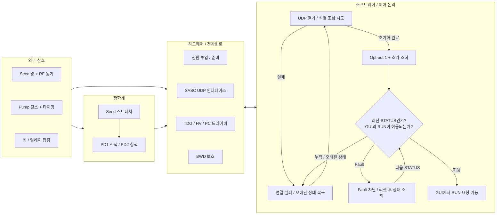
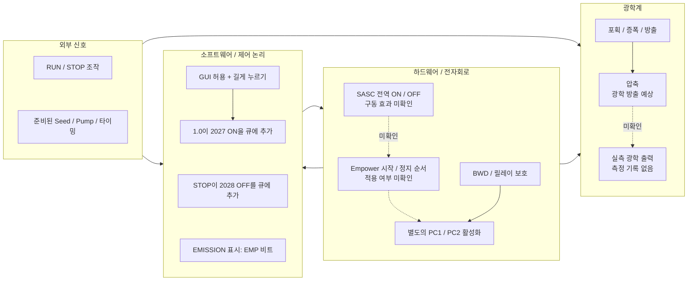
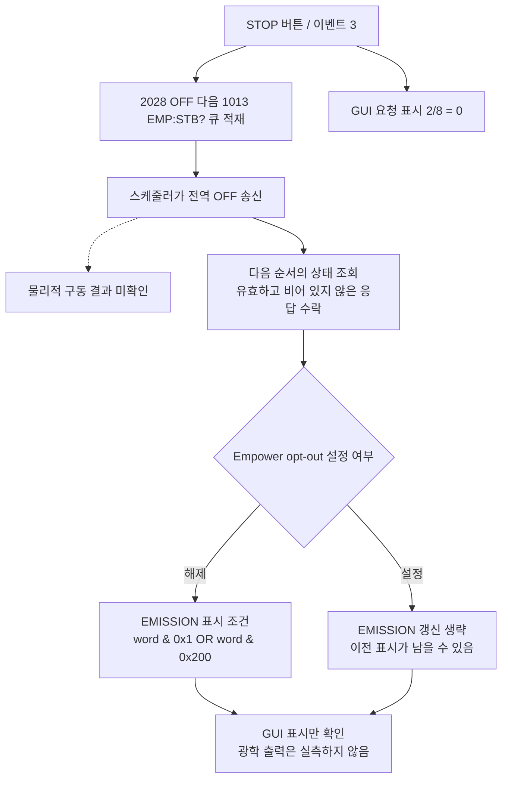

# 1. 통합 운전: 전원 투입부터 예상 광학 방출까지

## 1.1 메인 흐름이 설명하는 범위

메인 도면은 문서에 기술된 하드웨어 기능과 실제 분석한 소프트웨어를 결합한다. 영역 사이의 화살표는 인터페이스를 나타낸다. 개별 신호와 보호 기능의 관계는 도면 2에서 상세히 설명한다. 연결되지 않은 하드웨어 항목을 숨겨진 순차 기동 프로그램으로 해석해서는 안 된다. 이 도면은 **근거에 기반한 기능 관계도**이며, 인증된 배선도나 기동 SOP가 아니다. 물리적인 전원, Seed 준비, Pump 준비, 키와 릴레이 접점은 외부에서 발생하는 사건이다. Python 실행이 이를 수행하지 않는다. 제공된 Spitfire Pro 매뉴얼을 대상 SPTF-100F-1KHPR에 정확히 적용할 수 있는지는 **UNKNOWN**이다.

그림 1A–1B의 소프트웨어 기준은 **Native PY_SPF 1.0**, 커밋 `cebcc284`이다. 복원된 XP 동작, 현재 Python 동작, 제조사 설명 및 기록된 실장비 응답을 서로 같은 것으로 취급하지 않는다.

### 메인 도면 근거표

그림 1A의 UDP 초기화는 C1, opt-out과 초기 조회는 C3, 최신 상태 및 GUI 허용 판단은 C2/C4, 리셋은 C5, 관측된 보드 통신은 P01, 외부 준비와 하드웨어 기능은 M1–M4에 근거한다. 그림 1B의 RUN/STOP 요청은 C6, EMISSION 표시는 C7, 제조사가 설명하는 활성화 및 광학 경로는 M1/M2/M4, 관측하지 못한 펌웨어·광학 경계는 U1에 해당한다. 그림 1C의 STOP 콜백은 C8, 상태 해석기는 C7, 검증되지 않은 물리적 결과는 U1에 근거한다. 이 참조는 도면 요소 안에 넣지 않고 여기에서 관리한다.

| 키 | 등급 | 정확한 참조 및 주장 범위 |
|---|---|---|
| C1 | CODE VERIFIED | [제어기 초기화 174–235줄](https://github.com/El-Carretero/PY_SPF/blob/cebcc28490f48e9e5d4d1c2e2feef34d638244e7/spitfire/controller.py#L174-L235), [초기 시도 150–177줄](https://github.com/El-Carretero/PY_SPF/blob/cebcc28490f48e9e5d4d1c2e2feef34d638244e7/spitfire/scheduling.py#L150-L177): UDP 열기와 원본 방식의 식별 조회 3회이며, 하드웨어 자가 시험이 아니다. |
| C2 | CODE VERIFIED | [제어기 436–550줄](https://github.com/El-Carretero/PY_SPF/blob/cebcc28490f48e9e5d4d1c2e2feef34d638244e7/spitfire/controller.py#L436-L550): 재시도, 무응답 시 재접속, 오래된 STATUS 및 GUI 허용 처리. |
| C3 | CODE VERIFIED | [초기·폴링 큐 78–121줄](https://github.com/El-Carretero/PY_SPF/blob/cebcc28490f48e9e5d4d1c2e2feef34d638244e7/spitfire/scheduling.py#L78-L121): 기본 보드 opt-out 쓰기, 상태 회신, 우선순위 큐 및 폴링 순서. |
| C4 | CODE VERIFIED | [STATUS 해석과 상태 점검 228–236 및 329–351줄](https://github.com/El-Carretero/PY_SPF/blob/cebcc28490f48e9e5d4d1c2e2feef34d638244e7/spitfire/decoders.py#L228-L351): STATUS 비트 0이 원본 방식의 RUN·채널 GUI 차단을 결정한다. |
| C5 | CODE VERIFIED / XP/LOG VERIFIED | [리셋 콜백 290–291줄](https://github.com/El-Carretero/PY_SPF/blob/cebcc28490f48e9e5d4d1c2e2feef34d638244e7/spitfire/callbacks.py#L290-L291), [연속 요청 근거](../evidence/fault_burst_summary.json), [단회 시험](../evidence/reset_retest_summary.json): 리셋 수신 확인과 복구 상태 회신은 별개의 관측이다. |
| C6 | CODE VERIFIED / XP/LOG VERIFIED | [RUN 이벤트 194–198줄](https://github.com/El-Carretero/PY_SPF/blob/cebcc28490f48e9e5d4d1c2e2feef34d638244e7/spitfire/callbacks.py#L194-L198), [길게 누를 때 ON 처리 738–749줄](https://github.com/El-Carretero/PY_SPF/blob/cebcc28490f48e9e5d4d1c2e2feef34d638244e7/spitfire/controller.py#L738-L749), 3장의 원본 콜백·작업 루틴 근거: 명령 생성을 설명하며, 관측된 광학 방출을 뜻하지 않는다. |
| C7 | CODE VERIFIED | [Empower 해석기 270–292줄](https://github.com/El-Carretero/PY_SPF/blob/cebcc28490f48e9e5d4d1c2e2feef34d638244e7/spitfire/decoders.py#L270-L292): Empower ON/COUNT 비트에 따른 GUI `EMISSION` 표시. opt-out이면 갱신을 건너뛴다. |
| C8 | CODE VERIFIED | [STOP 콜백 200–201줄](https://github.com/El-Carretero/PY_SPF/blob/cebcc28490f48e9e5d4d1c2e2feef34d638244e7/spitfire/callbacks.py#L200-L201): 이벤트 3은 전역 OFF와 Empower 상태 조회를 순서대로 큐에 넣고 GUI 요청 표시를 해제한다. |
| M1 | MANUAL | MAN-330A, 인쇄 6-1–6-2 / PDF 61–62: 작업자 준비, Seed·PD 확인, Pump RUN 및 이후 별도의 PC 활성화. |
| M2 | MANUAL | 인쇄 3-9–3-10 / PDF 41–42: 광 펄스 포획, 이득, 방출 및 타이밍 기준. |
| M3 | MANUAL | 인쇄 4-3–4-6 / PDF 49–52: TDG 전원·드라이버, 키, BWD 및 커넥터 경로. |
| M4 | MANUAL | 인쇄 6-9–6-10 / PDF 69–70: 매뉴얼상 Pump RUN/STOP, PD 표시 및 릴레이 리셋. |
| P01 | XP/LOG VERIFIED | 관측된 보드 측 UDP 기록과 식별 응답. 정리한 출처 경로와 해시는 `evidence/source_registry.json` 참조. |
| U1 | UNKNOWN | 설치된 펌웨어의 전역 ON/OFF 전체 구동 순서, 상세 내부 버스 및 독립적인 광학 입증 자료는 제공되지 않았다. |

## 1.2 전원 투입, 외부 입력 및 소프트웨어 준비

그림 1A는 네 개의 영역을 구분한다. 수동으로 준비하는 Seed와 Pump 경로는 PC 초기화 코드에서 시작되지 않는다. SASC 종단점은 관측된 보드 측 인터페이스다. 이 인터페이스와 각각의 TDG·Empower 동작 사이의 내부 연결을 실측 회로처럼 재구성하지 않았다.

Native 1.0의 `gui_ready`는 현재 연결·STATUS 경로의 유효성을 나타낸다. `check_health`는 별도로 STATUS 비트 0이 설정되면 RUN을 비활성화한다. 도면의 **GUI에서 RUN 요청 가능**은 두 표시 조건을 모두 충족한다는 분석용 표현이며, 장비가 보고하는 READY 열거값이 아니다. 관측 기록에서 `STATUS=2`, `COMSTATUS=0`과 `TDG:STBH?=0x00330409`가 함께 나타났다. 따라서 일반 Fault 해제가 BWD 해제를 입증하지는 않는다. **XP/LOG VERIFIED:** 제한된 리셋 시험은 `evidence/reset_retest_summary.json`에 있다.

원본 방식의 해석기는 STATUS 비트 1이 설정되면 PC 토글이 해제된 값을 예측해 표시하고 `RES12`를 요청하기도 한다. 캐시된 값이나 예측된 GUI 값은 실제 채널의 조회 응답이 아니다. 읽기 전용·허용 명령 제한 진단에서는 이러한 자동 쓰기를 억제했으며, 예측된 PC LED를 하드웨어 판단에서 제외했다.

## 1.3 RUN, 활성화 및 광학적 결과

그림 1B는 소프트웨어 명령과 제조사가 설명하는 정상 광학 경로를 구분한다. **전역 `ON` 예시는 장비에 에너지를 인가하는 명령의 참조이며, 실행 지시가 아니다.** 정리된 자료에 실제 ON부터 광학 출력까지의 캡처가 있다고 주장하지 않는다. 매뉴얼은 Empower 구성을 설명한다. 해당 Pump 순서가 Native 1.0 opt-out 또는 외부 펌프 사용 시의 펌웨어 동작과 같다고 가정하지 않는다.

Native 1.0의 길게 누르기 작업 루틴은 **정수 초** 차이가 3을 엄격히 초과한 뒤 전역 `ON`을 큐에 추가한다. 버튼을 놓거나 메뉴가 개입하면 대기 중인 시작 요청을 취소한다. 매뉴얼의 전체 Pump·셔터·출력 상승 순서를 코드 자체가 구현하는 것은 아니다. 해석된 제어 값은 Seed 도달, Pump 발사 또는 PC 드라이버 스위칭의 증거가 아니다. 백엔드의 길게 누르기 작업 루틴은 GUI의 모든 Fault 비활성화 조건을 독립적으로 다시 검사하지 않는다. 따라서 콜백을 직접 주입하면 비활성화된 버튼의 정상 경로를 우회할 수 있다. 실장비 확인에서는 이러한 주입으로 RUN을 가동하지 않았다. 자세한 내용은 3장과 4장에 있다.

매뉴얼의 정상 절차에서는 Pump 시작 후 PC1/PC2를 활성화한다(인쇄 6-2). 녹색 RUN 버튼이나 Pump의 `EMISSION` 막대를 증폭된 Spitfire 출력과 동일시하지 않는다. Python 해석기에서 해당 막대는 Empower `1013`의 ON/COUNT 비트를 따르며, Empower opt-out이 설정되면 갱신되지 않는다. 숨겨지거나 이전 상태가 남은 막대만으로 출력 빔의 유무를 입증할 수 없다.

STOP/OFF를 **모든 에너지 제거**로 일반화해서는 안 된다. 매뉴얼상 STOP은 Pump 다이오드를 끄고 셔터를 닫지만, Seed, TDG HV 전원 또는 독립 제어되는 외부 펌프까지 꺼졌음을 의미하지 않는다. BWD에 의한 트리거 차단과 외부 인터록에 의한 HV 제거는 제조사가 설명하는 서로 다른 보호 기능이며, 그림 2B에서 별도로 다룬다. 일반적인 소프트웨어 Fault만으로 어느 물리적 보호가 작동했는지 확정할 수 없다.

### STOP과 표시 갱신의 명시적 경로

그림 1C는 Native STOP 콜백과 이후의 표시 갱신 경로를 명시한다. **CODE VERIFIED:** C8, C7 및 4장에서 설명하는 스케줄러에 근거한다. 이벤트 3은 `2028 OFF` 다음에 `1013 EMP:STB?`를 큐에 넣고, 즉시 GUI `2/8=0`으로 설정한다. 쓰기 수신 확인은 반드시 성공해야 하는 허용 조건이 아니다. 응답 대기·유예 구간 이후에는 스케줄러가 조회를 진행할 수 있다. 수락된 유효한 비어 있지 않은 상태 응답만이 도면의 해석기 입력이 된다. `1013`에는 STATUS와 같은 별도의 응답 경과 시간 검사가 없다. Esc의 경로는 다르다. `2028`을 큐에 넣고 요청 표시를 해제하지만, 이 즉시 후속 `1013` 조회는 수행하지 않는다. 이러한 소프트웨어 동작만으로 펌웨어의 물리적 OFF 순서나 모든 에너지의 제거를 입증할 수는 없다.

## 1.4 실패, 복구 및 최종 확인 범위

| 조건 | 확인된 응답 | 복구 판단의 한계 |
|---|---|---|
| UDP 열기·초기화 실패 | CODE VERIFIED: 1.0은 연결 표시를 비활성화하고, 횟수가 제한된 시도와 재시도·재접속 경로를 사용한다. | 이후 응답을 수락한 것은 통신 관측이며, 하드웨어 자가 시험 결과가 아니다. |
| 최신 STATUS 없음 | CODE VERIFIED: 1.0은 제어를 비활성화하고 대기 중인 구동 요청을 취소한다. 기존 장비 출력이 OFF라는 증거는 아니다. | 정해진 복구 경로에서 최신 STATUS를 확보한다. 오래된 ON 요청을 다시 실행해서는 안 된다. |
| 일반 Fault / RUN 차단 | CODE VERIFIED: STATUS 비트 0이 원본 방식의 GUI RUN·채널 허용에 영향을 준다. | 원인과 정확한 펌웨어 응답은 개별 근거가 필요하다. 리셋 ACK만으로 원인 제거를 입증하지 못한다. |
| BWD 임계값 위반 | MANUAL: 어느 한 광검출기라도 임계값 아래이면 PC 트리거 선택을 차단한다. | 원인이 된 광학 조건을 복구하고 두 PD 표시를 확인한 후 릴레이를 리셋한다. GUI 범위에서 공장 임계값을 추정하지 않는다. |
| TDG 외부 인터록 열림 | MANUAL: PC 고전압을 즉시 제거한다. Seed와 Pump는 계속 동작할 수 있다. | 설치 배선과 승인된 복구 절차를 확인해야 한다. 본 보고서는 우회 절차를 제공하지 않는다. |
| Fault Reset 반복 | XP/LOG VERIFIED: 정상 ACK가 수신되는 동안 우선순위 큐의 처리 독점으로 STATUS가 지연됐고, 마지막 대기 리셋이 취소됐다. | 소프트웨어 스케줄링 결함을 어댑터 이상이나 광학 Fault와 구분한다. 본 보고서에서는 실행 코드를 수정하지 않는다. |
| 출력 근거 없음 | UNKNOWN: 독립적인 광학 출력 측정 기록이 제공되지 않았다. | 마지막 노드를 검증된 방출 대신 **광학 방출 예상(Emission Expected)**으로 유지한다. |

제조사의 BWD는 광학 대역폭 보호 기능이며, Ethernet 워치독이 아니다. 내부 전자 타이밍만으로 광검출기에 정상 Seed 스펙트럼이 들어오는 조건을 대신할 수 없다. 통신 ACK, GUI 인터록 표시 및 실측 광 펄스는 각각 별도의 근거 기록으로 관리해야 한다.
