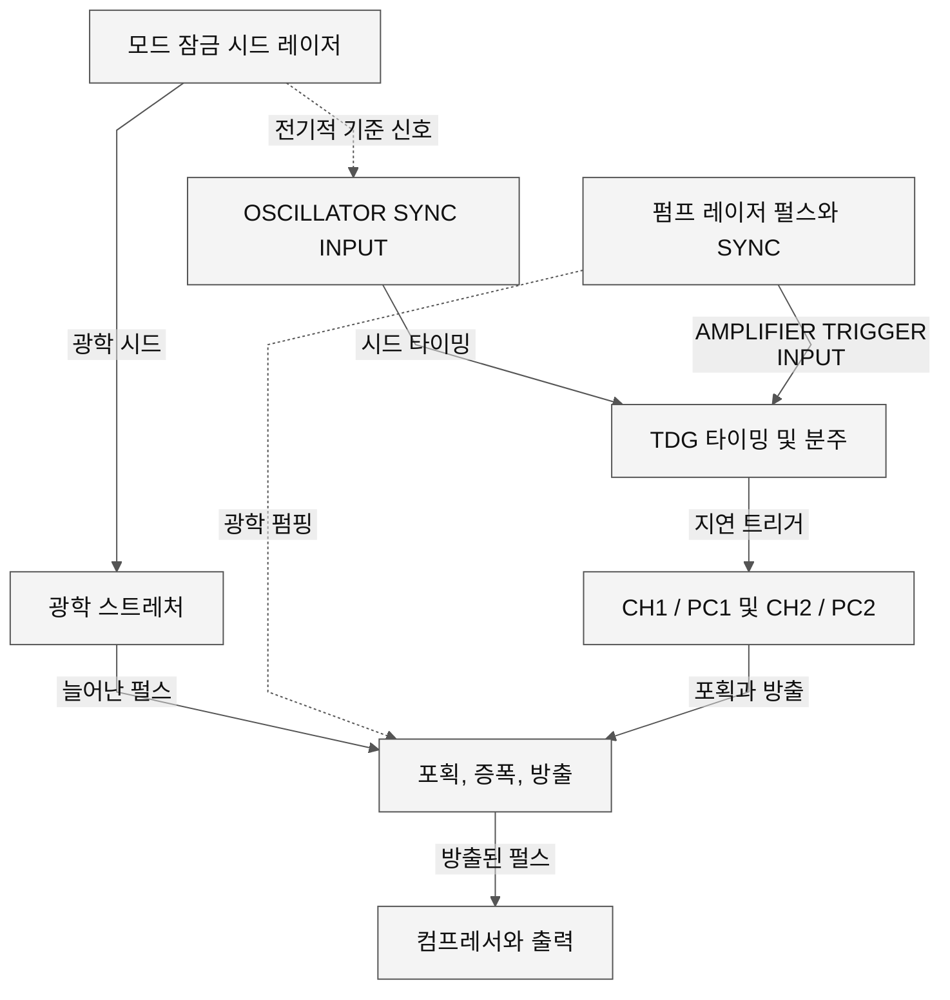
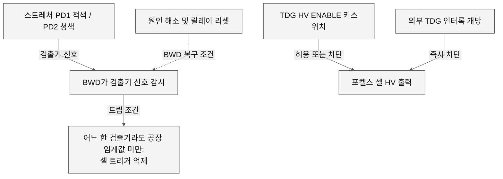

# 2. 광학 타이밍과 인터록의 경계

문서에 설명된 증폭기는 광학 시드와 정확한 타이밍의 전기 신호를 모두 필요로 한다. 정상적인 Ethernet 링크, 읽을 수 있는 TDG 레지스터, 활성화된 GUI 제어 항목만으로는 늘어난 펄스가 포획·증폭·방출·재압축되었다고 입증할 수 없다. 이 절에서는 이러한 관측과 제조업체가 설명한 보호 기능을 구분한다.

## 2.1 적용 범위와 근거

제공된 제조업체 매뉴얼은 **MAN-330A**, *Spitfire Pro Ti:Sapphire Regenerative Amplifier Systems*, 부품 번호 0000-330A, Rev. A, 2005년 1월판이다. 표지와 서문에 명시된 모델은 **Spitfire Pro F, Pro 40F, Pro PM**이다. 사용자 장비의 식별 정보는 **2005 SPTF-100F-1KHPR**이다. 명판 모델과 매뉴얼 모델의 대응 자료, 최초 출하 보고서, 설치된 TDG/펌프 배선 기록은 제공되지 않았다. 따라서 각 Pro 전용 커넥터, 임계값, 동작 순서, 사양이 해당 장비에 그대로 적용되는지는 **UNKNOWN**이다. 제조 시기가 비슷하고 GUI 용어를 공유한다는 사실만으로 동일성이 입증되지는 않는다. 매뉴얼의 사양보다 구매 주문서의 사양이 우선한다는 조건도 있다(인쇄면 3-11, PDF 43쪽).

여기서 근거 등급 **MANUAL**은 제조업체의 설명, **CODE VERIFIED**는 고정된 Python 소스에서 확인한 동작, **XP/LOG VERIFIED**는 이 보고서의 다른 부분에서 식별한 캡처 관측, **INFERRED**는 추론임을 명시한 연결, **UNKNOWN**은 제공된 자료로 입증되지 않은 사항을 뜻한다. **CODE VERIFIED**는 조사하지 않은 컨트롤러 펌웨어의 동작이나 전기적 응답을 입증하지 않는다. 이 절에서는 **XP/LOG VERIFIED** 등급의 광출력 측정 결과를 제시하지 않는다.

| 근거 ID | 등급 | 출처와 범위 |
|---|---|---|
| M-3.9 | MANUAL | MAN-330A, 인쇄면 3-9, PDF 41쪽: 재생 증폭의 포획, 반복 증폭, 방출. |
| M-3.10 | MANUAL | 인쇄면 3-10, PDF 42쪽: 시드 RF 기준, 펌프의 TTL 상승 에지 트리거, PC1/PC2 지연, 실험 장비용 SYNC. |
| M-4.1 | MANUAL | 인쇄면 4-1, PDF 47쪽: 헤드 엄빌리컬과 별도의 증폭기 공진기 포토다이오드 커넥터. |
| M-4.3 | MANUAL | 인쇄면 4-3, PDF 49쪽: TDG HV 전원, 헤드 장착 드라이버, HV 키스위치와 표시등. |
| M-4.4 | MANUAL | 인쇄면 4-4, PDF 50쪽: BWD 검출기 기능, 모델별 공장 설정 임계값, 그림 4-5. |
| M-4.5 | MANUAL | 인쇄면 4-5, PDF 51쪽: 펌프 트리거 입력과 별도의 외부 TDG 인터록. |
| M-4.6 | MANUAL | 인쇄면 4-6, PDF 52쪽: 시드 동기화 연결, CH1/CH2 출력, 통신 커넥터. |
| M-6.2 | MANUAL | 인쇄면 6-2, PDF 62쪽: 펌프 시작과 이후의 PC1/PC2 활성화는 별도 단계. |
| M-6.8 | MANUAL | 인쇄면 6-8, PDF 68쪽: GUI는 시드 레이저를 작동시키지 않으며, 통신 표시등에는 별도의 의미가 있음. |
| M-6.9 | MANUAL | 인쇄면 6-9, PDF 69쪽: RUN/STOP, EMISSION, COUNT, RAMPING, 채널 제어. |
| M-6.10 | MANUAL | 인쇄면 6-10, PDF 70쪽: PD1/PD2의 의미와 BWD 릴레이 리셋. |
| M-6.11 | MANUAL | 인쇄면 6-11, PDF 71쪽: Empower Q-switch 소스 모드와 외부 트리거 저주파수 조건. |
| M-6.13–15 | MANUAL | 인쇄면 6-13–6-15, PDF 73–75쪽: 제조업체의 고장 분류와 리셋 설명. |
| M-8.1/3 | MANUAL | 인쇄면 8-1 및 8-3, PDF 87 및 89쪽: 시스템이 일부 동작하더라도 증폭 출력이 없을 수 있는 원인. |
| C-SIG-1 | CODE VERIFIED | [프로토콜 목록, 15–16행](https://github.com/El-Carretero/PY_SPF/blob/cebcc28490f48e9e5d4d1c2e2feef34d638244e7/spitfire/protocol.py#L15-L16): EMP와 TDG는 서로 다른 명령 네임스페이스. |
| C-SIG-2 | CODE VERIFIED | [디코더, 131–165행](https://github.com/El-Carretero/PY_SPF/blob/cebcc28490f48e9e5d4d1c2e2feef34d638244e7/spitfire/decoders.py#L131-L165): 채널 플래그, 오실레이터/트리거 모드, opt-out 읽기 응답. |
| C-SIG-3 | CODE VERIFIED | [디코더, 270–304행](https://github.com/El-Carretero/PY_SPF/blob/cebcc28490f48e9e5d4d1c2e2feef34d638244e7/spitfire/decoders.py#L270-L304): 통신, 펌프 상태, 고장 표시 갱신. |
| C-SIG-4 | CODE VERIFIED | [디코더, 319–344행](https://github.com/El-Carretero/PY_SPF/blob/cebcc28490f48e9e5d4d1c2e2feef34d638244e7/spitfire/decoders.py#L319-L344): TDG 비트와 표시등의 대응 및 소프트웨어 정상 상태 표시. |
| C-SIG-5 | CODE VERIFIED | [콜백, 194–203행](https://github.com/El-Carretero/PY_SPF/blob/cebcc28490f48e9e5d4d1c2e2feef34d638244e7/spitfire/callbacks.py#L194-L203) 및 [RUN 누름 유지, 738–749행](https://github.com/El-Carretero/PY_SPF/blob/cebcc28490f48e9e5d4d1c2e2feef34d638244e7/spitfire/controller.py#L738-L749): 소프트웨어 요청 생성. |

PDF 쪽수는 표지와 앞부분을 포함해 1부터 세는 실제 페이지 번호이다. 매뉴얼 파일의 SHA-256은 `d9bb260827f78a2ed67477043cb3036a26b771aaf19a0c3ec9aa6649449d5e29`이다. 저작권이 있는 매뉴얼 전체를 이 저장소에 복제하지 않았다.

## 2.2 광학 경로와 서로 다른 두 타이밍 기준

그림 2A는 커넥터 핀 배치도나 회로도가 아니라 매뉴얼이 설명하는 기능적 경로이다[M-3.9; M-3.10; M-4.5; M-4.6]. 선은 문서에 근거한 신호 또는 광학적 관계를 나타내며, 측정되지 않은 전압 레벨, 전파 지연, 숨겨진 펌웨어 게이트를 뜻하지 않는다.

**그림 2A.** 시드 기준 신호 케이블과 펌프 트리거 케이블은 서로 다른 역할을 한다. 매뉴얼에 따르면 TDG는 먼저 **펌프의 TTL 상승 에지 펄스**로 트리거되며, 시드 펄스를 선택하기 위해 시드 모드로커 기준 신호에 동기화된다[M-3.10]. 사용자 장비의 절대 지연 보정값, 위상 허용 구간, 펄스 파형, 실제 전기 인터페이스는 **UNKNOWN**이다.

MAN-330A는 **Mai Tai**를 사용할 때 TDG OSCILLATOR SYNC INPUT에 **80 MHz 출력이 아닌 40 MHz 출력**을 연결하도록 명시한다. **Tsunami**는 컨트롤러의 **SYNC가 아닌 MONITOR 출력**을 사용한다[M-4.6]. 이는 매뉴얼이 다루는 구성의 제조업체 연결 요구사항이다. 40 MHz 연결 지시가 시드의 광학 펄스열 자체도 반드시 40 MHz여야 한다는 근거는 아니다. 설치된 시드 모델, 선택한 출력, TDG 보정 상태는 별도로 확인해야 한다. 같은 페이지는 해당 입력의 임피던스가 내부 전환 가능한 50 Ω이고 지터가 250 ps 미만이라고 설명하지만, 사용자 설치에 허용되는 전체 전압/펄스 폭 범위까지 규정하지는 않는다.

매뉴얼은 PC1/CH1을 포획, PC2/CH2를 방출과 연결한다. 0–1000 ns 설정 범위는 제어 범위이며 측정된 타이밍 허용오차가 아니다. DIVISOR는 펌프 동기화 주파수에 대한 증폭기 반복률을 낮춘다. 분주값 응답이나 채널 활성화 상태만으로 광학 펄스 타이밍이 입증되지는 않는다[M-3.10; M-4.6; M-8.1/3].

## 2.3 임의의 통합 게이트를 가정하지 않은 보호 경로

**그림 2B.** 문서에 설명된 별도의 보호 기능들이다[M-4.3; M-4.4; M-4.5; M-6.10]. 이 도면은 공통 AND/OR 회로, 우선순위, 릴레이 코일 극성, 펌프/시드가 공유하는 인터록 배선을 제시하지 않는다. 이러한 세부 사항은 입증되지 않았다. 점선의 복구 화살표는 확인된 회로 경로가 아니라 리셋 조건을 나타낸다.

BWD는 스트레처에서 시드 스펙트럼의 일부를 감지한다. PD1은 적색 쪽, PD2는 청색 쪽에 해당한다. 매뉴얼에 따르면 어느 한 검출기의 신호라도 공장 설정 임계값 아래로 떨어지면 포켈스 셀 트리거가 차단되고 증폭용 펄스가 선택되지 않는다[M-4.4; M-6.10]. 이는 릴레이/리셋 상태가 설명된 검출기 기반 보호 억제 기능이다. 출력 펄스 폭을 직접 측정하는 기능은 아니다. 두 PD 표시등이 모두 켜져 있다는 사실만으로 전체 스펙트럼 품질, 올바른 컴프레서 위치, 안전한 피크 세기가 독립적으로 입증되지는 않는다. 공장 임계값 수치, 아날로그 전달함수, 디바운스 시간, 래치 구현, 대상 하드웨어 보정값은 **UNKNOWN**이다.

TDG 전면 키는 포켈스 셀 HV를 별도로 허용/차단한다. 외부 2핀 TDG 인터록은 정상 닫힘 스위치 회로로 설명된다. 이 회로가 열리면 포켈스 셀 HV가 즉시 꺼지고 증폭 출력이 차단된다. **시드나 펌프 레이저가 꺼지는 것은 아니다.** 매뉴얼은 이들의 인터록을 명확히 별도 회로로 취급한다[M-4.3; M-4.5]. 교체된 외부 펌프를 포함한 사용자 장비의 실제 회로 경로와 상태는 **UNKNOWN**이다. 6절의 설치된 펌프 배선 미확인 항목을 참조한다.

Empower 키스위치, 덮개/사용자 인터록, 냉각, 온도, Q-switch RF/저주파수, 다이오드/드라이버 전기 고장, 통신은 각각 별도의 매뉴얼 설명이 있다[M-6.13–15]. 이들을 하나의 불명확한 Boolean 게이트로 합쳐서는 안 된다. 일부 조건은 명시적인 펌프 고장 표시 및 수동 리셋 요구사항과 연결된다. 다른 조건은 증폭 출력을 억제하지만 모든 방사원이 정지했다고 입증하지는 않는다. 신호별 구분은 [5절](05_signal_reference.md)에 정리한다.

## 2.4 펌프 상태, GUI 상태, 광방출

MAN-330A는 RUN을 약 5초 동안 누르고 유지하는 펌프 시작 요청으로 설명한다. 이후의 순서는 다이오드 어레이 활성화, 적색 EMISSION 바, COUNT/경고음 지연, 펌프 헤드 셔터 개방, 출력 상승을 포함한다. STOP은 펌프 다이오드를 끄고 펌프 내부 셔터를 닫는다[M-6.9]. 시작 절차는 펌프 시작 후에 두 포켈스 셀 채널을 활성화하도록 별도로 설명한다[M-6.2]. 따라서 매뉴얼에서 펌프 발진, PC 채널 활성화, 증폭 출력은 서로 다른 상태이다.

고정된 Python 구현은 네이티브 RUN 누름 이벤트에서 유지 요청을 준비한다. 유지 시간 계산은 `int(now) - int(started) > 3`이며, 조건을 만족하면 태그 2027, `ON`을 큐에 넣는다. STOP은 태그 2028, `OFF`와 펌프 상태 읽기 요청을 큐에 넣는다[C-SIG-1; C-SIG-5]. 이는 **CODE VERIFIED** 등급의 요청 동작이다. 제조업체가 설명한 약 5초의 전체 펌프/셔터 순서를 재현하거나 그 시간을 측정한 것이 아니며, 요청된 동작이 실제로 수행되었다는 근거도 아니다. 이 절의 물리적 주장을 입증하기 위해 이 요청들을 실행하지 않았다.

GUI의 EMISSION, READY/STOP, COUNT, RAMPING, 고장, PD 표시는 반환된 상태 필드와 디코더 규칙에서 생성된다[C-SIG-3; C-SIG-4]. 특히 `ALL SYS OK` 같은 코드상의 문구는 상태 비트에 대한 소프트웨어 해석이며 독립적인 광학 측정이 아니다. 매뉴얼도 증폭 출력 부재나 성능 저하의 가능한 원인으로 BWD, 시드/펌프 동작, 타이밍, 인터록, 드라이버, 정렬 문제를 열거한다[M-8.1/3].

## 2.5 소프트웨어 선택과 물리적 우회 근거의 구분

`EMP:QSW:SOURCE`는 펌프의 Q-switch 소스를 설정한다. 여기서 **INTERNAL**은 Empower 전원장치 내부 클록을 뜻한다[M-6.11]. `TDG:OSC:MODE`와 `TDG:TRIG:MODE`는 서로 다른 TDG 명령 계열이다[C-SIG-1; C-SIG-2]. **INT**라는 단어를 공유한다고 해서 같은 설정은 아니다. TDG INT 모드가 유효한 광학 시드를 합성하거나, BWD 조건을 충족하거나, 설치에 필요한 동기화 신호를 대신한다고 입증하는 자료는 없다.

마찬가지로 `EMPOPTOUT`, `HEDOPTOUT`, `ECUOPTOUT`은 읽기 응답에 따라 GUI 하위 시스템 상태와 표시를 바꾸는 소프트웨어 설정이다[C-SIG-2; C-SIG-3]. 현재 시작 정책은 쓰기 허용 운전에서 Empower opt-out을 설정하며, 자세한 내용은 소프트웨어 흐름 절에서 설명한다. 외부 펌프를 설치한 경우 이 정책이 관련될 수 있으나, **opt-out은 물리적 인터록 우회, 유효한 외부 펌프 트리거, 별도 전원으로 동작하는 펌프의 위험 억제를 입증하지 않는다**. 교체 펌프, 해당 셔터, 트리거 케이블, 인터록 회로, 전기 레벨, 고장 전파는 모델에 맞는 배선 자료와 측정으로 확인되기 전까지 **UNKNOWN**이다.
