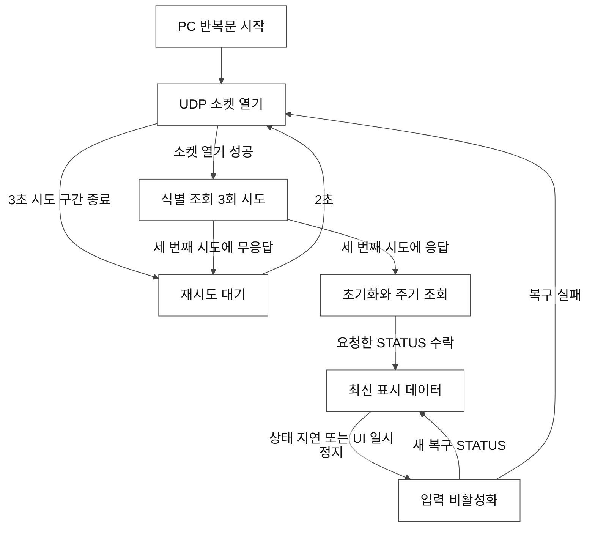
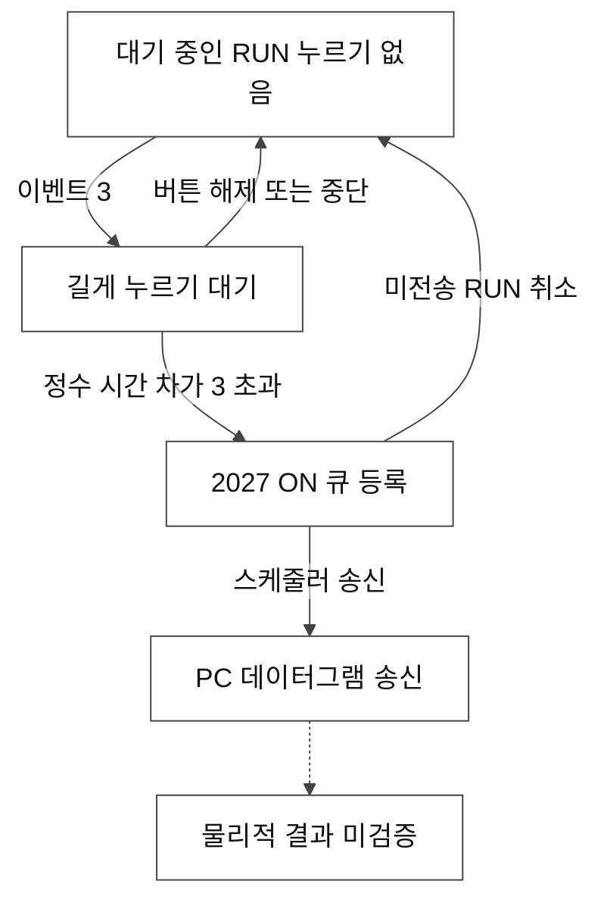

# 3. PC 제어 상태와 하드웨어 관측

**상태: REVIEW — 사람의 승인 대기 중.** 이 장은 변경 불가능한 커밋 `cebcc28490f48e9e5d4d1c2e2feef34d638244e7`의 PY_SPF 1.0을 설명한다. 패키지 버전은 `1.0.0`이고, 재구현한 NI GUI 버전은 `1.6.0`이다. 두 버전 모두 SASC 펌웨어 버전과는 다르다. 이 작업은 문서만 변경하며 장비를 조작하지 않는다.

## 근거의 범위

| 등급 | 이 장에서의 의미 |
|---|---|
| **CODE VERIFIED** | 인용한 Python 소스에 존재하는 조건 또는 동작이다. 해당 릴리스나 브랜치를 명시한다. |
| **XP/LOG VERIFIED** | 원본 x86 디스어셈블리·격리된 오라클 또는 기록된 실장비 관측이다. 각 항목에 출처 유형을 명시한다. 오라클은 Windows XP에서의 하드웨어 실행이 아니다. |
| **MANUAL** | 매뉴얼 330A, Rev. A에 제조사가 설명한 동작이다. 인쇄 페이지와 PDF 페이지를 함께 표시한다. |
| **INFERRED** | 확인한 근거를 종합한 개념적 설명이며, 구현된 펌웨어 상태가 아니다. |
| **UNKNOWN** | 확보한 코드·매뉴얼·관측으로 확인되지 않은 사항이다. |

원본 실행 파일의 SHA256은 `8a87bcad1709f93358cba5f5588647999524ba8b481c2f38cc6cc82a96623e9b`이다. 해당 코드와 격리된 원본 x86 오라클은 기존 PC 동작의 근거이다. 이 자료만으로 펌웨어 구현을 알거나 광출력을 측정할 수는 없다. [XP-CALLBACK: 원본 작업 함수][X-RUN]; [XP-DECODER: 오라클 방식][X-ORACLE].

## 서로 구분해야 하는 상태 차원

이 저장소에는 `OFF → READY → RUNNING`이라는 하나의 하드웨어 상태 기계가 검증되어 있지 않다. 다음 상태들은 동시에 존재할 수 있으며 각각 구분해서 읽어야 한다.

| 상태 차원 | 코드 또는 관측 | 확인할 수 있는 내용 | 확인할 수 없는 내용 |
|---|---|---|---|
| PC 애플리케이션 수명주기 | `controller.running` | 애플리케이션 반복문을 계속 실행해야 하는지 여부이다. | 레이저·셔터·HV 전원이 켜졌는지 여부이다. |
| UDP 세션 | `transport`, 시작 시도, `scheduler.hold`, 대기 요청 | 로컬 소켓이 존재하고 PC가 요청을 예약할 수 있는지 여부이다. | 모든 하위 시스템의 준비 상태이다. |
| 수락된 통신 | `state['connected']`, 마지막으로 일치한 응답 | 디코더가 이 세션에서 비어 있지 않은 응답을 수락했다는 사실이다. | 전체 하드웨어의 RUN이나 광방출이다. |
| 표시 데이터 준비 | `gui_ready`, 요청한 현재 `1085`, 상태 데이터의 경과 시간 | Native 화면이 저장된 입력 정책을 복원할 수 있는지 여부이다. | 제조사가 정한 운전 전제 조건의 충족 여부이다. |
| GUI 건전성 정책 | `STATUS?` 비트 0 → `delay_monitor_status` | GUI 건전성 루틴이 RUN과 PC1/PC2 컨트롤을 비활성화하는지 여부이다. | 독립적인 펌웨어 억제 조건이나 직접적인 광 측정이다. |
| RUN 의도 | `evnt_cmt`, `_button_started`, 큐에 들어간 `2027` | 대기 중인 길게 누르기 입력이나 PC 요청이다. | 확인되었거나 완료된 물리적 시작이다. |
| TDG/BWD 관측 | `1039`, PD 비트와 BWD 래치 마스크 | 보고된 TDG 상태 워드와 그 디코딩 결과이다. | 두 포켈스 셀이 실제로 동작하거나 출력 파워가 측정되었다는 사실이다. |
| Empower 관측 | `1013`, Opt-out, Emission 표시 여부 | Opt-out이 아닐 때 GUI에 표시하는 펌프 상태 비트이다. | Spitfire의 전체 출력 상태이다. |

**CODE VERIFIED:** 초기화와 상태 저장은 [PY-CONTROLLER: `controller.py` L23–82][C-STATE]에 있다. 통신 상태를 갱신하는 것은 RUN 버튼이 아니라 디코더 효과이다. [PY-DECODER: `decoders.py` L110–126][D-CONNECTED], [PY-CONTROLLER: L657–689][C-EFFECTS].

예를 들어 유효한 `STATUS=3`은 `gui_ready=True`로 만들면서도 비트 0에 의해 GUI 건전성 루틴이 RUN을 비활성화할 수 있다. `HV=1`, `COMSTATUS=1`, BWD 래치, 숨겨진 Emission 표시는 하나의 신뢰할 수 있는 “동작 중” 값으로 합칠 수 없다. `COMSTATUS`에는 고유한 비트별 Fault 패널 대응이 있다. [PY-DECODER: L225–236][D-STATUS], [PY-DECODER: L338–344][D-HEALTH].

## PC 세션과 표시 데이터 준비

그림 3A는 PC 변수를 투영한 **INFERRED** 개념도이며 펌웨어 상태도가 아니다. “최신 표시 데이터”는 소프트웨어의 데이터 준비만을 뜻한다.

**CODE VERIFIED — 상태 전환의 세부 내용:**

| 계기 | PC 동작과 제한 | 근거 |
|---|---|---|
| 시작·연결 | 큐와 대기 중인 길게 누르기를 지우고 데이터를 미준비 상태로 만든 뒤 UDP 전송 계층을 연다. Native 레이아웃과 화면 탐색은 계속 보이며 기존의 회색 가림막은 표시하지 않는다. | [PY-CONTROLLER: L174–209][C-OPEN], [PY-CONTROLLER: L113–136][C-PRESENT] |
| 소켓 열기 실패 | 3초의 열기 시도 구간에서 최소 0.25초 간격으로 시도한다. 실패 후에는 2초 뒤에 다음 연결 시도를 예약한다. | [PY-CONTROLLER: L211–227][C-ATTEMPT], [L447–461][C-OPEN-RETRY] |
| 식별 단계 | 앞선 시도에 응답이 있어도 태그 `1000`을 세 번 보낸다. 각 시도의 응답 기한은 3초이다. 세 번째 시도에서 비어 있지 않은 응답을 받았는지가 시작 성공을 결정한다. | [PY-SCHEDULER: L149–177][S-IDN], [PY-CONTROLLER: L468–486][C-IDN] |
| 식별 성공 | 스케줄러 보류를 해제하고 초기화를 큐에 넣는다. 이것만으로 `gui_ready`가 설정되지는 않는다. | [PY-CONTROLLER: L474–477][C-IDN] |
| 데이터 준비 | 요청하지 않았거나 초기화 전에 도착한 STATUS는 거부한다. 요청과 일치하고 유효하며 비어 있지 않은 STATUS만 디코딩하여 표시 준비를 열 수 있다. | [PY-CONTROLLER: L554–619][C-RX], [PY-DECODER: L228–236][D-STATUS] |
| 일치하는 응답 없음 | 스케줄러 비활성 시간이 10초를 넘으면 소켓 재개방을 요청하고, 30초를 넘으면 재접속 분기를 선택한다. 일반 경로에서는 앞선 임계값에 먼저 도달한다. 이는 통신 임계값이며 레이저 정지 확인이 아니다. | [PY-SCHEDULER: L135–146][S-INACTIVE], [PY-CONTROLLER: L501–518][C-STALE] |
| 다른 응답은 계속되지만 STATUS 없음 | 최신 STATUS 없이 30초를 초과하면 장비 입력을 비활성화하고 대기 중인 구동 요청을 취소한다. 통신은 여전히 연결 상태로 표시될 수 있다. | [PY-CONTROLLER: L519–525][C-STALE] |

일반 모드 초기화에는 `1068` 재조회보다 먼저 `2036 EMPOPTOUT 1`이 포함된다. 읽기 전용 모드에서는 이 쓰기와 다른 자동 쓰기를 생략한다. 이는 Python 릴리스의 정책이며 수정하지 않은 XP 실행 파일의 동작으로 돌려서는 안 된다. [PY-SCHEDULER: L78–97][S-INITIAL].

## UI 일시 정지, 복구와 취소

**CODE VERIFIED:** Native 1.0은 UI를 생성한 스레드에서 재진입을 방지한 25ms Win32 타이머를 사용하고 외부 반복문을 보조 경로로 둔다. 백그라운드 조회 스레드에서 CVI를 호출하지 않는다. `KillTimer` 이후에도 큐에 남은 타이머 콜백이 실행될 수 있으므로 GUI 해제 중에도 타이머 객체를 유지한다. [PY-TICKER: L14–46][T-LIFE], [L72–125][T-TICK], [PY-NATIVE: L479–507][N-LOOP].

Native 틱 간격이 2초를 넘으면 UI 일시 정지 복구를 시작한다. 첫 STATUS 전에는 대기 중인 RUN을 취소하고 초기화를 보존한다. 이미 성립한 세션에서는 아직 보내지 않은 구동 요청을 취소하고 수신 버퍼를 비운 뒤 기존 소켓에서 새 STATUS를 요청한다. 복구 조회 전에 버퍼에 있던 응답은 최신성을 입증할 수 없다. 한 틱에서는 최대 64개 데이터그램을 처리하며, 이 제한에 도달했다는 사실은 기존 수신 큐가 비었다는 증거가 아니다. [PY-CONTROLLER: L276–292][C-DRAIN], [L344–438][C-PAUSE], [L562–568][C-RX].

취소 규칙은 매개변수가 비어 있는 정확한 종료 요청 `2006`, `2013`, `2016`, `2023`, `2028`만 보존한다. 이 요청들은 수신 격리가 계속되는 동안에도 한 번 보낼 수 있다. 이는 의도적으로 대기시킨 요청을 보존하는 것이며, 하드웨어 OFF를 자동 생성하는 동작이 아니다. 새 복구 조회가 성공하면 시작 쓰기를 재실행하지 않고 주기 조회를 재개한다. 복구 시도를 소진하면 재접속한다. [PY-CONTROLLER: L312–438][C-PAUSE].

**XP/LOG VERIFIED — 원본 x86이며 실제 XP 시험이 아님:** 원본은 `RunUserInterface` 전에 CVI 스레드 풀 작업 함수 세 개를 예약한다. Python의 UI 스레드 타이머와 수신 격리는 구현 변경이다. 원본 통신 오류 분기에는 모달 대기도 있으나 이 릴리스는 비모달 복구를 사용한다. [XP-CALLBACK: 디스어셈블리 L9685–9706][X-THREADS], [L9408–9487][X-RECOVERY]. **XP/LOG VERIFIED — 실장비 로그:** 저장된 릴리스 검증에는 시간과 범위를 제한한 Native 메뉴·연속 관찰 검사의 내용 및 시험한 정확한 소스 범위가 기록되어 있다. [LOG-SOAK][LOG-SOAK].

## RUN: 입력, 억제, 요청과 물리적 결과

PC에만 존재하는 다음 의도 상태를 하드웨어 OFF/ON 상태라고 부르면 안 된다.

그림 3B는 소프트웨어의 RUN 의도와 물리적 상태를 구분한다.

**CODE VERIFIED:** 메인 패널 `6`, 컨트롤 `10`의 콜백 `cllbck`은 이벤트 `3`에서 길게 누르기를 준비하고 이벤트 `1`에서 준비 플래그를 지운다. 작업 함수는 `int(now) - int(start) > 3`을 검사하여 `[2027]ON`을 큐에 넣고 TCU GUI 토글 `2/8=1`을 설정한 뒤 대기 중인 누르기를 지운다. 이는 정수 초 비교이며 정확히 4초로 고정된 물리적 시작 시간이 아니다. 큐 등록과 실제 통신 송신은 서로 다른 시점일 수 있다. [PY-CALLBACKS: L194–203][CB-RUN], [PY-CONTROLLER: L738–749][C-HELD].

**XP/LOG VERIFIED — 원본 x86과 격리된 오라클:** 이벤트 `3`에서 준비하고 이벤트 `1`에서 해제한다. 주소 `0x406953`의 작업 함수는 같은 정수 조건 이후 `2027`을 큐에 넣는다. 콜백만으로 ON을 송신하지는 않는다. GUI 토글 갱신은 별도의 `ECU:TECON` 명령이 아니다. [XP-CALLBACK: L14210–14240][X-RUN-CB], [L9136–9182][X-RUN].

현재 타이머는 마우스 버튼 해제, Alt/F10, 표준 메뉴·창 이동 플래그 또는 같은 프로세스의 다른 전경 패널을 감지하면 길게 누르기나 미전송 `2027`을 취소한다. 이 RUN 누르기 규칙은 별도의 `2005 EMP:ON`을 취소하지 않는다. CVI 사용자 지정 메뉴는 Win32 메뉴 플래그를 항상 설정하지 않으므로 `menu_ticks`가 0이어도 메뉴가 열리지 않았다는 증거는 아니다. [PY-TICKER: L88–102][T-TICK].

**중요한 구현 경계 — CODE VERIFIED:** 건전성 루틴은 `delay_monitor_status != 0`이면 RUN을 비활성화한다. `_held_turn_on` 자체는 읽기 전용·미준비 조건을 검사하지만 Fault 워드나 RUN 컨트롤의 DIM 상태를 다시 검사하지는 않는다. 따라서 주입한 Native 어댑터·Controller 이벤트는 허용된 일반 GUI 클릭과 동등하지 않다. 이 장은 해당 경계를 설명하며 우회를 허용하지 않는다. [PY-DECODER: L329–344][D-HEALTH], [PY-NATIVE: L360–372][N-EVENT], [PY-CONTROLLER: L738–749][C-HELD].

**MANUAL:** 인쇄 6-9 / PDF 69페이지는 RUN을 Empower 펌프 다이오드 시작, 카운트다운, 셔터 개방과 출력 상승으로 설명한다. 인쇄 6-1 / PDF 61페이지는 이후 시작 절차 전에 두 BWD 표시가 모두 녹색일 것을 요구한다. 인쇄 6-2 / PDF 62페이지는 RUN과 포켈스 셀 활성화를 별도 단계로 나열한다. **UNKNOWN:** 특히 Empower Opt-out 상태에서 `[2027]ON`이 일으키는 정확한 SASC 펌웨어 동작과 내부 순서는 PC 코드나 격리된 오라클로 확인되지 않는다. ON 송신이나 그 수신 응답만으로 측정된 광방출이 입증되지는 않는다. [MAN-330A].

## STOP과 HV는 별개

| 동작 | 확인된 PC 요청 | 경계 |
|---|---|---|
| STOP, 메인 `6/11`, 이벤트 `3` | `2028 OFF`, 이어서 `1013` 조회, GUI `2/8=0`. | 이 콜백에는 명시적인 `2016 TDG:HV:OFF`가 없다. |
| Escape | `2028 OFF`와 GUI `2/8=0`. 읽기 전용에서는 차단한다. | PC 애플리케이션 종료 명령이 아니다. |
| HV 스위치, 타이밍 패널 `5/34`, 이벤트 `1` | `2017 TDG:HV:ON` 또는 `2016 TDG:HV:OFF`, 이어서 `1061` 조회. | RUN/STOP과 독립된 콜백이다. |
| 종료·창 닫기 | 애플리케이션 반복문과 전송 계층을 중지한다. | 하드웨어 OFF 명령을 만들어 보내지 않는다. |

**CODE VERIFIED:** [PY-CALLBACKS: L200–203][CB-RUN], [L254–257][CB-HV], [L305–306][CB-STOP], [L148–152][CB-QUIT]. **XP/LOG VERIFIED — 원본 x86·격리된 콜백 오라클:** [XP-CALLBACK: STOP L14177–14207][X-STOP], [HV L18795–18850][X-HV]. **MANUAL:** 인쇄 6-9 / PDF 69페이지는 STOP을 펌프 다이오드 OFF와 펌프 공진기 셔터 닫힘으로 설명한다. **UNKNOWN:** 이것이 관측한 Opt-out 구성에서 `2028`이 모든 HV 전원·시드 레이저·광경로를 끈다는 증거는 아니다. [MAN-330A].

## BWD·Emission·상태는 하나의 장비 상태가 아닌 관측값

**CODE VERIFIED:** `1039 TDG:STBH?`는 16진수이다. `word & 0x300000 == 0`이면 `BWD OK`를 회색·비활성 상태로 표시하고, 이 마스크에 비트가 하나라도 설정되면 `RESET BWD`를 노란색·활성 상태로 표시한다. PD1과 PD2는 별도로 반전된 비트 `0x10000`, `0x20000`에서 디코딩한다. 확보한 소스는 BWD 비트 20·21이 각각 PC1/PC2라는 대응을 확정하지 않는다. `1066 TDG:STBHFLT?`는 별도의 Fault 디코더를 구동한다. [PY-DECODER: L218–227][D-TDG], [L319–327][D-BWD].

**XP/LOG VERIFIED — 실장비 로그:** 식별 정보를 정리한 BWD 이력은 관측된 워드와 관측 공백의 한계를 보고한다. 리셋 수신 응답, COMSTATUS 비트 해제, 관측된 BWD 마스크 해제는 서로 다른 사건이다. [LOG-BWD][LOG-BWD]. **MANUAL:** 인쇄 4-4 / PDF 50페이지와 6-10 / PDF 70페이지는 두 광검출기의 임계값과 원인이 해결된 뒤의 리셋을 설명한다. **INFERRED — 광학·전자 신호의 구분에 따른 추론:** 전자적인 Internal 클록은 두 검출기에 들어가는 광학 시드 스펙트럼을 공급하지 않는다. 매뉴얼의 QSW SOURCE INTERNAL 설명은 Empower 클록에 관한 것이며 서비스 수준의 오실레이터·트리거 명령 구현을 입증하지 않는다. [MAN-330A].

**CODE VERIFIED:** 메인 `6/32`의 `MSG_EMISSION`은 고정된 문구와 색으로 시작하며 처음에는 숨겨져 있다. `emp_optout == 0`이면 수락한 `1013 EMP:STB?`의 비트 `0x1` 또는 `0x200`이 설정되었을 때 표시한다. `emp_optout == 1`은 이 갱신을 건너뛰며, 이미 보이던 표시를 적극적으로 지우지는 않는다. `STATUS`, HV 재조회, 큐에 들어간 RUN은 이 표시 여부를 직접 설정하지 않는다. [PY-DECODER: L269–292][D-EMP]. **XP/LOG VERIFIED — 원본 디코더·에뮬레이션:** 같은 Opt-out 조기 반환과 표시 조건이 원본과 오라클에 있다. [XP-DECODER: L11965–11983][X-EMP-OPT], [L12179–12200][X-EMISSION]. **UNKNOWN:** 이 표시는 독립적으로 검증한 광파워 측정이 아니다. 숨겨져 있다는 사실만으로 빛이 없음을 확인할 수 없다.

## 버전과 검토의 한계

이 장의 Python 관련 설명은 `cebcc28`에 한정된다. `78d3f447b1ca3dea35c5a737b75569a882bc0650`의 `origin/main`은 패키지 `1.6.0.post1`이며 현재 전송 계층·읽기 전용·타이머 보호를 모두 포함하지는 않는다. [이전 main 버전][OLD-MAIN]. 원본 XP 작업 함수의 스케줄링, 현재 Python 스케줄링, 제조사 운전 지침, 실장비 관측은 서로 다른 근거 층으로 유지한다.

## 출처 참조

아래 링크는 변경 불가능한 코드 참조이다. `MAN-330A`는 *Spitfire Pro User's Manual*, 330A, Rev. A이며, 인쇄·PDF 페이지 쌍은 위에 명시했다. 로컬 로그 근거는 식별 정보를 정리한 자료이며 운전 지침이 아니다.

[C-STATE]: https://github.com/El-Carretero/PY_SPF/blob/cebcc28490f48e9e5d4d1c2e2feef34d638244e7/spitfire/controller.py#L23-L82
[C-PRESENT]: https://github.com/El-Carretero/PY_SPF/blob/cebcc28490f48e9e5d4d1c2e2feef34d638244e7/spitfire/controller.py#L113-L136
[C-OPEN]: https://github.com/El-Carretero/PY_SPF/blob/cebcc28490f48e9e5d4d1c2e2feef34d638244e7/spitfire/controller.py#L174-L209
[C-ATTEMPT]: https://github.com/El-Carretero/PY_SPF/blob/cebcc28490f48e9e5d4d1c2e2feef34d638244e7/spitfire/controller.py#L211-L227
[C-OPEN-RETRY]: https://github.com/El-Carretero/PY_SPF/blob/cebcc28490f48e9e5d4d1c2e2feef34d638244e7/spitfire/controller.py#L447-L461
[C-IDN]: https://github.com/El-Carretero/PY_SPF/blob/cebcc28490f48e9e5d4d1c2e2feef34d638244e7/spitfire/controller.py#L468-L486
[C-RX]: https://github.com/El-Carretero/PY_SPF/blob/cebcc28490f48e9e5d4d1c2e2feef34d638244e7/spitfire/controller.py#L554-L619
[C-DRAIN]: https://github.com/El-Carretero/PY_SPF/blob/cebcc28490f48e9e5d4d1c2e2feef34d638244e7/spitfire/controller.py#L276-L292
[C-PAUSE]: https://github.com/El-Carretero/PY_SPF/blob/cebcc28490f48e9e5d4d1c2e2feef34d638244e7/spitfire/controller.py#L312-L438
[C-STALE]: https://github.com/El-Carretero/PY_SPF/blob/cebcc28490f48e9e5d4d1c2e2feef34d638244e7/spitfire/controller.py#L501-L525
[C-EFFECTS]: https://github.com/El-Carretero/PY_SPF/blob/cebcc28490f48e9e5d4d1c2e2feef34d638244e7/spitfire/controller.py#L657-L689
[C-HELD]: https://github.com/El-Carretero/PY_SPF/blob/cebcc28490f48e9e5d4d1c2e2feef34d638244e7/spitfire/controller.py#L738-L749
[S-IDN]: https://github.com/El-Carretero/PY_SPF/blob/cebcc28490f48e9e5d4d1c2e2feef34d638244e7/spitfire/scheduling.py#L149-L177
[S-INITIAL]: https://github.com/El-Carretero/PY_SPF/blob/cebcc28490f48e9e5d4d1c2e2feef34d638244e7/spitfire/scheduling.py#L78-L97
[S-INACTIVE]: https://github.com/El-Carretero/PY_SPF/blob/cebcc28490f48e9e5d4d1c2e2feef34d638244e7/spitfire/scheduling.py#L135-L146
[D-CONNECTED]: https://github.com/El-Carretero/PY_SPF/blob/cebcc28490f48e9e5d4d1c2e2feef34d638244e7/spitfire/decoders.py#L110-L126
[D-STATUS]: https://github.com/El-Carretero/PY_SPF/blob/cebcc28490f48e9e5d4d1c2e2feef34d638244e7/spitfire/decoders.py#L225-L236
[D-HEALTH]: https://github.com/El-Carretero/PY_SPF/blob/cebcc28490f48e9e5d4d1c2e2feef34d638244e7/spitfire/decoders.py#L329-L344
[D-TDG]: https://github.com/El-Carretero/PY_SPF/blob/cebcc28490f48e9e5d4d1c2e2feef34d638244e7/spitfire/decoders.py#L218-L227
[D-BWD]: https://github.com/El-Carretero/PY_SPF/blob/cebcc28490f48e9e5d4d1c2e2feef34d638244e7/spitfire/decoders.py#L319-L327
[D-EMP]: https://github.com/El-Carretero/PY_SPF/blob/cebcc28490f48e9e5d4d1c2e2feef34d638244e7/spitfire/decoders.py#L269-L292
[CB-RUN]: https://github.com/El-Carretero/PY_SPF/blob/cebcc28490f48e9e5d4d1c2e2feef34d638244e7/spitfire/callbacks.py#L194-L203
[CB-HV]: https://github.com/El-Carretero/PY_SPF/blob/cebcc28490f48e9e5d4d1c2e2feef34d638244e7/spitfire/callbacks.py#L254-L257
[CB-STOP]: https://github.com/El-Carretero/PY_SPF/blob/cebcc28490f48e9e5d4d1c2e2feef34d638244e7/spitfire/callbacks.py#L305-L306
[CB-QUIT]: https://github.com/El-Carretero/PY_SPF/blob/cebcc28490f48e9e5d4d1c2e2feef34d638244e7/spitfire/callbacks.py#L148-L152
[N-EVENT]: https://github.com/El-Carretero/PY_SPF/blob/cebcc28490f48e9e5d4d1c2e2feef34d638244e7/spitfire/native.py#L360-L372
[N-LOOP]: https://github.com/El-Carretero/PY_SPF/blob/cebcc28490f48e9e5d4d1c2e2feef34d638244e7/spitfire/native.py#L479-L507
[T-LIFE]: https://github.com/El-Carretero/PY_SPF/blob/cebcc28490f48e9e5d4d1c2e2feef34d638244e7/spitfire/native_ticker.py#L14-L46
[T-TICK]: https://github.com/El-Carretero/PY_SPF/blob/cebcc28490f48e9e5d4d1c2e2feef34d638244e7/spitfire/native_ticker.py#L72-L125
[X-RUN-CB]: https://github.com/El-Carretero/PY_SPF/blob/cebcc28490f48e9e5d4d1c2e2feef34d638244e7/analysis/annotated_disasm.txt#L14210-L14240
[X-RUN]: https://github.com/El-Carretero/PY_SPF/blob/cebcc28490f48e9e5d4d1c2e2feef34d638244e7/analysis/annotated_disasm.txt#L9136-L9182
[X-THREADS]: https://github.com/El-Carretero/PY_SPF/blob/cebcc28490f48e9e5d4d1c2e2feef34d638244e7/analysis/annotated_disasm.txt#L9685-L9706
[X-RECOVERY]: https://github.com/El-Carretero/PY_SPF/blob/cebcc28490f48e9e5d4d1c2e2feef34d638244e7/analysis/annotated_disasm.txt#L9408-L9487
[X-STOP]: https://github.com/El-Carretero/PY_SPF/blob/cebcc28490f48e9e5d4d1c2e2feef34d638244e7/analysis/annotated_disasm.txt#L14177-L14207
[X-HV]: https://github.com/El-Carretero/PY_SPF/blob/cebcc28490f48e9e5d4d1c2e2feef34d638244e7/analysis/annotated_disasm.txt#L18795-L18850
[X-EMP-OPT]: https://github.com/El-Carretero/PY_SPF/blob/cebcc28490f48e9e5d4d1c2e2feef34d638244e7/analysis/annotated_disasm.txt#L11965-L11983
[X-EMISSION]: https://github.com/El-Carretero/PY_SPF/blob/cebcc28490f48e9e5d4d1c2e2feef34d638244e7/analysis/annotated_disasm.txt#L12179-L12200
[X-ORACLE]: https://github.com/El-Carretero/PY_SPF/blob/cebcc28490f48e9e5d4d1c2e2feef34d638244e7/analysis/native_decoder_oracle.py#L1-L5
[LOG-BWD]: ../evidence/bwd_history_summary.json
[LOG-SOAK]: ../evidence/release_validation.json
[OLD-MAIN]: https://github.com/El-Carretero/PY_SPF/blob/78d3f447b1ca3dea35c5a737b75569a882bc0650/spitfire/__init__.py#L1-L2
