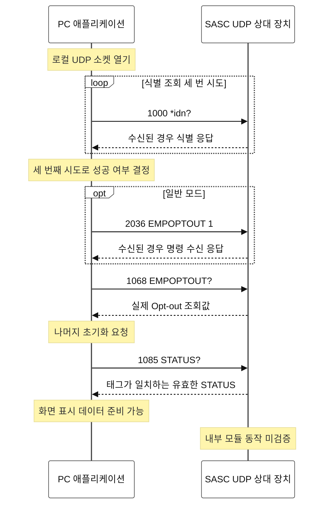
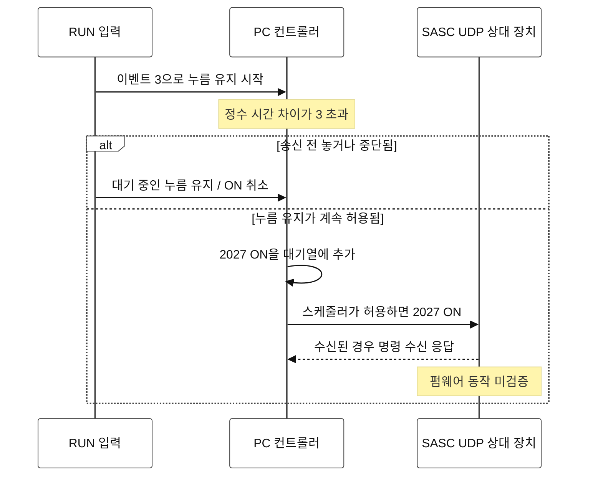
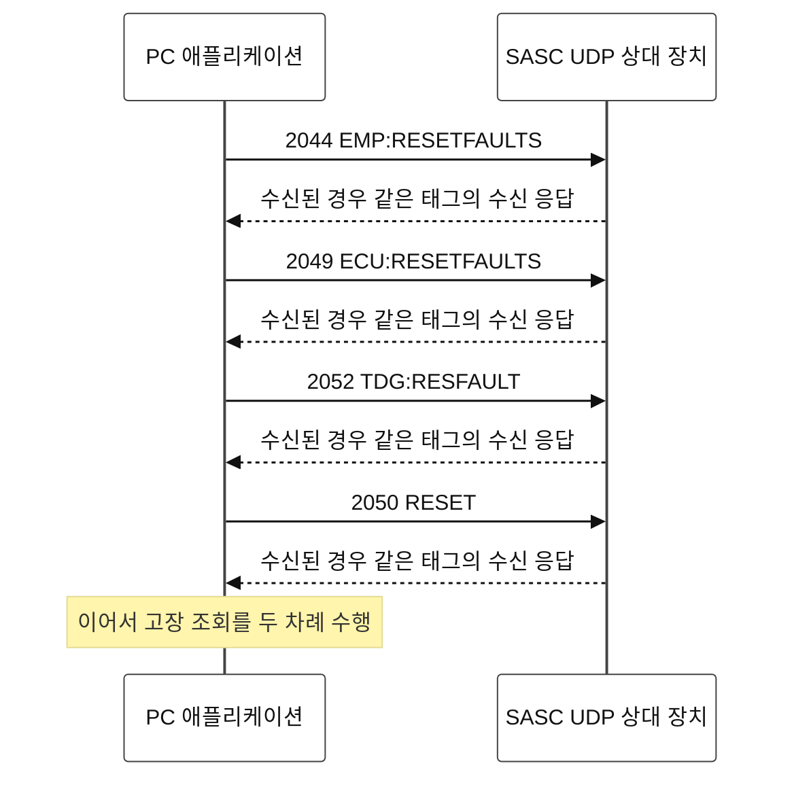

# 4. 통신 순서와 확인의 한계

**상태: 검토 중 — 사람의 승인 대기.** 이 장은 커밋 `cebcc28490f48e9e5d4d1c2e2feef34d638244e7`의 PY_SPF 1.0을 설명한다. 이 문서를 작성하기 위해 장비 명령을 실행하지 않았다.

## 통신 경계와 표기법

**CODE VERIFIED:** 현재 PC 전송 계층은 설정된 상대 장치로 ASCII UDP 요청을 보낸다. 기본 목적지는 `10.19.70.13:1024`, 로컬 바인딩은 `0.0.0.0:1024`이며, 출발지 주소는 로컬 어댑터가 결정한다. Windows에서는 배타적 바인딩을 사용한다. 다른 출발지 주소나 포트에서 들어온 데이터그램은 거부한다. [PY-PROTOCOL: `protocol.py` L147–198][P-UDP].

**XP/LOG VERIFIED — p01 실장비 로그:** 관찰된 상대 장치는 자신을 `Spectra Physics,SASC,1.5.0`으로 식별한다. 아래 UDP 화살표는 관찰된 이 상대 장치에서 끝난다. 제조사 도면에는 이더넷 어셈블리가 TDG로 표시될 수 있지만, PC 캡처에는 SASC와 TDG/Empower/ECU 사이의 내부 통신이 드러나지 않는다. 내부 메시지, 순서, 펌웨어 상태 전이는 **UNKNOWN**으로 남는다. [LOG-RESET][LOG-RESET], [LOG-SOAK][LOG-SOAK].

| PC 프레임 형식 | 예시와 해석 |
|---|---|
| 요청 접두부 | `Spectra-Physics:CMD_ECLIPSE,` |
| 요청 한 줄 | `[1068]EMPOPTOUT?` 뒤에 LF가 붙음 |
| 응답 프레임 형식 | `Spectra-Physics:REPLY_ECLIPSE:<1068>1` |
| 태그 | 조회/명령 종류의 식별자이며, 고유한 트랜잭션 번호가 아님. |
| 파싱 시 추가되는 표기 | `(packet,line)`은 분석을 위해 로컬에서 추가하며, 펌웨어의 트랜잭션 토큰이 아님. |

**CODE VERIFIED:** [PY-PROTOCOL: L13–26][P-FORMAT], [L29–87][P-PARSE]. 현재 `Controller._send`는 선택된 요청의 패킷을 만들고 즉시 내보낸다. 콜백이 여러 요청을 대기열에 넣더라도, 이를 하나의 원자적 UDP 묶음으로 전송하는 것은 아니다. 일반적으로 처리 중인 요청 하나가 일치하는 응답을 받거나 제한 시간이 끝날 때까지 스케줄러의 응답 대기 수(balance)를 유지한다. [PY-CONTROLLER: L237–274][C-SEND], [PY-SCHEDULER: L110–133][S-QUEUE].

아래에서 사용하는 근거 등급은 **CODE VERIFIED**, **XP/LOG VERIFIED**, **MANUAL**, **INFERRED**, **UNKNOWN**이다. 원본 x86 오라클/디스어셈블리에 근거한 주장은 모두 그 출처를 표시하며, 실제 Windows XP 환경이나 레이저를 시험했다는 뜻이 아니다.

## A — 연결 열기, 초기화, 상태 조회

그림 4A는 PC와 상대 장치 사이의 경계만 보여 준다. 시작 성공은 통신 초기화의 성공이며, 하드웨어 준비 상태가 검증되었다는 뜻은 아니다.

**CODE VERIFIED — 세부 동작과 한계:**

- `1000`은 세 번 시도한다. 응답이 오면 해당 시도를 일찍 마치고 다음으로 진행하며, 응답이 없으면 제한 시간은 3 s이다. 세 번째 시도가 실패하면 2 s 뒤에 다시 연결을 시도하도록 예약한다. [PY-SCHEDULER: L149–177][S-IDN], [PY-CONTROLLER: L447–486][C-STARTUP].
- 일반 초기화는 `1068` 조회 바로 앞에 `2036 EMPOPTOUT 1`을 삽입한다. 쓰기 명령의 수신 응답이 없으면 1 s의 유예 뒤에 조회를 진행하며, 쓰려던 값을 근거로 화면 값을 만들어 내지 않는다. 읽기 전용 초기화는 이 쓰기와 `2047 EMP:LBOBREAK 1`을 건너뛴다. [PY-SCHEDULER: L78–97][S-INIT], [PY-CONTROLLER: L491–500][C-OPT-ACK].
- 초기화에는 이 축약 그림보다 많은 요청이 포함된다. 정확한 순서는 prefix, ECU, MIL, TDG, EMP 목록을 이어 붙인 뒤 `1062`를 추가한 것이며, 위에서 설명한 명령을 삽입하거나 건너뛴다. 기존 디코더는 `1067 TDG:OSC:MODE?` 응답에 `INT`가 없으면 `2030 INT`, 이어서 `2030 EXT`를 요청한다. `STATUS`의 비트 1은 채널 리셋 경로를 요청한다. 읽기 전용에서는 이러한 자동 쓰기를 차단한다. [PY-SCHEDULER: L15–23, L78–108][S-INIT], [PY-DECODER: L143–152][D-OSC], [L228–236][D-STATUS], [PY-CONTROLLER: L657–669][C-EFFECTS].
- 읽기 전용은 단순히 버튼을 비활성화하는 기능이 아니라 최종 송신 단계의 정책이다. 카탈로그에 정확히 정의되어 있고, 매개변수가 비어 있으며, `?`로 끝나는 조회만 허용한다. 기존의 불완전한 조회 `1026 TDG:DEL`은 제외한다. [PY-CONTROLLER: L237–250][C-SEND]. Controller를 사용하지 않고 조회 문자열만 직접 보내는 별도 도구는 디코더가 생성하는 쓰기를 실행하지 않는다.

### 폴링과 요청 완료

내부 대기열은 외부 폴링 대기열보다 우선한다. 일반 폴링은 `1039`로 시작하고, 일반 폴링 항목 14개 각각의 뒤에 `1039`를 끼워 넣는다. 서비스 권한에서는 측정 조회 네 개를 추가한다. 기본 송신 간격 0.25 s에서 요청 29개로 이루어진 일반 주기는 **첫 송신부터 다음 주기의 첫 송신까지** 명목상 최소 7.25 s가 걸리며, 손실, 우선 처리 작업, 그 밖의 지연이 있으면 더 길어진다. 한 주기 안에서 첫 송신부터 마지막 송신 사이의 간격은 28개뿐이다. 이는 STATUS 갱신 주기를 보장하는 수치가 아니다. [PY-SCHEDULER: L15–24, L99–121][S-QUEUE], [PY-CONTROLLER: L24–44][C-CONFIG].

| 사건 | 현재 PC 동작 | 확인할 수 있는 범위 |
|---|---|---|
| 태그가 일치하는 조회 응답 | 대기 중인 태그를 해제하고, 비어 있지 않은 값을 디코딩함. | 같은 태그의 조회를 반복했을 때, 태그 일치만으로 지연된 이전 응답을 구별할 수 없음. |
| 태그가 일치하는 빈 응답 | 요청을 해제하고 값 없음/빈 응답으로 기록하며, 다른 태그의 이전 페이로드를 재사용하지 않음. | 빈 값은 숫자 0이나 측정된 상태가 아님. |
| 잘못되었거나 예상하지 않은 태그 | 기록 후 무시하며, 다음 요청을 해제하지 않음. | 추가 데이터그램이 다른 트랜잭션의 진행을 뜻하지는 않음. |
| 조회 제한 시간 도달 | 0.7 s가 지나면 안전한 카탈로그 조회를 최대 두 번 재시도하여 총 세 번 시도함. | 재시도는 조회에 허용되며, 구동 명령에는 허용되지 않음. |
| 쓰기 명령의 수신 응답 없음 | 1 s 뒤에 건너뛰고 `write_ack_timeouts`를 기록하며, 쓰기를 재전송하지 않음. | 송신 여부가 불확실하거나 수신 응답이 없다는 이유로 구동 명령을 다시 보내지 않음. |
| 소켓 송신 실패 | 오류를 기록하고, 다음 처리의 대기 시간이 무한정 늘어나지 않도록 제한함. | `sendto` 성공은 로컬에서 송신을 제출했다는 뜻일 뿐, 장비 동작을 뜻하지 않음. |

**CODE VERIFIED:** [PY-CONTROLLER: L237–310][C-SEND], [L554–619][C-RX]; [PY-SCHEDULER: L123–133][S-QUEUE]. 리셋 명령의 수신 응답은 내용이 비어 있을 수 있다. 디코더는 모든 수신 응답을 물리적 동작 완료의 긍정 판정으로 바꾸지 않는다.

**XP/LOG VERIFIED — 원본 x86:** 원본은 파싱한 응답이 `1000`이 아니면 현재 처리 중인 태그와 일치하는지 확인하지 않고 메시지 balance를 줄이며, 최솟값을 0으로 제한한다. 수신 스케줄링과 시스템 시각 기반 복구도 이 릴리스와 다르다. 현재의 중복 응답 비우기, 출발지 필터링, 횟수를 제한한 조회 재시도, 송신 간격 제어, UI 일시 정지 후 응답 격리를 원본 XP에서 검증된 동작으로 설명해서는 안 된다. [XP-CALLBACK/XP-DECODER: 디스어셈블리 L15443–15454][X-BALANCE], [L10999–11010][X-RECEIVE], [L9408–9487][X-RECOVERY].

현재 UI 일시 정지 복구에서는 PC가 먼저 로컬에 버퍼링된 응답을 버린 다음, 같은 소켓으로 새 `1085`를 보낸다. 새로운 응답이 수락되면 초기화를 다시 실행하지 않고 재개하며, 실패하면 재접속한다. 통신 형식에 여전히 고유한 트랜잭션 ID가 없으므로, 네트워크에서 지연된 같은 태그의 응답은 프로토콜의 한계로 남는다. [03 — PC 제어 상태](03_state_machine.md)를 참조한다. [PY-CONTROLLER: L344–438][C-PAUSE].

## B — RUN 요청과 제조사의 시작 순서

**CODE VERIFIED:** 사용자가 GUI에서 직접 조작하는 경로, 주입된 어댑터 이벤트, 대기열에 들어간 요청, 데이터그램 송신은 별개의 단계이다. 입력이 전달되기 전에 건전성 판단이 RUN을 비활성화할 수 있다. 이 UI 경계를 우회하면 `_held_turn_on`은 DIM/고장 상태를 독립적으로 다시 확인하지 않는다. 읽기 전용 및 데이터 준비 전 차단은 이와 별도로 적용된다. [PY-DECODER: L338–344][D-HEALTH], [PY-NATIVE: L360–372][N-EVENT], [PY-CONTROLLER: L738–749][C-HELD].

그림 4B는 측정된 광방출이 아니라 Native 1.0의 요청 순서를 보여 준다.

작업 루틴은 GUI `2/8=1`도 설정한다. 이 RUN 분기에서는 별도의 `2022 ECU:TECON`이나 `2017 TDG:HV:ON`을 보내지 않는다. 명시적인 HV 명령이 없다는 사실이 펌웨어 내부에서 HV를 바꿀 수 없다는 증거는 아니다. [PY-CONTROLLER: L738–749][C-HELD]. **XP/LOG VERIFIED — 원본 디스어셈블리/에뮬레이션:** 작업 루틴 `0x406953`과 콜백 `0x40aba7`은 기존 코드의 이벤트/작업 루틴 구분과 `2027`을 뒷받침한다. 실제 ON 시험을 했다는 뜻은 아니다. [XP-CALLBACK: L9136–9182][X-RUN], [L14210–14240][X-RUN-CB].

### 제조사가 설명한 순서 — 별도의 근거 층위

**MANUAL:** 330A Rev. A의 인쇄 쪽 6-9 / PDF 69쪽은 표준 Empower 장착 시스템을 다음과 같이 설명한다. RUN 누름 유지 → Empower 펌프 다이오드 켜짐 및 빨간 Emission 표시줄 → COUNT/지연/비프음 → 펌프 셔터 열림 → 낮은 출력으로 레이저 발진 후 제어된 출력 상승. STOP은 펌프 다이오드를 끄고 펌프 공진기 셔터를 닫는 동작으로 설명한다. 이는 제조사의 운전 설명이며, SASC 내부 메시지를 디코딩한 기록이 아니다.

매뉴얼은 별도로 HV 키 스위치와 그 뒤의 RUN 조작에 앞서 안정된 시드와 두 BWD 표시등의 녹색 상태를 요구하며, RUN 뒤에 PC1/PC2를 활성화하는 절차를 나열한다. 해당 위치는 인쇄 쪽 6-1 / PDF 61쪽과 인쇄 쪽 6-2 / PDF 62쪽이다. 또한 GUI가 Mai Tai/Tsunami 시드 레이저를 조작하지 않는다고 명시한다(인쇄 쪽 6-8 / PDF 68쪽). 실제 광출력을 판단하려면 그에 맞는 물리적 근거가 필요하며, 소프트웨어의 `running`, ON 수신 응답, HV 조회값, Emission 표시만으로는 판단할 수 없다. [MAN-330A].

**UNKNOWN:** 이 SASC 펌웨어와 Empower Opt-out 구성에서 전역 `ON`/`OFF`가 일으키는 전체 물리적 동작, 내부 직렬 통신/릴레이 순서, 암묵적인 HV 동작, 소프트웨어만 시험했을 때의 실제 증폭 광방출은 확인되지 않았다.

## C — 리셋, STOP, HV 순서

### C1. 고장 리셋

고장 패널 `3/53`의 `cllbckcmd_reset`은 이벤트 `1`에서 아래와 같은 정확한 순서로 쓰기를 대기열에 넣는다. 이 네 쓰기 명령은 BWD 리셋과 서로 대체할 수 없다.

그림 4C는 고장 리셋의 메시지 순서를 보여 준다.

각 차례에는 **독립된 요청 다섯 개**를 다음 순서로 보낸다. `1089 COMSTATUS?`, `1088 ECU:STBH?`, `1014 EMP:FAULT?`, `1066 TDG:STBHFLT?`, `1057 ECU:STBH?`. 같은 순서를 두 번 수행하는 것은 원본의 의도된 동작이며, 버튼 콜백이 두 번 실행되었다는 증거가 아니다. **CODE VERIFIED:** [PY-CALLBACKS: L290–291, L319–321][CB-RESET]. **XP/LOG VERIFIED — 원본 x86/에뮬레이션 콜백:** 정확히 같은 네 쓰기와 반복 조회 순서가 원본과 일치한다. [XP-CALLBACK: L2897–2938][X-FAULT-ORACLE].

**XP/LOG VERIFIED — 실장비 재시험:** 민감 정보를 제거한 리셋 근거는 각 쓰기의 송신과 수신 응답, 리셋 후 상태 표본, Native 어댑터 호출의 검증 범위를 구분한다. 이 시험은 실제 마우스 이벤트의 검증이 아니다. 빈 수신 응답은 답신을 받았다는 뜻이며, 모든 기저 고장이 해제되었다는 뜻은 아니다. `2050 RESET`을 근거 없이 “표시등 하나 지우기”로 바꾸어 부르거나 전원 재인가로 가정해서는 안 된다. [LOG-RESET][LOG-RESET].

### C2. BWD 리셋, STOP, 별도의 HV 스위치

| UI 동작 | 순서대로 보내는 PC 요청 | 해석의 한계 |
|---|---|---|
| 메인 BWD `6/5`, 이벤트 `3` | `2018 TDG:RESBWD`; `1066 TDG:STBHFLT?` | 메인 버튼의 현재 BWD 상태는 별도 조회 `1039`에서 디코딩함. |
| 메인 STOP `6/11`, 이벤트 `3` | `2028 OFF`; `1013 EMP:STB?`; GUI `2/8=0` | 이 콜백은 명시적인 `2016`을 덧붙이지 않음. |
| HV 스위치 `5/34`, 이벤트 `1` | `2017 TDG:HV:ON` 또는 `2016 TDG:HV:OFF`; `1061 TDG:HV:ON?` | 전역 ON/OFF와는 별도의 콜백과 조회임. |

**CODE VERIFIED:** [PY-CALLBACKS: L200–203][CB-STOP-BWD], [L254–257][CB-HV]. **XP/LOG VERIFIED — 격리된 원본 x86 오라클:** BWD 리셋도 같은 두 요청을 사용하며, STOP과 HV는 서로 다른 분기이다. [XP-CALLBACK: L9–24][X-BWD-ORACLE], [디스어셈블리 L14177–14207][X-STOP], [L18795–18850][X-HV].

BWD에서는 다음 네 주장을 구별해야 한다. `2018`을 송신에 제출했다는 것, 태그가 일치하는 수신 응답을 받았다는 것, 이후 `1039`가 한쪽 또는 양쪽 래치 비트의 해제를 보고했다는 것, 광학적 선행 조건/출력이 물리적으로 확인되었다는 것이다. 로그 근거는 이를 따로 보고한다. **MANUAL:** 인쇄 쪽 6-10 / PDF 70쪽은 리셋이 릴레이를 작동시키며, 원인이 해결되고 두 PD 표시등이 모두 녹색이면 증폭이 재개된다고 설명한다. **UNKNOWN:** ACK만으로는 두 조건 중 어느 것도 확인할 수 없다. [LOG-BWD][LOG-BWD], [MAN-330A].

## D — 로컬 TCP 상태 조회 서비스

재구현된 로컬 TCP 상태 서비스는 또 하나의 별도 경계이다. 캐시된 GUI/컨트롤러 값으로 `FAULTS?`, `*IDN?`, `TDG_STATUS?`, `TEMP_STATUS?`에 응답한다. 임의의 명령을 레이저로 전달하지 않는다. TCP `TDG_STATUS?` 결과에는 GUI의 DIM 상태에서 유도한 플래그가 포함될 수 있으며, 이는 독립적인 하드웨어 센서가 아니다. [PY-CONTROLLER: L160–166][C-TCP], [PY-PROTOCOL: `tcp.py` L94–120][TCP-READ].

## 출처

`MAN-330A`는 제공된 *Spitfire Pro User's Manual*, 330A, Rev. A를 가리킨다. 인쇄 쪽과 PDF 쪽은 각 주장 옆에 함께 표시했다. 현재 소스 링크는 `cebcc28`을 사용한다.

[P-UDP]: https://github.com/El-Carretero/PY_SPF/blob/cebcc28490f48e9e5d4d1c2e2feef34d638244e7/spitfire/protocol.py#L147-L198
[P-FORMAT]: https://github.com/El-Carretero/PY_SPF/blob/cebcc28490f48e9e5d4d1c2e2feef34d638244e7/spitfire/protocol.py#L13-L26
[P-PARSE]: https://github.com/El-Carretero/PY_SPF/blob/cebcc28490f48e9e5d4d1c2e2feef34d638244e7/spitfire/protocol.py#L29-L87
[C-CONFIG]: https://github.com/El-Carretero/PY_SPF/blob/cebcc28490f48e9e5d4d1c2e2feef34d638244e7/spitfire/controller.py#L24-L44
[C-SEND]: https://github.com/El-Carretero/PY_SPF/blob/cebcc28490f48e9e5d4d1c2e2feef34d638244e7/spitfire/controller.py#L237-L310
[C-STARTUP]: https://github.com/El-Carretero/PY_SPF/blob/cebcc28490f48e9e5d4d1c2e2feef34d638244e7/spitfire/controller.py#L447-L486
[C-OPT-ACK]: https://github.com/El-Carretero/PY_SPF/blob/cebcc28490f48e9e5d4d1c2e2feef34d638244e7/spitfire/controller.py#L491-L500
[C-RX]: https://github.com/El-Carretero/PY_SPF/blob/cebcc28490f48e9e5d4d1c2e2feef34d638244e7/spitfire/controller.py#L554-L619
[C-PAUSE]: https://github.com/El-Carretero/PY_SPF/blob/cebcc28490f48e9e5d4d1c2e2feef34d638244e7/spitfire/controller.py#L344-L438
[C-EFFECTS]: https://github.com/El-Carretero/PY_SPF/blob/cebcc28490f48e9e5d4d1c2e2feef34d638244e7/spitfire/controller.py#L657-L669
[C-HELD]: https://github.com/El-Carretero/PY_SPF/blob/cebcc28490f48e9e5d4d1c2e2feef34d638244e7/spitfire/controller.py#L738-L749
[C-TCP]: https://github.com/El-Carretero/PY_SPF/blob/cebcc28490f48e9e5d4d1c2e2feef34d638244e7/spitfire/controller.py#L160-L166
[S-INIT]: https://github.com/El-Carretero/PY_SPF/blob/cebcc28490f48e9e5d4d1c2e2feef34d638244e7/spitfire/scheduling.py#L15-L108
[S-IDN]: https://github.com/El-Carretero/PY_SPF/blob/cebcc28490f48e9e5d4d1c2e2feef34d638244e7/spitfire/scheduling.py#L149-L177
[S-QUEUE]: https://github.com/El-Carretero/PY_SPF/blob/cebcc28490f48e9e5d4d1c2e2feef34d638244e7/spitfire/scheduling.py#L15-L133
[D-OSC]: https://github.com/El-Carretero/PY_SPF/blob/cebcc28490f48e9e5d4d1c2e2feef34d638244e7/spitfire/decoders.py#L143-L152
[D-STATUS]: https://github.com/El-Carretero/PY_SPF/blob/cebcc28490f48e9e5d4d1c2e2feef34d638244e7/spitfire/decoders.py#L228-L236
[D-HEALTH]: https://github.com/El-Carretero/PY_SPF/blob/cebcc28490f48e9e5d4d1c2e2feef34d638244e7/spitfire/decoders.py#L338-L344
[CB-RESET]: https://github.com/El-Carretero/PY_SPF/blob/cebcc28490f48e9e5d4d1c2e2feef34d638244e7/spitfire/callbacks.py#L290-L321
[CB-STOP-BWD]: https://github.com/El-Carretero/PY_SPF/blob/cebcc28490f48e9e5d4d1c2e2feef34d638244e7/spitfire/callbacks.py#L200-L203
[CB-HV]: https://github.com/El-Carretero/PY_SPF/blob/cebcc28490f48e9e5d4d1c2e2feef34d638244e7/spitfire/callbacks.py#L254-L257
[N-EVENT]: https://github.com/El-Carretero/PY_SPF/blob/cebcc28490f48e9e5d4d1c2e2feef34d638244e7/spitfire/native.py#L360-L372
[TCP-READ]: https://github.com/El-Carretero/PY_SPF/blob/cebcc28490f48e9e5d4d1c2e2feef34d638244e7/spitfire/tcp.py#L94-L120
[X-BALANCE]: https://github.com/El-Carretero/PY_SPF/blob/cebcc28490f48e9e5d4d1c2e2feef34d638244e7/analysis/annotated_disasm.txt#L15443-L15454
[X-RECEIVE]: https://github.com/El-Carretero/PY_SPF/blob/cebcc28490f48e9e5d4d1c2e2feef34d638244e7/analysis/annotated_disasm.txt#L10999-L11010
[X-RECOVERY]: https://github.com/El-Carretero/PY_SPF/blob/cebcc28490f48e9e5d4d1c2e2feef34d638244e7/analysis/annotated_disasm.txt#L9408-L9487
[X-RUN]: https://github.com/El-Carretero/PY_SPF/blob/cebcc28490f48e9e5d4d1c2e2feef34d638244e7/analysis/annotated_disasm.txt#L9136-L9182
[X-RUN-CB]: https://github.com/El-Carretero/PY_SPF/blob/cebcc28490f48e9e5d4d1c2e2feef34d638244e7/analysis/annotated_disasm.txt#L14210-L14240
[X-FAULT-ORACLE]: https://github.com/El-Carretero/PY_SPF/blob/cebcc28490f48e9e5d4d1c2e2feef34d638244e7/analysis/native_callback_extended_results.json#L2897-L2938
[X-BWD-ORACLE]: https://github.com/El-Carretero/PY_SPF/blob/cebcc28490f48e9e5d4d1c2e2feef34d638244e7/analysis/native_callback_extended_results.json#L9-L24
[X-STOP]: https://github.com/El-Carretero/PY_SPF/blob/cebcc28490f48e9e5d4d1c2e2feef34d638244e7/analysis/annotated_disasm.txt#L14177-L14207
[X-HV]: https://github.com/El-Carretero/PY_SPF/blob/cebcc28490f48e9e5d4d1c2e2feef34d638244e7/analysis/annotated_disasm.txt#L18795-L18850
[LOG-BWD]: ../evidence/bwd_history_summary.json
[LOG-RESET]: ../evidence/reset_retest_summary.json
[LOG-SOAK]: ../evidence/release_validation.json
